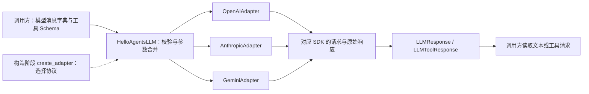

# P01 学习记录：统一消息与模型协议

日期：2026-10-14。目标快照：HelloAgents main / V1.0.1 / c597a7ca46ea9969e5b21d9e130549ab69626ff9。

2026-10-15 学习粒度修正：本篇保留概览与已有实测证据；主线改为[架构递进正文](p01-progressive-guide.md)的 A1～A8，从调用方需求出发，比较方案、确定契约、分配职责与模式、安排实现、审查扩展和资源。配套[设计决策详解](p01-progressive-explanations.md)说明取舍。上一版 27 个源码细节单元已由架构路线替代。

P00 已按你的明确要求免实验通过。P01 当前的非流式模型层已核查并通过本阶段测试；学习与理解仍需结合下面的源码阅读。真实模型服务尚未调用，流式机制在 P04、共享模型预算在 P18 接通。

本轮检查时仓库已经存在 P01 实现及测试，因此本轮以核查、实测和解释现有实现为主，没有覆盖或重新生成这些代码。

## 1. P01 在整个框架中的位置

这一层把模型配置、输入消息和三种提供商协议统一起来，让后续 Agent 可以使用相同的数据结构与调用方法。



模型请求返回 ToolCall 后，P01 只交付这个数据对象。工具注册、执行、回执和 Agent Loop 在 P02/P03 实现。SDK 没有在这一层自动执行你的 Python 工具。

构造时选择适配器；每次调用准备消息字典 → 公共检查与参数合并 → 协议转换和 SDK 请求 → 返回统一响应。需要工具的调用同时传工具 Schema。

## 2. 先读四个数据对象

阅读顺序：[message.py](../hello_agents/core/message.py) → [llm_response.py](../hello_agents/core/llm_response.py) → [config.py](../hello_agents/core/config.py) → [exceptions.py](../hello_agents/core/exceptions.py)。

| 对象 | 表达什么 | 谁使用 |
| --- | --- | --- |
| Message | 框架保存的消息，包含 role/content/timestamp/metadata | 后续历史管理和会话持久化 |
| ToolCall | 模型请求执行的工具，包含 id/name/arguments | 后续 Runtime 调度工具 |
| LLMResponse | 普通模型响应，包含文本、模型、usage、耗时和停止原因 | 普通模型调用与摘要等 |
| LLMToolResponse | 可同时包含文本和多个工具请求的模型响应 | 后续 Function Calling 循环 |
| StreamStats | 流结束后的使用量与耗时数据契约 | P04 的流式实现 |
| Config | 框架配置及相应字段约束 | 后续 Agent 与组件装配 |

### Message：保存格式与模型输入

Message 是 Pydantic 模型，其 role 限定为 user/assistant/system/tool/summary；初始化会提供时间和 metadata。to_dict/from_dict 用于保存和恢复，时间序列化为 ISO 字符串。

模型调用的公共输入则是字典列表，例如：

```python
from hello_agents import Message

message = Message("你好", "user")
print(message.to_dict())  # 保存格式：含 timestamp 和 metadata
model_messages = [{"role": message.role, "content": message.content}]
print(model_messages)     # 此例实际发送模型的字段
```

不要从 to_dict 的注释推断所有字段都应发给 SDK。模型层检查列表/字典/role 边界，并保留合法的提供商字段，不会自动把框架 Message 对象转换成模型协议。后续工具历史还需保留 tool_calls 和 tool_call_id，不能只提取文本。

### ToolCall：请求，不是执行结果

```python
from hello_agents.core.llm_response import ToolCall

call = ToolCall("call-1", "calculate", '{"expression":"2+3"}')
print(call.id, call.name, call.arguments)
```

id 将在后续阶段连接请求与回执；name 用于查找工具；arguments 是模型协议返回的 JSON 字符串，后续 Runtime 再解析。创建 ToolCall 不会执行 calculate。

### 普通响应与工具响应

```python
from dataclasses import asdict
from hello_agents.core.llm_response import LLMResponse, LLMToolResponse, ToolCall

answer = LLMResponse("结果是 5", "demo-model", usage={"total_tokens": 12})
request = LLMToolResponse(
    content=None,
    tool_calls=[ToolCall("call-1", "calculate", '{"expression":"2+3"}')],
    model="demo-model",
    finish_reason="tool_calls",
)
print(answer.content, answer.to_dict())
print(asdict(request))
```

ToolCall/LLMToolResponse 是 dataclass，不靠类型注解自动严格校验每一个字段；Message/Config 使用 Pydantic 校验。usage 通过 default_factory 建立独立字典，避免多个响应共享可变默认值。LLMResponse 的位置参数顺序保留原契约，不能随意把新增字段插到旧位置之前。

finish_reason 和 reasoning_content 是服务端返回信息。文本不空也可能输出被截断，停止原因将在 P03 决定是否继续执行工具；P01 不把“有文本”解释为任务完成。

## 3. 再读统一模型入口

源码：[llm.py](../hello_agents/core/llm.py)。

按照 __init__ → _validate_messages → _call_kwargs → invoke/invoke_with_tools → close/aclose 阅读。

- model/api_key/base_url 显式配置优先于环境变量；应用自己加载 .env。
- Config.from_env 与 HelloAgentsLLM 的配置入口不同。Config 定义字段，不会自动把字段传给一个已经创建好的 LLM。
- timeout 必须为有限正数；构造 kwargs 中的 messages/tools/stream/model/tool_choice 等调用字段会被拒绝。
- 构造时 kwargs 是默认选项，单次调用覆盖默认；副本保护调用者与实例的嵌套配置。
- 输入必须为字典列表，每条 role 非空；外部 HumanMessage 对象需要显式转换。
- invoke 返回 LLMResponse；invoke_with_tools 返回 LLMToolResponse。
- 当前非流式 ainvoke/ainvoke_with_tools 使用 asyncio.to_thread。可 await 不等于底层请求能被立即强制取消。
- close/aclose 支持重复关闭；关闭后的模型拒绝继续调用。

构造 LLM 会选择适配器；SDK 同步客户端通过 _get_client 延迟创建并用锁保护初次并发初始化。应用拥有模型生命周期，可以使用 with/async with。

## 4. 最后读三个适配器

源码：[llm_adapters.py](../hello_agents/core/llm_adapters.py)。

先读 BaseLLMAdapter 的客户端持有与关闭，再依次阅读 OpenAI、Anthropic、Gemini 的 invoke、消息/工具转换和 invoke_with_tools。

| 协议 | 工具定义 | assistant 工具请求 | 工具回执 |
| --- | --- | --- | --- |
| OpenAI 兼容 | function.parameters | tool_calls，参数是 JSON 字符串 | role=tool + tool_call_id |
| Anthropic | input_schema | tool_use，input 是对象 | user 内容中的 tool_result + tool_use_id |
| Gemini | function declarations | model 内容中的 function_call | function_response，利用历史 ID 映射回工具名称 |

三种 SDK 返回形状不同，但适配器都输出统一 ToolCall/LLMToolResponse。这是让未来 Runtime 只维护一份工具循环的基础。

provider 显式指定时优先；否则按解析出的主机名判断。看起来带 anthropic.com 的恶意后缀主机不会按 Anthropic 识别。代理地址可显式声明协议。

usage 的保留范围依协议不同：OpenAI helper 可保留嵌套和提供商指标，未报告的缓存指标不补零；Anthropic 当前只映射三项基本总量，Gemini 映射基本计数并对这些计数的空值使用 0。共享响应类型不代表信息量相同。当前代码尚未加入 P04 流式方法及 P18 预算装饰器。

## 5. 历史为什么变成这样

在参考仓库读这三个提交：

```bash
git show 8ac7202 -- hello_agents/core/llm_response.py hello_agents/core/llm.py
git show 1d4bfa2 -- hello_agents/core/llm_adapters.py
git show 52b2597 -- hello_agents/core/llm_adapters.py
```

8ac7202 新增工具响应契约，并同步迁移 Agent 对 SDK 响应结构的访问；1d4bfa2 记录 Gemini SDK 迁往 google.genai；52b2597 补齐服务商工具定义和多轮消息转换等契约。阅读重点是输入/输出约定如何变化，以及调用方为什么要一起改。

## 6. 本阶段实测证据

- 补充学习注释前，message.py、config.py、exceptions.py、llm_response.py 的 AST 与固定参考快照一致；后续只改注释和文档字符串，已比较忽略说明字符串后的执行 AST 不变。
- 已存在的三种非流式 Adapter 方法与参考方法一致。
- LLM facade 当前没有共享预算参数/装饰器；按计划在 P18 接通。
- 复刻环境导入路径指向 mini-hello-agent，pip check 通过。
- OpenAI 1.109.1、Anthropic 1.11.0、google-genai 2.28.0 三个 SDK 已安装。
- 三种实际 SDK 客户端构造测试通过；没有向真实服务发送模型请求。
- 非流式阶段测试结果：48 passed，1 skipped，12 deselected。
- skipped 为默认不启用的真实服务用例；deselected 为本次选择排除的 stream/think 路径。两个 usage 流式尾包测试也不属于本次命令，留到 P04。

复盘命令，在复刻仓库根目录执行：

```bash
.venv/bin/python -m pytest -q -p no:cacheprovider   tests/test_p01_data_contract.py   tests/test_llm_message_contract.py   tests/test_llm_function_calling.py   tests/test_p01_public_hardening.py   tests/test_usage_details.py::test_sync_response_preserves_nested_and_provider_metrics   tests/test_usage_details.py::test_unreported_cache_is_unknown   -k 'not stream and not think'
```

原测试断言没有削弱。首次选择误带两项未实现的流式测试，后来按阶段范围改为明确选择非流式 usage 测试。源码中的相关流式断言仍保留，P04 实现后完整回归。

[本轮测试输出](p01-test-results.log)。

历史文档验证记录：上一版源码粒度资料的 34 段 Python 示例曾在独立进程、阻断网络连接的条件下全部运行成功。该资料已由当前架构版替代；此记录仅说明当时的示例验证，不作为本版架构理解验收的证明。当前调整只修改四份学习文档，保留上面的既有实现检查结果，没有修改源码、原始测试或调用真实模型。

## 7. 当前学习入口与架构验收

从[架构正文 A1](p01-progressive-guide.md#p01-a1)开始，先说明后续 Agent 需要什么能力、P01 的责任到哪里结束。源码清单用于核对设计，不再按每个小函数轮流展开。

P01 理解验收聚焦：

1. 为什么需要统一模型边界，直接 SDK、统一分支类、入口加适配器等方案如何选择？
2. 输入、输出、保存消息和工具意图如何划分，谁控制工具循环？
3. Facade、Adapter、简单工厂分别解决什么问题，当前代码在解耦上还有什么限制？
4. 哪些职责围绕同一变化放在一起，增加协议或升级 SDK 时修改范围如何判断？
5. 怎样先完成纵向调用链，再扩展协议、装配和生命周期；用什么测试证明边界工作？

既有测试结果与架构理解分别记录；本轮文档调整不会自动将你的理解标为通过，也不改变 P00 的免验安排。
