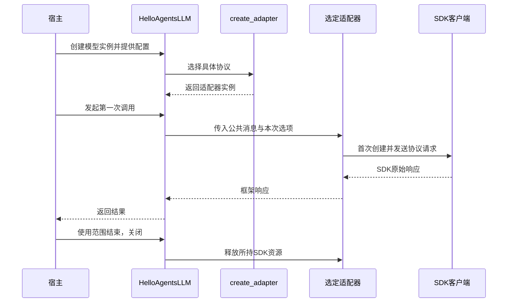

# P01 设计决策详解：方案、模式与变化影响

配套[架构递进正文](p01-progressive-guide.md)。正文回答先做什么、下一步为何出现；本篇解释每一步的选择、替代方案、设计原则与当前实现的差距。按 A1～A8 对照阅读，不以函数级练习作为主线。

以下方案评价是基于目标需求的设计分析，不声称还原作者未记录的思考过程。Git diff 能证明的是接口与代码怎样变化；最终行为以固定快照为准。

<a id="p01-a1"></a>
## A1：需求决定边界，调用者决定切入点

### 为什么先分析调用方

“写一个 LLM 封装”过于宽泛，既可能是简单文本函数，也可能是一整套 Agent 执行器。先描述后续 Runtime 需要什么，才能判断哪些能力必须提供、哪些职责应留在外部。

本项目上层需要的是一次模型请求的结果，然后自己执行工具、保存历史、决定继续或终止。如果适配器接管循环，上层就必须与另一套执行状态、权限和副作用处理协商，P01 的责任范围也会迅速越过模型协议。

这条边界可从参考仓库的 [model_events/turn_events](/Users/lincunhao/Documents/github/HelloAgents/hello_agents/core/runtime.py:124)核对：运行器准备输入、选择调用入口并消费结果，工具循环由本地 Runtime 控制。该调用方在后续阶段实现，P01 先提供其依赖。

### 架构需求如何落到验收

| 需求 | 需要的设计能力 | 验证问题 |
| --- | --- | --- |
| 多策略 Agent 使用同一模型层 | 稳定公共入口 | 调用方是否还要识别 SDK 类型？ |
| 模型能提出多个工具请求 | 结构化结果与调用身份 | 文本、工具名、参数和 ID 是否保留？ |
| 工具结果可供下一轮使用 | 完整工具消息转换 | 第二次发出的请求是否仍有关联信息？ |
| 多协议接入 | 可替换的适配实现 | 换协议是否要改工具循环？ |
| 宿主组合多个组件 | 明确配置与资源所有权 | 模型实例由谁创建、谁关闭？ |
| 离线验证 | 可替代的 SDK 边界 | 不请求远端能否检查真实组装逻辑？ |

**本步设计产物的示例：**“P01 为调用方提供普通与带工具描述的单次调用；输入为消息/Schema/选项，输出为框架响应；具体协议由模型层处理，工具执行和循环由调用方负责。”

这段说明比列出十个类更早约束设计：任何新增功能都先判断是否符合这条责任边界。

<a id="p01-a2"></a>
## A2：如何在方案之间选择

### 先确定选择标准

这里的主要标准是：三种协议能否完整表达工具往返；SDK 变化是否扩散到 Agent；能否通过稳定契约测试；实现和依赖成本是否符合复刻任务。

不需要在没有数据时给各方案编造性能分数。先用必须满足的条件排除不合适方案，再比较剩余成本。

### 两个容易混淆的决定

**统一调用入口**只保证调用者从同一个地方进入。一个巨大的 provider 分支类也能做到这一点。

**统一依赖契约**进一步要求：调用方接收框架认可的数据，协议差异由内部消化。若公共入口最后返回原始 SDK 响应，上层仍受 SDK 结构牵制。

因此本项目选择“入口＋适配器＋统一响应”。职责分离有三类收益：公共约定集中；某协议变化主要由对应实现承接；上层测试不必知道各 SDK 的响应层级。

### 什么时候选择别的方案

- 单服务、单协议、很少调用点：直接 SDK 或薄函数可以满足需求，不必提前建设多协议框架。
- 少量差异且生命周期简单：统一类内分支的维护成本可能可接受；是否拆分看变化是否不断集中和外溢。
- 外部统一层已经满足业务语义：可以比较引入它的收益与依赖成本。但本次任务要复刻目标内部机制，替换成外部框架会改变学习和实现范围。

**代价也要接受：**适配层会增加转换代码、契约维护和测试工作，公共接口也无法天然抹平所有服务商能力。可解释地承担这些成本，比宣称“用了模式就更先进”更有价值。

<a id="p01-a3"></a>
## A3：数据契约怎样支撑低耦合

### 输入为什么没有全部改成框架专有对象

完整的内部请求模型能让业务概念更独立，但要持续维护多模态、工具扩展、供应商选项等转换。目标使用 OpenAI 风格字典和 JSON Schema，减少新建对象体系的成本，并给扩展字段留出空间。

相应代价是输入约定仍带某种协议的形状；公共边界只校验基本结构，后面还需要适配器、SDK 或服务端的检查。它是一种程度有限的统一，不能描述为完全无关供应商的领域语言。

### 输出为什么采用框架响应对象

输出是上层决策依赖的事实。如果直接返回 SDK 对象，每个消费者都要了解它的结构，SDK 变化就沿调用链传播。响应对象把这种依赖转换为 content、tool_calls、usage、停止信息等稳定概念。

ToolCall 与工具执行回执应分开：前者是模型意图，后者是执行证据；模型层不应通过创建 ToolCall 就触发本地操作。调用 ID 则跨越两次请求，维持完整交互关系。

### 保存消息为什么单独存在

存储消息关心恢复、时间和附加信息；模型消息关心协议表达。两者强行合并，会让存储元数据进入 SDK，也可能让工具关系在保存时退化为纯文本。目标将 Message 作为保存表示，调用边界使用消息字典，后续历史层负责重放原生工具消息。

**检查契约质量的方法：**拿同一段工具交互分别喂给三种适配器，调用方始终只处理框架的工具请求；同时检查原始 ID、参数和下一次请求没有丢失。它检验的是语义连续性，不只是 Python 返回类型相同。

对照：[消息保存对象](../hello_agents/core/message.py)、[响应契约](../hello_agents/core/llm_response.py)、[公共输入边界](../hello_agents/core/llm.py)。

<a id="p01-a4"></a>
## A4：模式与高内聚、低耦合怎样对应

### 模式应由问题引出

| 当前问题 | 对应做法 | 在本项目中的位置 | 不应扩大成什么 |
| --- | --- | --- | --- |
| 调用方不想重复理解整个模型子系统 | Facade：提供统一公共入口 | HelloAgentsLLM | 包办工具、历史和运行策略的总控类 |
| SDK 接口与框架契约不匹配 | Adapter：转换输入与输出 | 三种具体 Adapter | 能代替权限、业务参数和任务成功判断的万能层 |
| 具体实现的选择与普通调用混在一起 | 简单工厂：集中创建规则 | create_adapter | 目标没有要求的插件发现/注册系统 |
| 交换结果时依赖 SDK 私有结构 | 框架数据契约 | ToolCall、两类响应 | 为每项字段都建立一层抽象 |

当前 create_adapter 是函数与映射式选择，称为简单工厂较准确；GoF Factory Method 依靠创建方法的多态结构，不能仅因函数“创建对象”就套上该名称。适配器能被替换，具有策略式使用特征，但它的主要职责仍是接口转换。

### 高内聚：一起变化的职责放在一起

Anthropic 的消息转换、工具 Schema、结果解析和客户端调用，都围绕“用 Anthropic 协议完成一次请求”变化，放在同一适配实现中有明确理由。它做的不止一个小动作，却有一致的责任。

如果把各协议的请求转换集中到一处、响应转换集中到另一处、工具转换再分到第三处，一次 SDK 升级就可能要跨多个模块寻找同一协议的逻辑。文件看起来各管一个动作，变化却被打散了。

### 低耦合：限制必须知道的知识

调用方知道框架消息与结果；统一入口知道适配接口和创建规则；具体适配器知道 SDK。创建位置可以知道具体类，普通调用路径主要依赖统一能力。这种依赖是有边界的，并不要求所有模块互相完全不了解。

“新增协议时业务循环不增加 provider 分支”是有价值的检查；“任何变更都只改一个文件”不是合理目标，因为公共契约变化本来就可能要求生产者与消费者协同迁移。

### 当前实现的解耦程度

HelloAgentsLLM 组合一个适配器；具体适配器继承 BaseLLMAdapter，复用客户端管理并实现抽象调用方法。组合与继承分别用于不同关系，不需要选一个口号覆盖两者。

但接口、工厂、实现位于同一 `llm_adapters.py`；门面直接导入工厂，也通过具体类名映射 provider 显示值。它提供实用的协议隔离，没有实现严格的物理分层依赖倒置，也没有公开的任意 adapter 注入接口。本次解释这些取舍，保持代码结构。

对照：[统一入口](/Users/lincunhao/Documents/github/mini-hello-agent/hello_agents/core/llm.py:17)、[适配接口](/Users/lincunhao/Documents/github/mini-hello-agent/hello_agents/core/llm_adapters.py:37)、[简单工厂](/Users/lincunhao/Documents/github/mini-hello-agent/hello_agents/core/llm_adapters.py:702)。

<a id="p01-a5"></a>
## A5：为什么采用纵向实现，而不是先填完所有文件

先建立完整文件列表只能证明结构存在；一条纵向链则能检验这些模块是否协作。它同时穿过公共入口、契约、适配器和 SDK 边界，尽早暴露职责切分错误。

### 可执行的施工拆分

| 轮次 | 完成工作 | 需要看到的结果 |
| --- | --- | --- |
| 1 | 定义普通响应、最小适配接口；实现 OpenAI 普通请求；接入门面与选择路径 | 调用方拿到统一响应，公共选项进入 SDK 请求 |
| 2 | 加入工具描述、ToolCall 和工具响应；补第二次输入 | 工具 ID、参数和回执关系不丢失；仍由调用方控制下一次请求 |
| 3 | 按相同契约接入 Anthropic/Gemini | 同一个调用场景可替换具体实现 |
| 4 | 补齐目标配置、资源、异步包装和错误边界 | 宿主可可靠创建、复用、关闭模型实例 |
| 5 | 核对完整公开接口与原始阶段断言 | 阶段范围完成，预留能力没有冒充已实现 |

这些是重建或核查顺序，不表示当前源码应改成五套临时架构。已完成的实现可沿同样顺序解释和验证。

### 每轮阅读源码时只追一个边界问题

第一轮追“请求与结果是否经由框架契约”；第二轮追“工具意图与执行控制是否分开”；第三轮追“协议差异是否由适配器吸收”。需要时再看方法实现，不把函数从上到下逐一讲完当作设计过程。

模拟 SDK 适合验证请求组装与响应归一化；真实服务调用则验证远端能力。前者是可重复的设计反馈，后者有独立验证价值。

<a id="p01-a6"></a>
## A6：共同职责怎样提取，扩展能力怎样验证

### 先区分公共规则与协议规则

公共消息基本边界、默认选项传递、对外关闭状态属于统一入口。系统消息放在哪里、工具选择怎样表达、SDK 从哪里读取用量属于具体协议。SDK 客户端的获取与释放具有共同生命周期，因此由适配器基类提供共享管理。

这是一种按责任提取的结果。不要因为三处都有响应循环，就假定它们应被一个通用解析器接管；也不要让门面逐项判断每个服务商的内容块类型。

### 用第二次输入检验抽象

第一轮工具请求成功，只覆盖了定义与响应。第二轮加入 assistant 工具请求和结果消息，才能检验协议是否保持完整交互关系：Anthropic 使用 tool_use/tool_result，Gemini 需要从历史关联函数名称，OpenAI 保留 tool_call_id。

调用方因此需要完整工具消息语义，但不用知道具体 SDK 对象。这就是“统一语义、内部转换”带来的实际收益。

### 历史提供什么证据

| 提交 | diff 可证明的变化 | 架构启示 |
| --- | --- | --- |
| `8ac7202` | 新增统一 ToolCall/LLMToolResponse，并迁移 Agent 的响应访问 | 数据契约要与消费者一起迁移 |
| `5a19188` | 修复 ReAct 残留的 `tc.function.*` 访问 | 创建统一对象不等于 SDK 耦合已经清理完毕 |
| `1d4bfa2` | Gemini 更换 SDK、客户端与生成入口 | 适配器是承接 SDK 演进的重要位置 |
| `52b2597` | 补工具 Schema、选择与多轮历史转换 | 单轮返回正确不足以证明协议闭环正确 |

在参考仓库可只读核查这些提交，无需切换工作区。中间版本的选择不一定与最终快照完全相同；这张表不补写未经记录的作者动机。

### 统一层保留哪些差异

当前 OpenAI usage 可保留嵌套与扩展指标；Anthropic/Gemini 只映射部分基本计数。输入采用某种协议风格、协议选择固定映射、部分停止原因保留服务商表达。这些说明统一边界需要准确陈述能力，不把各协议强行宣传成完全等价。

对照：[适配器实现](../hello_agents/core/llm_adapters.py)、[协议契约测试](../tests/test_llm_function_calling.py)。

<a id="p01-a7"></a>
## A7：配置与资源也是架构责任

### 先确定作用域，再决定复用

模型实例由宿主创建，可能传给一个或多个组件。SDK 客户端由适配器持有并复用，宿主通过模型边界结束其生命周期。把客户端变成全局共享对象，会引入密钥、地址、模型和关闭范围之间的协调问题；目标没有采用全局单例来隐藏这些关系。

公共选项属于实例默认策略，单次覆盖属于本次请求；会话与工具执行状态属于后续运行层。若将会话保存在适配器，一个模型实例服务多个 Agent 时就需要额外隔离；当前分工避免把这项责任混入协议层。

### 配置不是自动装配

Config 声明框架设置，HelloAgentsLLM 构造解析自己的连接与调用设置，create_adapter 选择协议。它们职责相邻但不是同一件事。没有实际消费某字段的装配代码，声明字段就不会自动启用功能。

### 构造和调用有两个时间点



“首次创建并发送”在图中合并表示两个连续动作：客户端只在首次需要时创建，后续请求复用它。选择协议在构造阶段完成，并非每次请求重新路由。

### 能力承诺与实现一致

ainvoke 使用线程执行同步调用，提供异步等待接口；这不等价于底层工作能被立即取消。流式、预算与完整运行取消属于后续能力。

错误分类以真实抛出路径为准，异常子类的声明不证明所有路径统一采用它。当前阶段的异常分工如下：

| 错误场景 | 触发位置 | 实际抛出类型 | 说明与限制 |
| --- | --- | --- | --- |
| 参数结构校验失败 | `llm._validate_messages` | 原生 `TypeError` / `ValueError` | 属于输入边界契约防御，直接拦截，不伪装成模型服务错误 |
| 实例生命周期冲突 | 关闭后调用 `invoke` | 原生 `RuntimeError` | 实例状态不匹配 |
| 连接凭证缺失 | `llm.__init__` | `HelloAgentsException` | 显式阻止构造无法建立通信的模型实例 |
| 底层 SDK 请求失败 | 各具体 Adapter 调用方法 | `HelloAgentsException` | 保留各 SDK 原始错误信息，但目前统一打包为框架基类，尚未细分至 `LLMException` 子类 |

对照：[构造和生命周期](../hello_agents/core/llm.py)、[客户端管理](../hello_agents/core/llm_adapters.py)、[Config](../hello_agents/core/config.py)、[异常定义](../hello_agents/core/exceptions.py)。

<a id="p01-a8"></a>
## A8：如何评审设计和验收 P01

### 用变化问题评审，而不只检查图是否漂亮

1. **新增协议时**，是否主要新增适配实现与选择规则？若 Agent 开始解析另一个 SDK 的响应结构，边界尚未稳定。
2. **升级 SDK 时**，框架的业务工具循环是否可以保持语义不变？需要联动哪些依赖和契约测试？
3. **新增公开结果字段时**，生产者与消费者是否一起迁移？这类有理由的联动不等于错误耦合。
4. **替换会话或权限模块时**，为何无需修改协议转换？若需要，先找出跨入适配器的职责。
5. **共用模型实例时**，谁创建、谁借用、谁关闭？模型状态与会话状态是否区分？

每个问题都应给出预计修改范围和依据。对当前 provider 类名映射、固定工厂以及输入协议风格等具体耦合也应如实记录。

### 验证点应与架构边界对应

| 现有测试 | 检验的边界 | 不能据此证明 |
| --- | --- | --- |
| [test_p01_data_contract.py](../tests/test_p01_data_contract.py) | 数据与公开兼容、Config 序列化、SDK 客户端构造 | 远端模型能力 |
| [test_llm_message_contract.py](../tests/test_llm_message_contract.py) | 公共消息输入边界、扩展字段 | 全协议的严格业务参数验证 |
| [test_llm_function_calling.py](../tests/test_llm_function_calling.py) | SDK 请求/响应、工具 Schema、历史转换 | 真实 Python 工具已在 P01 自动执行 |
| [test_p01_public_hardening.py](../tests/test_p01_public_hardening.py) | 配置覆盖、协议选择、资源和 SDK 配置 | 任意自定义适配器均可从公共 API 注入 |
| [test_usage_details.py](../tests/test_usage_details.py) | 当前非流式 usage 约定 | 三种服务商都提供同等明细、所有流式路径已实现 |

测试中替换 SDK 客户端，保留上层真实的输入、选项和转换路径。若直接让整个门面恒定返回成功，只能验证调用方如何处理这个假返回，无法证明 P01 的分层协作。

当前阶段范围的复盘命令，在复刻仓库执行：

```bash
.venv/bin/python -m pytest -q -p no:cacheprovider \
  tests/test_p01_data_contract.py \
  tests/test_llm_message_contract.py \
  tests/test_llm_function_calling.py \
  tests/test_p01_public_hardening.py \
  tests/test_usage_details.py::test_sync_response_preserves_nested_and_provider_metrics \
  tests/test_usage_details.py::test_unreported_cache_is_unknown \
  -k 'not stream and not think'
```

既有结果为 48 passed、1 skipped、12 deselected。真实服务测试未启用，流式/think 路径按阶段未选；共享预算尚待 P18。这里保留已有验证证据，本轮架构文档调整没有修改实现或扩大覆盖声明。

**架构理解验收：**给出 P01 的需求、方案选择、模块/契约图、资源所有权，并用“新增协议”和“SDK 升级”两个变化场景说明修改范围。能指出当前分层的收益、代价及保留耦合，比背出模式名称更有意义。

## 实施时如何对应到现有文件

| 架构产物 | 最终落点 | 为什么在这里 |
| --- | --- | --- |
| 公共调用约定 | [llm.py](../hello_agents/core/llm.py) | 调用方统一使用的边界 |
| 适配接口、协议实现、选择规则 | [llm_adapters.py](../hello_agents/core/llm_adapters.py) | 连接框架与 SDK 的转换边界；目标规模下共用文件 |
| 结果与工具意图契约 | [llm_response.py](../hello_agents/core/llm_response.py) | 生产者和消费者共同依赖的数据 |
| 保存消息 | [message.py](../hello_agents/core/message.py) | 历史/会话表示，与模型请求职责分开 |
| 框架配置模型 | [config.py](../hello_agents/core/config.py) | 声明与校验设置，装配另行负责 |
| 框架异常分类 | [exceptions.py](../hello_agents/core/exceptions.py) | 公共错误表达；实际抛出路径需另核对 |

可以按 A5 的施工顺序逐步核查这些文件。文件清单用于落地定位，设计顺序仍然从调用方需求和边界开始。
