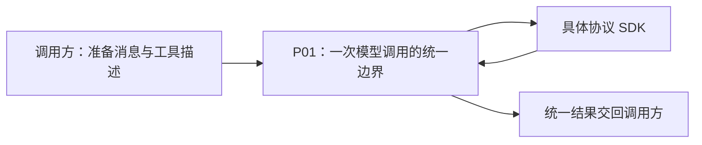
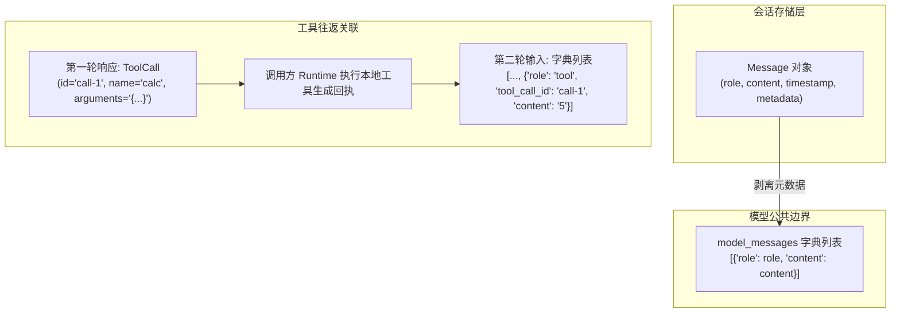

# P01 架构递进：怎样设计一个统一的模型调用层

目标快照：`HelloAgents V1.0.1 / c597a7ca46ea9969e5b21d9e130549ab69626ff9`。本篇按架构决策组织 P01，替代上一版 27 个源码细节单元。文件路径保持不变，便于继续学习。

**P01 要交付的是一个可供后续 Agent 使用的模型调用边界：上层用稳定的方式发出一次请求，底层适配不同模型协议，返回框架能理解的结果。** Agent 的工具循环仍由后续 Runtime 控制，模型调用层只交付工具请求。



这里先确定能力边界，暂不假定它必须由几个类实现。下面八步依次解决需求、方案、契约、职责、实现顺序、扩展、资源和验证；每一步都以前一步的产物为输入。

## 如何阅读与产出

每次推进一个**架构决策**，顺序为：问题背景 → 候选方案 → 选择标准 → 本项目的选择及代价 → 模块关系怎样改变 → 当前应做的工作 → 验证这个决定。

配套[设计决策详解](p01-progressive-explanations.md)解释方案取舍、模式与原则。源码和原始测试最后用于核对设计是否真正落地。语言语法、字段赋值、锁的实现等，只在影响某项架构结论时展开。

| 步骤 | 需要作出的决定 | 应形成的产物 |
| --- | --- | --- |
| A1 | P01 向谁提供什么能力，责任到哪里结束 | 需求与边界说明 |
| A2 | 在几种整体组织方式中选择哪一种 | 方案比较与选择理由 |
| A3 | 哪些数据跨边界，如何表达 | 输入、输出和错误契约 |
| A4 | 职责分给谁，依赖指向哪里 | 模块职责表与协作图 |
| A5 | 从哪里实现才能尽早验证设计 | 一条可工作的纵向调用链 |
| A6 | 怎样加入其他协议而保持上层稳定 | 协议差异归属与扩展方式 |
| A7 | 谁装配配置、创建资源并负责关闭 | 装配与状态所有权说明 |
| A8 | 怎样证明这些分层有价值、P01 已完成 | 变化场景、测试分层与交付检查 |

这八个产物可以直接写在本篇对应位置或自己的笔记中，不要求创建八份新文档、八个新模块。

<a id="p01-a1"></a>
## A1：先从后续 Agent 的需求切入

### 1. 先描述一段完整协作

以“计算 2+3”为例，后续运行层需要：

1. 准备当前消息和可用工具描述。
2. 调用模型，得到公开回答，或者得到“请求调用 calculate”的结构化结果。
3. 若请求工具，由运行层找到工具并执行，形成结果消息。
4. 再调用模型，让它根据工具结果回答。

P01 提供第 2 步所需的一次调用能力，并支持第 4 步再次传入完整历史。第 3 步的执行和整个循环的控制留给 P02/P03。

### 2. 从协作推导需求

| 需求 | 为什么需要 | 对设计的约束 |
| --- | --- | --- |
| 普通文本调用 | 摘要、规划等场景不一定需要工具 | 必须保留一个简单的普通调用入口 |
| 带工具描述调用 | 运行层需要知道模型请求了什么操作 | 响应要表达多个工具请求，不能只返回文本 |
| 多轮消息回放 | 工具结果需要成为下一次模型输入 | 输入必须保留工具请求与回执的关联 |
| 支持三种协议 | 目标版本包含 OpenAI、Anthropic、Gemini | 服务商差异不能扩散到每种 Agent 策略 |
| 统一统计与停止信息 | 上层需要观察消耗并决定下一步 | 结果要保留相关证据，而不是提前替上层决定完成 |
| 可独立测试、管理资源 | 依赖远端模型会使结构验证不稳定 | 需要可替代的 SDK 边界和明确生命周期 |

### 3. 此时先作一个边界决定

模型层负责“一次请求的配置、协议转换、SDK 调用与结果转换”；运行层负责“接下来做什么”。如果模型适配器同时执行 Python 工具，它就开始依赖注册表、权限、会话和循环终止策略，职责会沿调用链膨胀。

**现在做什么：**用一段话定义 P01 的对外能力，画出上述四步，给每步标出控制者。不要先从 Message 的字段列表开始设计。

**进入 A2 的依据：**能判断“增加一种模型协议”和“增加一种工具执行策略”分别属于哪个责任范围。详见 [A1 决策解释](p01-progressive-explanations.md#p01-a1)。

<a id="p01-a2"></a>
## A2：比较整体方案，再决定如何分层

需求已经明确，现在比较组织代码的方式。

| 方案 | 组织方式 | 适用情况 | 对本项目的代价 |
| --- | --- | --- | --- |
| ① 调用方直接使用 SDK | 每个 Agent 按服务商组装请求、解析结果 | 单模型的短小应用或原型 | SDK 结构和协议分支进入多个 Agent，变更范围扩大 |
| ② 一个统一类处理所有协议 | 一个入口内按 provider 分支 | 协议较少、差异有限时 | 请求、历史、响应、资源的差异持续汇聚在同一实现中 |
| ③ 统一入口＋协议适配器 | 公共入口稳定，协议转换由可替换实现负责 | 多协议，且要自己控制上层运行语义 | 增加契约、选择与适配层，需要维护兼容测试 |
| ④ 接入外部统一模型层 | 委托另一套库统一协议 | 交付速度优先且其语义满足需求 | 要评估依赖、工具消息和资源语义；也不符合本次对目标实现的完整复刻 |

### 为什么本项目采用方案③

有两个明确驱动力：三种原生协议的消息与工具格式不同；上层又希望维护同一套工具循环。把差异集中到适配器，能让 Agent 面向框架契约工作。

这是基于本项目需求的选择，不意味着所有模型应用都需要同样层数。若始终只有一种协议、没有统一框架要求，薄封装可能更合适。

### 分层如何由问题推动

最初“调用方 → SDK”能完成一次调用。加入第二种协议后，调用方开始识别响应结构；于是把转换收进模型边界。继续加入第三种协议时，再将该边界内部按协议分开，使一种协议的变化主要落在一个适配实现中。

**现在做什么：**写出选择③的两个需求依据，以及接受的一个成本。明确当前复刻终点已选定该组织方式；方案比较帮助理解取舍，不用于重构成另一种架构。

**进入 A3 的依据：**能回答：统一了入口之后，上层如果仍读取 SDK 私有结构，解耦是否已经实现？详见 [A2 方案选择](p01-progressive-explanations.md#p01-a2)。

<a id="p01-a3"></a>
## A3：先设计边界上传递什么，再安排类

### 1. 输入和输出分别选择统一程度

输入有三种选择：直接用各 SDK 对象；新建完整的框架请求对象体系；统一使用消息字典和工具 Schema。前者让上层知道协议，第二种增加转换与能力维护成本。目标选择第三种，采用 OpenAI 风格消息/工具描述作为共享输入，再由适配器转换。

输出也有选择：字符串、原始 SDK 对象、框架响应对象。字符串不能表达工具意图和统计；原始对象让调用方依赖 SDK 结构。目标采用框架响应对象。

这形成一种务实的组合：**输入是约定结构的字典，输出是显式框架数据对象。** 不必为了表面统一，再引入目标版本没有的请求类。

### 2. 定义需要跨边界的概念

| 概念 | 必须表达什么 | 责任边界 |
| --- | --- | --- |
| 模型消息 | 角色、内容，以及工具请求/结果等协议字段 | 调用方提供，适配器转换 |
| 工具描述 | 名称、说明、参数结构、选择策略 | 告诉模型怎样请求，不能直接执行本地函数 |
| 普通响应 | 公开文本、模型信息、统计、停止信息 | 上层读取事实并决定后续行为 |
| 工具响应 | 公开文本与零到多个调用请求 | 每次请求用 ID 关联后续结果 |
| 存储消息 Message | 会话保存所需内容、时间和附加信息 | 供历史管理，不直接等同 SDK 输入 |
| 错误 | 输入不合法、资源不可用、请求或解析失败 | 让调用方知道失败，不能伪装成正常回答 |

### 3. 建立两条必须保留的关系

其一，工具请求与结果通过调用 ID 关联。其二，响应事实与执行控制分开：模型层返回工具意图和停止信息，运行层解释它们。



当前输入仍采用具体协议风格，公共校验也不是完整 Schema 校验；统一结果仍可能含服务商特定统计。这些是边界的选择与限制，不代表实现了完全独立于协议的标准。

**现在做什么：**用不依赖 SDK 类名的方式写出一次普通调用与一次工具调用的输入/输出；补一张“存储消息 → 模型输入”的关系图。此时只确定语义、身份和所有权，不逐字段研究序列化语法。

**进入 A4 的依据：**换一个 SDK 后，调用方仍能按相同方式读取文本和工具请求。详见 [A3 数据契约取舍](p01-progressive-explanations.md#p01-a3)。

<a id="p01-a4"></a>
## A4：按变化原因划分职责，再使用设计模式

契约确定后，再讨论模块。高内聚的依据是“哪些工作围绕同一责任一起变化”；低耦合的依据是“变化经过哪些已约定的边界传播”。

### 1. 职责分配

| 模块角色 | 放在一起的工作 | 主要变化原因 |
| --- | --- | --- |
| 统一入口 HelloAgentsLLM | 公共调用方法、公共输入边界、默认调用选项、对外生命周期 | 框架公共调用方式变化 |
| BaseLLMAdapter 与具体适配器 | 客户端管理、协议消息/Schema/响应转换、SDK 调用 | 某协议或 SDK 变化 |
| create_adapter | 根据配置选择具体实现 | 支持的协议和选择规则变化 |
| 响应数据对象 | 框架认可的结果与工具请求结构 | 上下游交换信息的契约变化 |
| Message 与 Config | 分别表达保存消息、框架配置 | 存储/配置契约变化 |
| 后续 Runtime | 工具执行、回写、继续或停止 | Agent 运行策略变化 |

### 2. 模式怎样解决具体问题

- **Facade（外观）**：调用方通过 HelloAgentsLLM 使用模型能力，公共检查与选项不用在每个 Agent 重写。
- **Adapter（适配器）**：具体协议实现把外部 SDK 接口转换成框架契约，这是隔离协议变化的主要机制。
- **简单工厂**：create_adapter 集中选择和构造适配器，使普通调用路径不反复判断 provider。
- **统一数据契约**：响应对象传递数据，不承担工具执行；这是一项边界设计，不必再包装成额外的运行层。

模式名称描述这里的协作方式。当前工厂函数不是 GoF Factory Method 的继承结构；“根据 provider 替换实现”可从策略视角理解，但不需要再新建一套 Strategy 类。

```mermaid
flowchart TD
    App[宿主：创建模型并管理使用范围] --> LLM[HelloAgentsLLM：公共入口]
    LLM --> Contract[统一适配接口]
    Contract --> OA[OpenAIAdapter]
    Contract --> AN[AnthropicAdapter]
    Contract --> GE[GeminiAdapter]
    Factory[create_adapter：构造时选择] -.-> OA
    Factory -.-> AN
    Factory -.-> GE
    LLM -. 构造时调用 .-> Factory
    OA --> OSDK[OpenAI SDK]
    AN --> ASDK[Anthropic SDK]
    GE --> GSDK[Gemini SDK]
    OA --> Result[统一响应契约]
    AN --> Result
    GE --> Result
```



该图表达协作角色。源码把接口、工厂和三个适配器放在同一个文件中，没有实现严格的分包依赖倒置；HelloAgentsLLM 也知道工厂及部分具体类名。复刻时准确理解这种程度的解耦，不额外拆文件。

**现在做什么：**给每项需求指定唯一的主要负责者，再画创建关系与调用关系。列出三项适配器不应接管的工作：工具执行、会话保存、Agent 终止策略。

**进入 A5 的依据：**每个新增职责都能回答“为何属于这个模块，而不是相邻模块”。详见 [A4 模式与内聚耦合](p01-progressive-explanations.md#p01-a4)。

<a id="p01-a5"></a>
## A5：先打通一条纵向调用链，检验抽象是否有用

架构关系已经确定，下一步要得到一条真实工作的链路，而不是只建齐空类。

### 第一轮：普通调用的最小闭环

```text
调用方消息 → HelloAgentsLLM → OpenAIAdapter → 模拟 SDK → LLMResponse → 调用方
```

按依赖实现：最小响应契约 → 适配接口与 OpenAI 实现 → 选择路径 → 统一入口 → SDK 边界测试。Config 和 Message 提供所需数据定义，不为了完成它们的所有后续功能而阻塞这一闭环。

本轮检查的核心问题是：上层能否完全通过统一入口发起请求并读取框架结果？若测试必须让上层解析 choices/message，说明抽象边界还未闭合。

### 第二轮：在同一链路加入工具意图

为入口和适配接口增加目标要求的工具调用方法；传入 Schema，转换工具响应，保留调用 ID 与参数。工具结果先由教学调用方手工追加，再作第二次模型请求。

这一轮验证结果契约是否能支撑后续循环。它不要求在 P01 提前实现 ToolRegistry 或完整 Agent。

### 本轮需要完成的工作

1. 建立普通响应和工具响应的数据契约。
2. 实现 OpenAI 普通调用、工具调用与响应转换。
3. 由统一入口执行公共检查与选项传递，适配器处理 SDK 细节。
4. 在 SDK 边界替换客户端，检查发出的请求与返回的框架结果。
5. 标记尚未接入的协议和能力，再进入下一轮。

**交付物：**一个调用方无需导入 SDK 的完整请求样本，以及一份证明请求/响应契约的测试结果。当前仓库已有实现，可沿这条链反向核查，不要求删除重写。

**进入 A6 的依据：**即使不用真实模型，也能观察完整边界；同样明确这还没有验证远端服务和模型能力。详见 [A5 实现切入顺序](p01-progressive-explanations.md#p01-a5)。

<a id="p01-a6"></a>
## A6：加入第二、第三种协议，验证分层是否成立

### 1. 先列差异，再安排转换位置

| 差异 | OpenAI 兼容 | Anthropic | Gemini | 应由谁吸收 |
| --- | --- | --- | --- | --- |
| 系统提示词 | 消息数组内 | 独立 system | 独立 system_instruction | 具体适配器 |
| 工具定义 | function.parameters | input_schema | FunctionDeclaration/JSON Schema | 具体适配器 |
| 工具请求/结果历史 | tool_calls/tool_call_id | tool_use/tool_result | function_call/function_response | 具体适配器 |
| 工具选择策略 | OpenAI 风格约定 | 协议专用 type | FunctionCallingConfig | 具体适配器 |
| SDK 响应与统计 | choices/usage | 内容块/input-output | candidates/usage_metadata | 具体适配器 |

### 2. 用相同场景替换实现

保持 A5 的调用方与框架结果约定不变，分别实现 Anthropic、Gemini 的请求与响应转换。每加入一种协议，都回放“第一轮工具请求 → 固定回执 → 第二轮模型输入”，检查不仅能拿到结果，还能正确表达下一次输入。

如果这一步需要给 Agent 增加 provider 分支，先检查是哪项 SDK 知识越过了边界。若确实是新能力而非格式差异，再讨论公共契约是否需要演进；不要把所有差异硬塞进已有字段。

### 3. 决定哪些公共逻辑值得共享

三种适配器都需要客户端生命周期和同类调用入口，可由基类承载公共管理与接口。消息内容块、Schema 和 SDK 参数结构各不相同，放在各自实现中。

共享的依据是稳定职责，不是代码看起来都有一段 try/return。当前目标也没有把所有响应解析收进万能转换器，复刻时保持现有结构。

### 4. 常见协议转换陷阱与实现要点（Gotchas）

| 服务商 | 易踩坑细节 | 适配器实现策略 |
| --- | --- | --- |
| **Anthropic** | ① `system` 消息不可留在 `messages` 列表中<br>② 工具调用参数由 SDK 返回为 Python dict，非 JSON 字符串<br>③ 工具回执消息格式特殊 | ① 提取为顶级参数 `system=...`<br>② 使用 `json.dumps(block.input)` 归一为字符串，统一契约<br>③ 转换为 `role="user"` 下包含 `tool_use_id` 的 `tool_result` 块 |
| **Gemini** | 工具回执 `FunctionResponse` 强依赖函数名称，但公共协议回执通常只有 `tool_call_id` | 遍历请求历史记录 `tool_call_names[id] = name`，回执时根据 ID 查回工具名；未命中时回退为 `"tool_result"` |
| **OpenAI** | 模型的 `arguments` 为原始生成文本，网络异常或提前截断可能产生非法 JSON | 适配器或上层解析时做防御性异常处理（`json.JSONDecodeError`），避免异常冲垮调用链 |

**现在做什么：**完成差异表、两个新增适配器和选择映射；记录相同调用方如何使用它们。最后才用 `8ac7202`、`5a19188`、`1d4bfa2`、`52b2597` 核对契约迁移和 SDK 演进的历史证据。

**进入 A7 的依据：**能说明增加协议时哪些地方应变、哪些地方应保持稳定；同时承认当前 provider 名称映射等仍存在的具体依赖。详见 [A6 扩展与历史](p01-progressive-explanations.md#p01-a6)。

<a id="p01-a7"></a>
## A7：把配置、创建与资源所有权接起来

调用链可以运行后，还需要使它能被宿主可靠使用。这一步关心生命周期和装配，不钻进每一行配置解析。

### 1. 明确创建顺序

```text
宿主提供连接参数/环境
  → HelloAgentsLLM 解析模型连接与调用默认值
  → create_adapter 选择并创建一个适配器
  → 首次调用时创建具体 SDK 客户端
  → 多次请求复用
  → 宿主结束使用范围，调用 close/aclose
```

Config 是框架配置模型；LLM 连接参数由模型对象自己的构造入口读取。当前二者没有自动绑定，应用需要显式传递；配置声明、组件装配和功能执行属于不同动作。

### 2. 明确状态归属

| 状态或资源 | 所有者 | 生命周期 |
| --- | --- | --- |
| 模型实例的使用范围 | 创建它的宿主 | 创建到关闭，可借给多个上层组件 |
| 默认调用选项与关闭状态 | HelloAgentsLLM | 实例级 |
| SDK 客户端及协议配置 | 具体适配器 | 首次使用到释放 |
| 本次请求参数、转换消息 | 本次调用路径 | 调用期间 |
| 统一响应 | 返回后由调用方使用 | 由调用方决定保留 |
| 完整会话与工具执行状态 | 后续历史/运行层 | 跨调用或跨会话，不能塞进适配器 |

### 3. 保持与当前实现相符的能力承诺

P01 的异步入口使用线程包装同步请求。它提供异步等待能力，但不自动获得强制取消底层工作的能力。流式调用留到 P04，跨调用预算留到 P18。资源懒加载、关闭和错误传播是模型边界职责；完整任务取消与副作用收尾仍需要运行层参与。

**现在做什么：**补齐配置来源、显式协议优先、实例选项与单次覆盖、资源创建/关闭、同步与异步入口；在设计图上标明所有者和释放责任。

**进入 A8 的依据：**能够说明“两个 Agent 共用一个模型实例，谁应关闭它”，并区分每次请求的数据与跨请求状态。详见 [A7 装配与生命周期](p01-progressive-explanations.md#p01-a7)。

<a id="p01-a8"></a>
## A8：用变化场景验证高内聚、低耦合

架构质量通过修改影响范围和边界可验证性来判断，不按类数量、文件数量或模式数量评分。

### 1. 先做变化影响审查

| 变化场景 | 主要修改位置 | 应重点保持稳定的部分 |
| --- | --- | --- |
| 一个 SDK 升级，公共能力未变 | 对应适配器、依赖与 SDK 契约测试 | Agent 工具循环与公共响应语义 |
| 新增第四种协议 | 新适配实现、工厂、测试；当前还需检查 facade 的 provider 名称映射 | 已有 Agent 策略和工具执行逻辑 |
| 新增公开响应信息 | 数据契约、生产者和真正需要它的消费者 | 无关协议/工具模块 |
| 更换会话保存方式 | 存储/历史层 | SDK 适配器 |
| 修改工具执行权限 | 注册表/运行层 | 模型请求转换 |
| 单次调用改生成参数 | 公共调用选项与协议参数映射 | 实例之外的其他调用状态 |

低耦合的具体目标是让变化沿职责边界传播，并可解释为什么必须联动；不是要求任何变化都只能修改一个文件。

### 2. 分层验证设计

1. **公共边界测试**：消息输入、配置选择、选项传递、统一结果、生命周期。
2. **适配器契约测试**：捕获实际发给 SDK 的消息/工具/配置，并检查返回转换。
3. **跨协议场景测试**：三种协议复用同一语义场景，尤其检查第二次请求。
4. **真实服务验证**：另行验证远端服务支持和实际模型能力，不能由模拟成功代替。

测试替换 SDK 客户端或其创建位置，而不是跳过整个 P01。这样既能隔离网络，又能验证公共入口到协议边界的协作。当前测试使用 patch 和内部客户端替换；目标没有公开的 adapter 构造注入参数，不要把测试做法写成已经提供的公共插件接口。

### 3. 最终交付检查

- [ ] 能用一张图说明 P01 的边界、调用路径、结果返回与循环控制者。
- [ ] 能比较 A2 的方案，说明当前选择的需求依据与成本。
- [ ] 有稳定输入/输出契约，存储消息与模型请求职责清楚。
- [ ] 公共入口、协议适配、创建选择和运行策略的责任可区分。
- [ ] 能解释 Facade、Adapter、简单工厂分别解决的实际问题。
- [ ] 三协议普通调用与工具消息往返满足目标契约，调用方不解析 SDK 私有对象。
- [ ] 配置和资源有明确所有者；同步/异步、流式预留与取消能力描述准确。
- [ ] 原有 P01 阶段检查通过，协议差异与未验证范围已记录。
- [ ] 能用至少两项变化场景判断修改范围，指出当前解耦仍有限的地方。

现有实现的 48 项离线阶段检查属于已有实现证据，见[学习记录](p01-learning-record.md)。本篇是架构设计路线，理解验收不以重新写出每行代码为标准。可执行的阶段验证命令和测试映射见[设计决策详解](p01-progressive-explanations.md#p01-a8)。

## 将八步变成实际施工顺序

```text
需求与边界
  → 比较组织方案
  → 定义消息/工具/结果契约
  → 分配入口、适配、选择职责
  → OpenAI 普通请求纵向闭环
  → 同一协议的工具意图与第二次请求
  → Anthropic/Gemini 替换验证
  → 配置、生命周期和异步入口补齐
  → 变化影响审查与阶段验收
```

开始带学时使用：

> 从 P01 的 A1 开始，按架构决策带我学习。每一步先说明要解决什么问题、有哪些方案、为什么选择当前方案，再给职责和依赖的变化、实施任务与验证方式。源码只用于验证这项设计，先不展开语言和函数细节。
