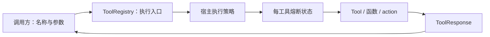

# P02 架构递进：从模型工具意图到统一执行边界

参考快照：`V1.0.1 / c597a7ca46ea9969e5b21d9e130549ab69626ff9`。先修是 P01 的消息、工具意图与模型协议契约。P02 提供工具的定义、注册和单次执行，自动模型循环在 P03 接通。

本篇沿用 P01 的架构学习方式：每步明确问题、候选方案、选择理由、职责变化、实施任务与验证。配套[设计决策详解](p02-progressive-explanations.md)解释模式、代价和当前限制。



图中是获准执行的主路径。拒绝与熔断直接返回错误回执，不执行工具；正常执行后的结果用于更新熔断状态。注册与描述生成是另一条准备路径。

| 步骤 | 架构决定 | 产物 |
| --- | --- | --- |
| A1 | 执行责任从哪里开始、到哪里结束 | P01/P02/P03 边界 |
| A2 | 工具如何接入与选择 | 注册表和工具来源方案 |
| A3 | 描述、参数、结果怎样表达 | Schema 与执行回执契约 |
| A4 | 哪些规则由谁统一处理 | 注册、策略、熔断、具体工具职责图 |
| A5 | 从哪里形成最小闭环 | 计算器的描述→执行→回执 |
| A6 | 怎样扩展函数与多 action 工具 | 统一入口下的不同调用适配 |
| A7 | 权限、失败与子表状态如何组合 | 执行顺序与状态所有权 |
| A8 | 如何验证和接给后续运行层 | 原始契约证据与变化影响审查 |

<a id="p02-a1"></a>
## A1：先从一次工具调用的消费者出发

P01 返回 `ToolCall(id, name, arguments)`。运行层需要按 name 找到实际实现，执行后获得可回写的结果。模型给出的意图不能直接被当作宿主授权，也不意味着任何函数已经执行。

可选边界有两种：让每个 Agent 直接找函数、检查权限、处理错误；或提供统一工具执行入口。前者原型简单，但每种 Agent 会重复处理工具接入与执行规则。目标选择后者。

P02 对调用方提供两组能力：准备阶段注册工具并获取描述；运行阶段按名称和输入执行一次，返回统一回执。P03 再负责把模型意图解析、调用 P02、追加消息并决定继续。

**现在做什么：**画出模型意图、工具执行、结果回写三步，分别标注 P01、P02、P03 的主要责任。输出 P02 的公共能力说明。

**验收：**能说明为何工具描述、执行许可和实际执行是不同动作。详见 [A1](p02-progressive-explanations.md#p02-a1)。

<a id="p02-a2"></a>
## A2：选择工具组织方式

| 方案 | 优点 | 当前代价 |
| --- | --- | --- |
| 名称→函数的字典 | 最小、易接入 | 描述、参数、异步、权限和结果包装容易散落在调用方 |
| 所有工具只实现一个类接口 | 统一描述与返回方式 | 简单函数也必须包装，已有功能接入成本增加 |
| 注册表统一入口，支持对象与适配后的函数/action | 将接入差异留在工具层 | 要明确三条调用约定，不能假定所有函数都接受 kwargs |
| 直接采用模型 SDK 的工具执行器 | 可利用已有编排 | 执行权与本地框架语义需要重新协调，不符合当前复刻边界 |

目标采用第三种：`ToolRegistry` 存名称映射，`Tool` 定义对象契约，普通函数保留单 input 调用；`@tool_action` 标记方法，由 `AutoGeneratedTool` 适配成 Tool。

注册表持有已创建的工具实例。它不是负责创建所有组件的依赖注入容器，也不会自动发现任意 Python 函数。

**现在做什么：**确定三种来源的描述和调用方式，建立名称唯一与显式替换规则。

**验收：**同名冲突默认拒绝；显式替换在 Tool 与函数之间也成立。增加工具无需给 Agent 增加类型判断。详见 [A2](p02-progressive-explanations.md#p02-a2)。

<a id="p02-a3"></a>
## A3：先分开描述契约和执行结果

| 数据 | 谁产生 | 给谁使用 | 要保留的信息 |
| --- | --- | --- | --- |
| ToolParameter / JSON Schema | 工具实现或 action 生成器 | 模型适配层、描述消费者 | 参数结构、必需项、嵌套约束 |
| 执行输入 | 调用方 | 注册表与具体工具 | 对象参数或既有单 input 约定 |
| ToolResponse | 工具或包装层 | Runtime、模型、日志 | status、text、data、error、stats、context |

只返回字符串会让“成功”“部分成功”“没有有效结果”混在一起。目标选择 `success/partial/error` 三种状态。partial 不是错误别名；它表示结果可用但有截断、回退或部分失败等限制。

结构化 data 存在时，模型表示保留整个回执，避免来源和状态被压成单句。纯文本成功仍保持文本兼容。Schema 保留嵌套类型、引用和显式约束，不为简化展示而把对象/数组都改成字符串。

描述生成不等于完整运行时校验。当前 `Tool.validate_parameters` 主要检查必需项；普通函数、Tool 和 action 的执行约定不同。

**现在做什么：**先实现回执、错误码和参数定义，再实现描述输出。解释同一业务结果怎样给模型和日志使用。

**验收：**结构化回执可往返；Schema 不修改调用方原片段，嵌套引用可被标准验证器解析。详见 [A3](p02-progressive-explanations.md#p02-a3)。

<a id="p02-a4"></a>
## A4：按变化原因安排规则

| 职责 | 归属 | 变化原因 |
| --- | --- | --- |
| 工具的业务操作和参数说明 | 具体 Tool | 业务能力变化 |
| Tool 公共执行包装、Schema、action 适配 | base.py | 工具接入契约变化 |
| 名称注册、查找、同步/异步调度 | ToolRegistry | 工具目录与执行入口变化 |
| 宿主是否允许执行 | ToolPolicy/PermissionDecision | 宿主授权规则变化 |
| 连续失败后的暂时阻止 | CircuitBreaker | 可用性策略变化 |
| 统一结果表示 | ToolResponse | 消费者需要的数据变化 |

`Tool` 具有命令对象的使用形态：以相同入口执行不同操作。`AutoGeneratedTool` 是把方法调用适配成 Tool 的适配器。Policy 是可替换的宿主决策策略。注册表组织这些协作，不必创建额外的责任链框架。

`@tool_action` 当前只标记元数据，实际包装由生成器完成；不能仅因为语法使用装饰器，就宣称已实现 GoF Decorator 的对象包装结构。

**现在做什么：**建立各职责模块，保留目标结构；给新增规则指定主要负责人。

**验收：**更换许可规则不改计算器；新增工具不改熔断算法；改变回执语义会有理由地联动生产者和消费者。详见 [A4](p02-progressive-explanations.md#p02-a4)。

<a id="p02-a5"></a>
## A5：先打通计算器纵向闭环

```text
CalculatorTool 描述
  → 注册表登记与查找
  → 参数输入
  → 计时包装与业务执行
  → ToolResponse
  → 模型可见文本/JSON
```

按依赖先完成回执、参数与 Tool 基类，再实现计算器，最后经注册表执行。计算器以 AST 解释有限表达式，不把模型文本直接交给任意 Python 执行。

本轮检查描述中的名称与实际查找一致；`python_calculator` 是目标工具的实际名称。它支持 input/expression 的运行输入，但公开参数描述沿用 input。模型参数解析和类型转换由后续 Runtime 结合契约处理。

**现在做什么：**验证一个正确表达式、一个不合法表达式和一个未知工具。检查返回状态、结构化结果和错误，而不是只看打印文字。

**验收：**注册、执行和结果转换形成真实闭环；不能用始终成功的执行替身代替计算器。详见 [A5](p02-progressive-explanations.md#p02-a5)。

<a id="p02-a6"></a>
## A6：接入不同来源，但保留明确契约

| 来源 | 描述怎样来 | 执行怎样调用 |
| --- | --- | --- |
| Tool 对象 | get_parameters/to_openai_schema | run(parameters) / arun(parameters) |
| 普通函数 | 注册名称与说明，后续按单 input 描述 | func(input_text) |
| action 方法 | 方法签名、注解与说明，生成子 Tool | method(**parameters)，保留签名错误 |

普通函数注册的历史单 input 约定，不会自动升级成任意多参数展开。需要结构化多参数的方法，走 action/Tool 约定。异步入口真正 await 原生异步实现；普通同步工作移到线程。同步入口遇到异步函数/action 应给出错误，不能把 coroutine 转成“成功文本”。

注册可展开工具前，先校验全部描述和名称，再写入映射。否则一个子工具失败，会在目录中留下半套功能。

**现在做什么：**添加函数注册、action 生成与完整类型 Schema；覆盖异步执行与批量注册失败。

**验收：**嵌套数组/模型约束保留；展开失败不部分注册；原生异步函数确实执行。详见 [A6](p02-progressive-explanations.md#p02-a6)。

<a id="p02-a7"></a>
## A7：把权限、熔断和状态范围接起来

单次执行的主要顺序是：需要授权时快照输入 → 宿主策略 → 熔断检查 → 名称查找与执行 → 统一回执 → 记录熔断结果。

拒绝或策略自身失败时不执行工具，返回 PERMISSION_DENIED；这不是一次工具服务执行失败，不累计熔断。Policy 要同步返回 PermissionDecision，异步审批留给宿主事先完成。

熔断按名称记录执行结果：error 累计失败，success/partial 重置；达到阈值后阻止后续调用，超时检查时恢复。目标只有 closed/open 语义，没有额外 half-open 状态，也不会取消已经开始的并发工作。

| 状态 | 归属/共享方式 |
| --- | --- |
| 工具与函数名称映射 | 每个注册表持有；fork 创建独立映射 |
| 实际工具实例 | fork 后仍共享，内部状态没有隔离 |
| Policy | fork 沿用同一宿主策略 |
| CircuitBreaker | fork 共享，子表失败可影响父表同名工具 |
| 读取元数据缓存 | fork 深拷贝；文件工具在 P08 消费 |

因此 fork 是目录与部分缓存隔离，不是操作系统沙箱、事务或副作用回滚。模型可见目录、子表过滤与实际执行许可也不能互相替代。

**现在做什么：**把策略和熔断放入两个执行入口；实现 fork，记录共享和独立状态。

**验收：**拒绝无副作用；调用方不能在授权等待期间改掉已快照参数；同步/异步共享相同策略和熔断状态。详见 [A7](p02-progressive-explanations.md#p02-a7)。

<a id="p02-a8"></a>
## A8：通过变化场景验收，并交给 P03

| 变化 | 应主要改哪里 | 应保持稳定 |
| --- | --- | --- |
| 新增业务工具 | 新 Tool/函数/action 及注册位置 | Agent 循环、策略接口 |
| 更换宿主允许列表 | Policy 实例 | Tool 业务实现 |
| 调整连续失败阈值 | 显式 CircuitBreaker 注入 | 工具描述/业务操作 |
| 支持嵌套参数 | 参数 Schema/生成器 | 模型 SDK 的公共调用入口 |
| 为子任务缩小工具目录 | 注册表 fork/后续工具过滤 | 父表名称映射 |
| 进入完整工具循环 | P03 Runtime | P02 单次执行契约 |

本阶段沿用固定参考实现的七个工具模块，保持可执行结构一致；公共导出仅开放已实现部分。原始三份工具测试、Pydantic 序列化测试直接保留；依赖未来模块的综合测试只提取当前阶段原断言，后续恢复完整文件。

- [ ] ToolResponse 结构与模型表示符合目标语义。
- [ ] Schema 显式片段、嵌套类型与引用保留。
- [ ] 注册冲突、跨类型替换和展开失败行为确定。
- [ ] Tool、函数、action 的同步/异步执行约定准确。
- [ ] 权限拒绝与服务失败分开，无意外副作用。
- [ ] 熔断和 fork 的共享范围可解释。
- [ ] 原始阶段断言与 P01 回归通过，尚未接入的模块明确标记。

实现证据与提交边界见[阶段记录](p02-learning-record.md)。理解验收不会因为自动执行测试而自动标记完成。下一阶段从“怎样让模型请求、执行回执和下一次请求形成一条可恢复的循环”进入 P03。
