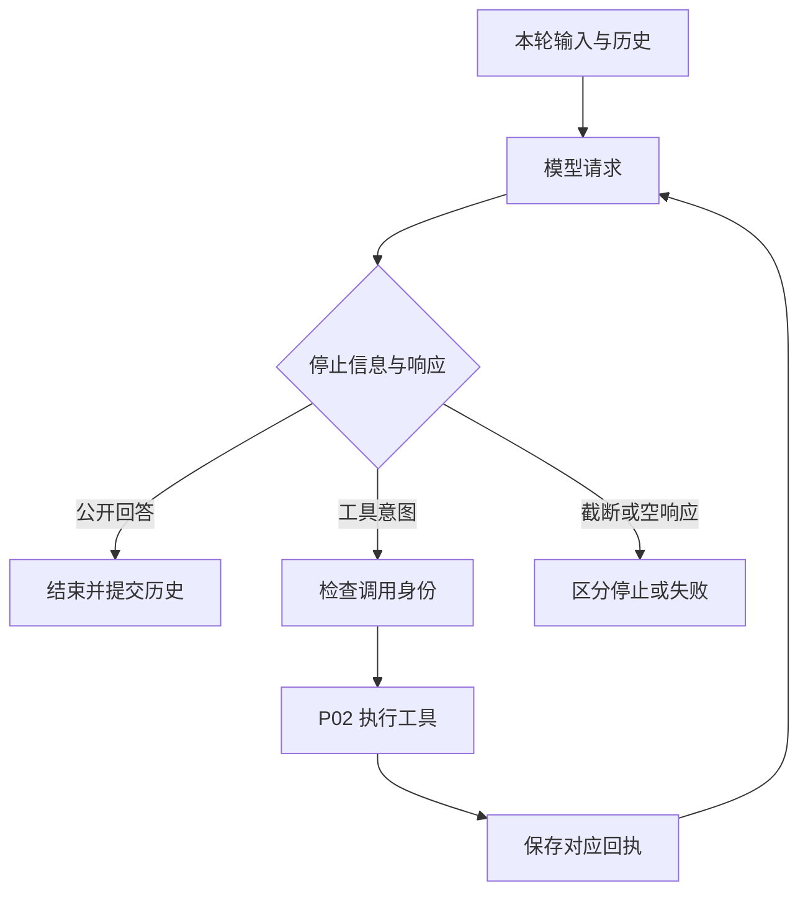

# P03 架构递进：把单次调用组织成可解释的工具循环

目标快照保持 `V1.0.1 / c597a7ca46ea9969e5b21d9e130549ab69626ff9`。P01 负责模型协议，P02 负责工具执行，P03 要交付真正控制二者顺序和状态的本地 Runtime。

沿用 P01 的八步架构路径，每步讨论方案、职责、实施与验证。[设计详解](p03-progressive-explanations.md)补充代价和边界。



<a id="p03-a1"></a>
## A1：明确谁拥有循环控制权

后续 Agent 不只需要“调用一次模型”，而是需要执行工具、把结果交回、继续请求。候选方案是交给 SDK Runner、每种 Agent 自写循环，或建立本地共享 Runtime。

目标选择共享 Runtime：模型协议仍由 P01 适配，业务操作仍由 P02 执行，继续/停止由 `turn_events` 决定。这样后续四种策略和四种入口可以共用一套执行规则。

**现在做什么：**描述两次模型调用之间必须发生的消息与工具操作，明确 SDK 不执行本地 Python 工具。

**验收：**能分别指明配置、协议、工具执行和下一轮决定的负责人。见 [A1](p03-progressive-explanations.md#p03-a1)。

<a id="p03-a2"></a>
## A2：选择一份异步事件机制作为核心

| 方案 | 收益 | 成本 |
| --- | --- | --- |
| 同步 while 循环优先，其他入口以后复制 | 首个调用容易实现 | 取消、状态和历史可能在多份循环中漂移 |
| 每种入口和 Agent 独立组织 | 局部自由度高 | 同一规则重复，实现和回归范围扩大 |
| 异步内部事件源，公共入口消费它 | 业务顺序和结果状态保持一份 | 需要清楚区分内部事件、公开事件和同步桥接 |

目标选择第三种：SimpleAgent._events 管运行生命周期，_run_loop 组织策略，Runtime 发出内部执行事件。普通 run/arun 消费事件后返回答案；流式公共入口也使用该机制，原生模型流在 P04 完整接入。

**现在做什么：**先打通 stream=False 的循环和同步桥接，保持最终模块位置。事件类型和必要生命周期结构一起落地，避免之后复制循环。

**验收：**改变调用入口，不改变工具执行与消息配对。P03 只作基本入口检查，不据此宣称原生 SDK 流式已完成。见 [A2](p03-progressive-explanations.md#p03-a2)。

<a id="p03-a3"></a>
## A3：把本次工作消息、长期历史和运行结果分开

| 状态 | 主要拥有者 | 用途 |
| --- | --- | --- |
| 本次 messages | SimpleAgent 建立，Runtime 推进 | 当前模型和工具交互 |
| 保存历史 | HistoryManager | 跨轮重放 |
| RunResult | 当前运行 | 答案、状态、停止原因、调用次数与统计 |
| 工具目录与熔断 | ToolRegistry | 独立于一次模型轮次复用 |

只保存最终文本会使第二轮失去工具请求/回执。目标把完整原生模型消息放进 Message.metadata.model_message，重放时优先使用它，保留 tool_calls、tool_call_id 与服务商字段。

工作消息不是长期历史的直接别名。运行结束时按整轮提交，不能边产出展示事件边破坏跨轮语义。

**现在做什么：**定义输入构建、工作消息追加、整轮提交、RunResult 更新的边界。

**验收：**第二轮对话能重放第一轮完整工具关系，而不只看到最后答案。见 [A3](p03-progressive-explanations.md#p03-a3)。

<a id="p03-a4"></a>
## A4：分配 Runtime 与 Agent 的职责

| 模块 | 主要责任 | 不应接管的责任 |
| --- | --- | --- |
| Agent 基类 | 公共配置/组件、工具描述与参数辅助 | 每种模型的 SDK 解析 |
| SimpleAgent | 输入、运行生命周期、历史提交、公开入口 | 各工具业务实现 |
| runtime.model_events | 选择模型入口并归一化模型事件 | 直接执行工具 |
| runtime.turn_events | 模型/工具顺序、身份、停止条件 | 管理宿主资源所有权 |
| ToolRegistry | 实际单次工具执行 | 决定整项任务完成 |

SimpleAgent 组合 Runtime 和组件；后续策略通过 _run_loop 等扩展点组织流程，不再各写完整生命周期。内部事件将执行与展示解耦，但没有引入全局事件总线。

**现在做什么：**沿协作链实现职责，保留实际状态控制者，避免只凭类名猜控制权。

**验收：**更换模型协议不改循环；新增工具不改循环；后续改变策略可以复用生命周期。见 [A4](p03-progressive-explanations.md#p03-a4)。

<a id="p03-a5"></a>
## A5：先完成一次真实工具往返

用脚本模型返回第一次 ToolCall 和第二次公开答案；工具本身实际执行 Python 函数。验证模型调用 2 次、工具执行 1 次，并观察 user→assistant 请求→tool 回执→assistant 的历史。

施工按依赖展开：事件/结果契约 → 必要组件与 Agent 基类 → Runtime → SimpleAgent → 根导出 → 完整场景测试。历史、计数、截断与装配是目标构造路径需要的地基，先提供真实实现。

目标组件模块还直接引用 SessionStore、SkillLoader，Agent 构造导入 TraceLogger。为保持目标结构，相关依赖模块也先落地；高级行为和启用路径仍留给 P06/P07/P09/P10 分别验收，不把“模块存在”算成阶段完成。

**现在做什么：**运行[离线例子](../examples/p03_tool_loop.py)，核对真实函数结果、消息序列和 RunResult。

```bash
.venv/bin/python -m examples.p03_tool_loop
```

示例使用显式字符计数器和脚本模型，不下载模型或 Token 编码资源，不发送远端请求。

**验收：**只替换外部模型，保留真实 Runtime 与 Registry；无需依赖模型随机输出判断正确。见 [A5](p03-progressive-explanations.md#p03-a5)。

<a id="p03-a6"></a>
## A6：扩展到停止条件和异常输入

| 情况 | 目标行为 | 架构理由 |
| --- | --- | --- |
| 工具参数坏 JSON/非对象 | 形成错误观察，可再交给模型 | 一次工具意图失败不必让整个运行崩溃 |
| 空或同批重复 ID | 执行前失败 | 避免无法可靠配对和重复副作用 |
| 模型输出被截断 | output_limit，不执行不完整工具请求 | 文本存在不证明工具参数完整 |
| 无公开文本也无工具 | EmptyModelResponse | 不能用空字符串伪装成功 |
| 工具轮次耗尽 | 撤下工具作最后总结，状态 max_iterations | 返回文本与任务确认完成分开 |
| 模型调用异常 | 向外传播并记录 failed | 调用方必须能识别运行失败 |

最大工具轮数与模型调用次数不是同一个限额。保留最后总结意味着模型调用可以比工具轮数多一次，且 tool_choice 不能继续强迫总结请求调用工具。

**现在做什么：**在共享循环中集中加入这些决策，保留原始契约测试，不让不同入口各自补分支。

**验收：**失败前后的工具执行次数、消息和状态都可核对。见 [A6](p03-progressive-explanations.md#p03-a6)。

<a id="p03-a7"></a>
## A7：保证提交与收尾属于同一生命周期

成功时先提交完整历史和统计，再发完成事件。失败、取消或消费者关闭时，finally 释放运行标记并尽量保留已确认回执。没有回执的请求只能标为结果未知，不能据此认定外部操作已回滚。

同一 Agent 的可变历史不允许同时被多次运行修改；独立任务应创建独立实例，共享的模型和工具资源仍由宿主管理。

P03 先核查非流式失败传播和状态恢复；完整取消矩阵、真实 SDK 流关闭、超时与私有推理字段在 P04 系统验证。预算模块当前只定义目标异常类型，共享准入和计量留在 P18。

**现在做什么：**让历史提交、异常状态、回调/事件和清理沿同一 _events 路径工作，记录已验证与待验证范围。

**验收：**错误不留下活动标记；多轮消息能恢复使用。见 [A7](p03-progressive-explanations.md#p03-a7)。

<a id="p03-a8"></a>
## A8：用调用次数、消息和状态共同验收

| 变化场景 | 应主要修改 | 应保持稳定 |
| --- | --- | --- |
| 增加模型协议 | P01 适配器 | 工具循环规则 |
| 新增工具 | P02 实现与注册 | Runtime 身份和回写规则 |
| 新增 Agent 策略 | 策略组织 | 生命周期、历史和单次工具执行 |
| 公开输出改成流式事件 | 事件消费与模型流接入 | 工具实际副作用和回执关联 |

验收至少包含：完整往返、第二轮重放、坏参数观察、重复 ID 预阻止、截断、空响应、迭代上限、异步模型覆写与默认最小行为。

测试来源、模块先行范围和具体结果见[实现记录](p03-learning-record.md)。下一阶段将当前共用机制扩展到原生模型流、超时、取消与四入口完整契约。
