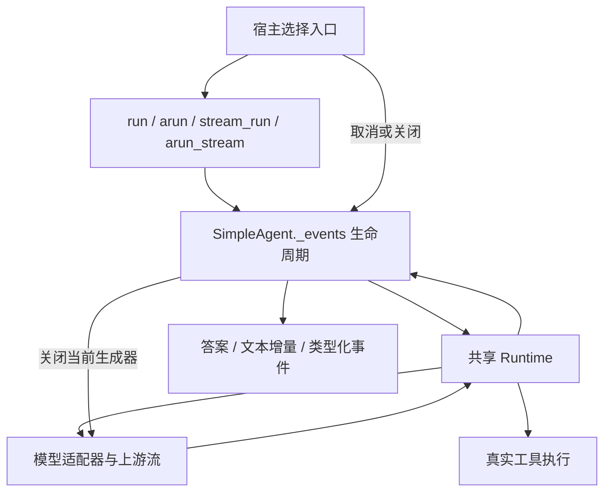

# P04 架构递进：四种入口共用执行、流式与取消规则

目标仍为固定 `V1.0.1 / c597a7ca46ea9969e5b21d9e130549ab69626ff9`。P03 已能完成模型→工具→模型闭环；P04 要让调用方式改变时，业务副作用、历史和结束状态保持一致。

配套阅读：[设计详解](p04-progressive-explanations.md)、[实现与验证记录](p04-learning-record.md)。本章从控制权和资源生命周期切入，之后再定位方法。

## A1：先定义入口改变后必须保持的行为

需求不是增加几个带 async 的方法。用户可能在脚本中阻塞调用、在服务中 await、在终端逐段显示，或向前端发送事件。这些入口应只改变消费方式，不能让同一工具执行两次，也不能使用不同的历史提交规则。

| 入口 | 对外结果 | 主要消费者 |
| --- | --- | --- |
| run | 最终答案字符串 | 同步脚本 |
| arun | await 后得到答案字符串 | 异步服务 |
| stream_run | 公开文本片段 | 同步逐段展示 |
| arun_stream | StreamEvent 事件 | 异步交互和传输 |

**现在做什么：**为同一场景约定一次写入、两次模型调用、完整请求/回执关系和 completed 状态；让四种入口执行该场景。

**验收：**能解释为什么 arun_stream 需要事件，而 stream_run 只交付文本；能说明“流式”不应意味着再运行一次任务。见[详解 A1](p04-progressive-explanations.md#p04-a1)。

## A2：选择共享机制，决定同步代码如何进入

| 方案 | 收益 | 代价 |
| --- | --- | --- |
| 四份独立循环 | 每份入口局部直观 | 超时、回执和取消规则重复 |
| 同步循环外包线程 | 容易兼容阻塞代码 | 流和取消仍需额外协议 |
| 异步内部事件源，入口消费它 | 业务执行和状态维护集中 | 要明确同步桥接和生成器关闭 |

沿用 P03 第三种方案：_events 包装执行；普通入口消费全部事件，流式入口筛选或转交事件。sync_events 为同步宿主建立并关闭事件循环。

**现在做什么：**把同步桥接放在入口边界，拒绝在已经运行的事件循环中嵌套同步入口；调用方此时使用 arun/arun_stream。

**验收：**同步桥接失败不会留下模型请求或历史；同一个 Agent 拒绝并发推进历史，关闭后仍可继续运行。见[详解 A2](p04-progressive-explanations.md#p04-a2)。

## A3：区分可展示增量与可执行的完整响应

模型可以先发半段工具名、半段 JSON，最后才给完整停止信息和 usage。文本增量可以展示，工具请求必须等完整响应才判断是否执行。

目标的模型流契约是：字符串代表公开文本片段；最后的 LLMToolResponse 代表完整内容、工具调用、停止信息、usage 和私有字段。OpenAI 工具流按 index 拼接 name/arguments，保存 ID，并处理 choices 为空的统计尾包。

**现在做什么：**将碎片汇总留在适配器，Runtime 只消费统一完整响应；Runtime 不解析 SDK 的 delta 层级，也不把半段 JSON 提前交给工具。

**验收：**分两段到达的参数能形成一个完整调用；没有 choices 的尾包仍计入 usage；公开文本不重复追加最终整包答案。见[详解 A3](p04-progressive-explanations.md#p04-a3)。

## A4：为不同提供商选择真实可用的流能力

| 路径 | 当前实现 | 架构边界 |
| --- | --- | --- |
| OpenAI 文本/工具原生异步流 | 直接消费异步 SDK | SDK 碎片由 OpenAIAdapter 归一化 |
| 同步文本流转 async | 后台线程＋容量 8 的队列 | 慢消费者不会让生产者无限缓存 |
| 不具备原生工具流的适配器 | 在线程中等待完整响应，再产出内容和响应 | 不模拟逐 Token 生成 |

Anthropic/Gemini 的同步文本流接入各自 SDK；它们的异步工具流沿用整包回退。调用方使用同一契约，但应知道实际延迟和取消能力不同。

**现在做什么：**保留 Adapter 扩展点，为有能力的协议实现原生路径，为其他协议保留诚实回退，不复制 Agent 循环。

**验收：**能分别解释接口兼容、逐段生成和请求可取消，不因方法带 astream 就认为三者相同。见[详解 A4](p04-progressive-explanations.md#p04-a4)。

## A5：沿资源所有权安排关闭和取消

需要区分本次请求的流、可复用客户端、宿主提供的模型和工具。当前请求的生成器应随本次运行关闭；宿主借给 Agent 的模型不会随一次运行结束被整体销毁。

关闭链沿消费关系向上游传播：宿主关闭 arun_stream → _events 关闭策略事件源 → Runtime 关闭模型事件源 → LLM 门面关闭适配器流 → 适配器释放请求流。OpenAI 工具流还关闭该请求专用客户端。

**现在做什么：**使用 try/finally 与 aclosing 保证提前退出也走收尾；回退线程设置停止标记，让当前阻塞读取返回后不再继续拉取。

**验收：**关闭返回前上游异步流已经收到关闭；_run_active 恢复。取消等待不能强制杀死同步 SDK 或工具线程，不能据此证明外部写入未发生。见[详解 A5](p04-progressive-explanations.md#p04-a5)。

## A6：把执行时限、观察者与慢消费分开

模型、工具和生命周期钩子具有不同作用。模型/工具超时应中断本次执行并报告失败；观察者钩子超时或异常记录后不替代业务结果。消费者逐段阅读的时间也不应计入模型下一次读取时限。

**现在做什么：**让模型时限围绕每次 anext 读取，而不是覆盖整个“产出片段→等用户消费→继续”过程；工具调度使用工具时限；钩子各自等待并限制时间。

**验收：**慢消费不会触发模型超时；真正慢模型/工具会失败并释放运行标记；on_start 超时与 on_finish 异常仍保留正确完成结果。见[详解 A6](p04-progressive-explanations.md#p04-a6)。

## A7：用回执决定取消后的历史，不猜外部结果

| 中断位置 | 必须保留或表达 |
| --- | --- |
| 模型等待中 | 取消状态，关闭上游，释放活动标记 |
| 工具执行中但未取得结果 | 对应 ID 的 unknown 回执 |
| 工具成功后 | 已确认回执和实际副作用 |
| AGENT_FINISH 处消费者关闭 | 已提交历史和完成状态 |

成功提交发生在完成事件之前。中断时补齐工具关系，但不把 unknown 写成已确认失败，也不自动重试副作用。

**现在做什么：**以回执和状态为恢复依据，按边界中断实际执行；特别安排“取消等待后线程才完成写入”的确定性场景。

**验收：**线程后续确实写入，框架回执仍是当时未确认的 unknown；能够说明为什么续跑前需要核实外部状态。见[详解 A7](p04-progressive-explanations.md#p04-a7)。

## A8：让事件进入传输层，再完成阶段验收

StreamEvent 转 SSE 时包含 event 行、JSON data 行和双换行帧边界。网络分块可以切开字符或事件，前端必须增量解码并缓存到完整帧，再解析 JSON。

StreamBuffer 只保留有限历史并丢弃最旧事件；它不是阻塞生产者的队列。模型回退队列才提供本阶段的有界生产缓冲。SSE 转换器负责序列化，不接管 Agent 运行状态。

**现在做什么：**用真实 Agent 事件形成 SSE，再故意按 7 字节切开，检查重组后公开答案与完成状态。确认此前暂缓的 14 项模型流测试已全部恢复。

**验收：**四入口一次写入、碎片与 usage、私有字段、模型/工具时限、取消/关闭/复用、钩子和 SSE 分片共同通过。下一阶段 P05 改变策略组织，复用本阶段的执行和收尾规则。
