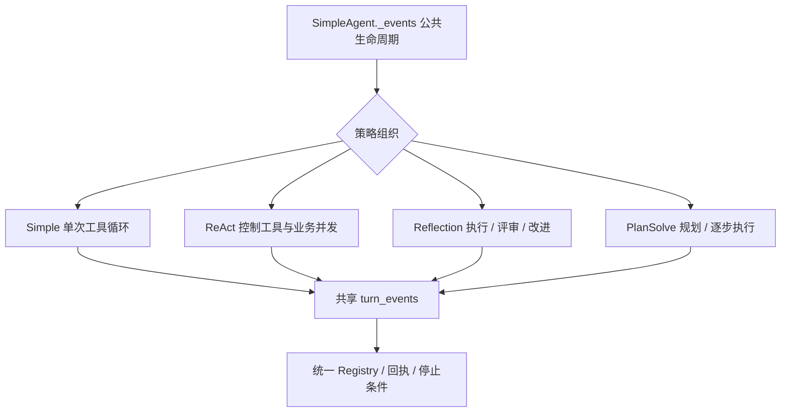

# P05 架构递进：让策略变化复用同一执行契约

固定目标仍为 `V1.0.1 / c597a7ca46ea9969e5b21d9e130549ab69626ff9`。已有模型协议、工具边界和四入口运行机制；本阶段增加 ReAct、Reflection、PlanSolve 和工厂。

配套：[设计详解](p05-progressive-explanations.md)、[实现记录](p05-learning-record.md)。先问策略需要改变哪段流程，再选择扩展点，不先堆砌设计模式。

## A1：把共同执行与可变策略分开

| 方案 | 适用性与代价 |
| --- | --- |
| 每种 Agent 从基类重写全部入口 | 自由度大，但会重复 P03/P04 的状态和收尾规则 |
| 运行器中不断按 Agent 类型分支 | 局部集中，但运行器将理解全部业务策略 |
| 继承共同生命周期，组合已有组件并覆写少数扩展点 | 目标当前选择；策略专注流程变化 |

SimpleAgent 提供 _events，三种策略继承它。ReAct 增加 Schema、控制工具和并发执行能力；Reflection/PlanSolve 覆写 _run_loop，内部继续调用 turn_events。

**现在做什么：**列出不变量（四入口、回执、错误、关闭、历史）和变化（控制工具、阶段、规划），把变化放进策略模块。

**验收：**能指出每种策略的实际控制者，而不把策略名称当作另一套工具执行引擎。见[详解 A1](p05-progressive-explanations.md#p05-a1)。

## A2：先实现 ReAct 的控制协议

目标使用原生工具调用表达 Thought/Finish，业务工具仍走 Registry。Thought 记录简短行动说明；Finish 给非空最终答案，并改变本轮控制状态。它们是策略内部控制工具，不在共享 Registry 注册成普通业务工具。

候选方案包括解析文本标记、注册两个业务函数、追加内部 Schema 并交给运行器处理。目标采用第三种，让工具意图保持统一 DTO，同时保留结束语义。

**现在做什么：**追加保留名称 Schema，拒绝用户工具撞名，验证 Finish.answer；同批 Finish 之后的请求写入未执行回执，不继续产生业务副作用。

**验收：**Thought→写入→Finish→第二次写入同批返回时，只有第一次写入发生，全部 ID 仍有回执。见[详解 A2](p05-progressive-explanations.md#p05-a2)。

## A3：只对纯业务批次引入并发

串行最容易维护顺序；所有请求并发可能使 Finish 与写入竞争；有限并发可缩短相互独立业务工具的总等待时间。目标仅在 ReAct 的纯业务多请求批次启用并发，含 Thought/Finish 时走原顺序串行路径。

**现在做什么：**在策略内用 semaphore 控制并发，失败标记阻止排队任务继续执行；失败后取消等待任务并回收。成功兄弟任务取得回执时立即记录，不能等整批全部成功才保存。

**验收：**并发峰值不超过配置；前一任务失败后队列中的写入不启动；已成功兄弟任务保留回执，未确认任务标 unknown。见[详解 A3](p05-progressive-explanations.md#p05-a3)。

## A4：将 Reflection 建成阶段组织器

Reflection 的变化是 execution→reflection→按需 refinement。每一阶段都可使用同一工具循环；如果每阶段另写模型/工具执行，将重复响应判断和状态处理。

**现在做什么：**_run_loop 管阶段顺序，_phase 调用 turn_events 并标记事件 phase；Memory.records 只保存本次尝试/反馈，新任务重置。评审说“无需改进”或英文等价触发词时返回最近 execution，不能把评审文字当答案。

**验收：**max_iterations=0 只执行一次；非 completed 阶段不再继续评审；改进路径统计三次模型调用并累加 usage。见[详解 A4](p05-progressive-explanations.md#p05-a4)。

## A5：规划先形成可校验契约，再允许执行

候选计划格式有自由文本、文本解析和结构化工具提交。目标让 Planner 请求 generate_plan，要求恰好一次正确调用，steps 是非空字符串列表，且响应未截断。

**现在做什么：**先验证计划，再进入任何业务步骤；规划阶段去掉业务 tool_choice，使用 auto；没有正确规划调用时失败，不默默把普通文字当计划。

**验收：**空列表、字符串、空白步骤、非字符串步骤均在业务副作用前失败；业务强制工具选择不覆盖规划工具。见[详解 A5](p05-progressive-explanations.md#p05-a5)。

## A6：逐步执行同时保留全局任务和已有证据

PlanSolve 的每一步需要原始任务、完整计划、已完成结果和当前步骤。Executor 负责格式化这种输入；PlanSolve 的运行循环借用它构造提示，并由 turn_events 执行本步。

**现在做什么：**执行器角色与调用者系统消息同时保留；将本步真实模型/工具轨迹并回本轮工作消息；本步非 completed 立即停止，步骤间取消不能保留上一步的 completed 来冒充整计划完成。

**验收：**第二步输入包含第一步结果；规划和执行 usage 都累计；取消第二步之前状态为 cancelled。独立 Executor 借用 Registry，不额外注册工具。见[详解 A6](p05-progressive-explanations.md#p05-a6)。

## A7：用简单工厂集中选择类型

调用方若多处写类型分支，会重复传播模型、Registry、Config、系统提示。目标 create_agent 通过简单分支构造具体策略，没有额外引入插件注册系统。

**现在做什么：**工厂只负责类型到构造函数的映射和参数传播，策略继续拥有行为；从 hello_agents.agents 暴露工厂，根包仅增加目标已有的三种 Agent 导出。

default_subagent_factory 同文件先落地；隔离、过滤与父状态恢复在 P11 另行验收，本阶段不把函数存在算作子代理机制完成。

**验收：**工厂创建正确类型，依赖对象身份和系统提示保持；未知类型明确失败。见[详解 A7](p05-progressive-explanations.md#p05-a7)。

## A8：用变化矩阵检查高内聚与低耦合

| 后续变化 | 主要修改位置 | 共同契约 |
| --- | --- | --- |
| 增加模型协议 | P01 Adapter | 策略和 Registry 不改 |
| 增加业务工具 | P02 工具与注册 | 阶段组织不改 |
| 调整反思停止/规划格式 | 对应策略 | 四入口和收尾复用 |
| 修改超时、回执、取消规则 | 共享执行层 | 各策略共同验证 |

**现在做什么：**运行四策略×四入口真实工具往返，再检查控制/业务混批、并发失败、坏计划、反思停止和统计。不要只用“四种类都能实例化”验收。

**验收：**能依据以上变化定位责任，也能指出当前 Runtime 对 ReAct 控制/并发扩展点仍有协作耦合。下一阶段 P06 处理历史增长与单次模型输入预算。
