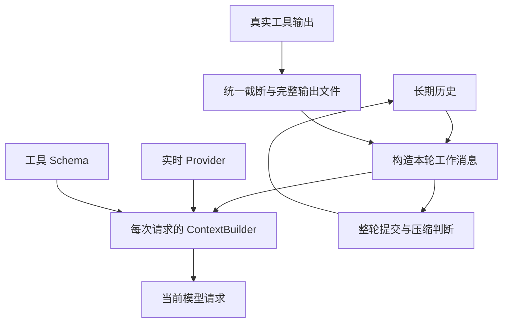

# P06 架构递进：历史增长如何变成有边界的模型输入

目标仍为固定 `V1.0.1 / c597a7ca46ea9969e5b21d9e130549ab69626ff9`。P03 为构造运行链已提供真实上下文模块；本阶段核查它们并补齐专项证据，不重写相同实现。

阅读：[设计详解](p06-progressive-explanations.md)、[实现记录](p06-learning-record.md)。切入问题是“任务越做越久，哪些信息保存，哪些送给模型，超限由谁处理”。

## A1：先分开保存与发送的需求

全量历史有助于续跑，但不能假设无限放进模型；直接删除历史容易丢掉工具证据；只在最终拼接字符串又会破坏角色和配对。

目标将长期历史交给 HistoryManager，本轮工作消息由 Agent/Runtime 推进，单次请求由 ContextBuilder 组装。工具长结果先经过独立截断器，Provider 在每次请求前收集候选资料。

**现在做什么：**画出以上四种数据形态，明确 Builder 的选择结果不自动写回历史，历史压缩也不是 Builder 的职责。

**验收：**能说明“本次没选入资料”和“历史已被压缩”的区别。见[详解 A1](p06-progressive-explanations.md#p06-a1)。

## A2：选择按完整轮保留历史

| 方案 | 收益 | 风险/代价 |
| --- | --- | --- |
| 按固定消息数删头部 | 实现最短 | 可能切断 assistant 工具请求与回执 |
| 按字节剪字符串 | 容易控制大小 | 会丢结构和协议字段 |
| 按 user 角色边界保留最近轮次 | 保持当前轮的关联结构 | 最少保留轮次可能让历史仍超预算 |

目标采用第三种：旧部分变成 summary，最近轮保持。读取返回列表浅副本，Message 对象仍共享；这不是不可变快照。

**现在做什么：**以真实工具轮次检查保留边界，再理解少于最少轮次时为什么不能靠压缩保证尺寸。

**验收：**保留轮次不拆配对；清空/压缩后计数正确；能指出 user 边界是当前启发式，策略加入的 user 消息也参与边界判断。见[详解 A2](p06-progressive-explanations.md#p06-a2)。

## A3：把三个限制放在各自的控制点

| 限制 | 单位和计算者 | 触发后果 |
| --- | --- | --- |
| 历史压缩阈值 | TokenCounter 估算 Token；Agent 比较阈值 | 请求 HistoryManager 压缩并重新计数 |
| 工具输出预览 | 行数＋UTF-8 字节；ObservationTruncator | 保留预览，完整结果按需写文件 |
| 单次模型输入 | Builder 的本地估算 Token，含 Schema 和资料包装 | 可选包整包排除；基础/必需内容超限抛错 |

这三者不能共用一个数字，也不能互相当作保障。P18 的共享请求/Token 消耗预算是另一层运行准入机制。

**现在做什么：**为每个限制写出位置、单位、结果；计数器纳入原生 tool_calls/tool_call_id 并缓存，压缩后重新统计。

**验收：**知道本地估算不等于服务商 usage，TokenCounter 和 Builder 的字符降级策略也不同。见[详解 A3](p06-progressive-explanations.md#p06-a3)。

## A4：先明确摘要的损失，再选择摘要方式

简单摘要不调用模型，保存轮数和消息统计；智能摘要额外调用模型，只处理保留边界以前的历史。目标保留这两条路径，并允许宿主注入完整摘要模型。

**现在做什么：**先验证统计摘要，再捕获智能摘要的实际输入，证明最近保留轮没有重复送去压缩；普通调用失败回退统计摘要，BudgetExceeded 继续向外传播。

**验收：**不把统计摘要当成事实保留；能解释为何预算耗尽不能借摘要回退绕过。当前只检查异常传播，完整预算计量到 P18。见[详解 A4](p06-progressive-explanations.md#p06-a4)。

## A5：在工具边界统一限制长结果

每个工具自行截断会形成不同约定；统一截断器能把业务结果生产与输入尺寸管理分开。目标先按行选择，再按 UTF-8 字节限制预览，支持 head/tail/head_tail，完整内容保存 JSON。

**现在做什么：**用中文长结果同时跨过行数和字节上限，验证方向、预览和完整文件回读。只有实际截断才创建输出目录。

**验收：**预览是有效 UTF-8 且不超字节；模型回执呈现 partial 及完整路径。完整文件存在不代表它已全部进入当前上下文。见[详解 A5](p06-progressive-explanations.md#p06-a5)。

## A6：选择可解释的资料筛选与组装

候选方案包括全部拼接、简单截头、让模型挑选，或本地确定性选择。目标采用本地词项相关度、MMR 多样性和整包预算，便于记录选择/排除原因，不引入一次额外模型调用。

**现在做什么：**保留基础消息与 Schema 预算，优先必需包，其他包按相关度和多样性选择；资料以 user 参考消息插入当前任务前，不拆已有工具配对。metadata.type=instructions 只影响保留优先级。

**验收：**相关资料保留来源/版本；不相关包有 relevance 原因，放不下有 budget 原因，基础/required 超限明确失败；relevance_score 高不自动入选。见[详解 A6](p06-progressive-explanations.md#p06-a6)。

## A7：让 Provider 按请求刷新，而不是按任务冻结

启动任务时抓取一次资料很简单，但工具可能撤回记忆或更新版本。若沿用旧快照，同一个任务后续请求会继续看到失效约束。

**现在做什么：**SimpleAgent._prepare_context 在每次模型请求前调用 Provider，再交给 Assembler。用真实工具修改资料源，核对第二次模型请求；提供了 packets/providers 却没组装器时明确报错。

**验收：**首个请求看得到的约束，撤回后第二个请求不再带入；原生工具配对仍完整。数据库检索和记忆的真实 Provider 组合分别留 P13/P15 验证。见[详解 A7](p06-progressive-explanations.md#p06-a7)。

## A8：用边界冲突完成验收

不要只测每个组件单独返回值。构造“历史已大但未到最少保留轮数”的任务，HistoryManager 不压缩，Builder 必须拒绝超限基础消息，不能默默删除任务或工具消息。

**现在做什么：**联合检查压缩、原生字段计数、UTF-8 截断、Schema/required 预算、相关度/MMR、Provider 刷新和四入口接收上下文。

**验收：**能从具体超限场景定位责任，并说明哪些数据被保存、被选择或被丢弃。下一阶段 P07 验证这些组件如何被显式替换，以及默认构造为什么不应偷偷开启功能。
