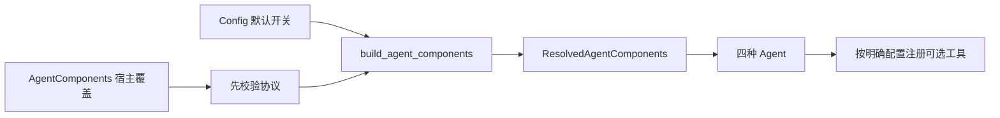

# P07 架构递进：用显式装配替换组件，保持默认行为简单

固定目标仍为 `V1.0.1 / c597a7ca46ea9969e5b21d9e130549ab69626ff9`。P06 已分清各组件职责，P07 解决“宿主如何替换其中一项，又不破坏其他默认行为”。

配套：[设计详解](p07-progressive-explanations.md)、[实现记录](p07-learning-record.md)。本阶段核验 P03 已落地的装配机制，不增加容器或重写构造链。

## A1：从替换场景确定装配需求

宿主可能已有历史、专用计数器、存储或摘要模型。强制继承具体类会扩大依赖；依靠全局对象会让不同任务共享状态；每个构造函数再加一组独立参数则会重复传播。

目标用 AgentComponents 集中传入覆盖项，构造时统一解析，再将实际组件交给 Agent。Config 表达默认策略，组件对象表达具体能力。

**现在做什么：**从“只替换计数器”“禁用会话”“使用宿主历史”三个变化场景说明谁应拥有配置、对象和状态。

**验收：**能解释为什么无需为每种替换新增 Agent 子类。见[详解 A1](p07-progressive-explanations.md#p07-a1)。

## A2：选择最小 Protocol 与构造注入

| 方案 | 取舍 |
| --- | --- |
| 只接受具体 HistoryManager 等类 | 容易判断类型，但宿主实现耦合目标类层级 |
| 全局服务定位器/容器 | 可动态查找，但隐含依赖和生命周期更难追踪 |
| 最小 Protocol＋构造覆盖 | 目标选择；只依赖需要的方法，构造时可检查 |

History/Counter/Truncator/Session/Skill 分别描述所需协议。ResolvedAgentComponents 保存解析后的对象；Agent 不需要知道宿主底层如何存储。

**现在做什么：**用不继承 HistoryManager 的组合对象接管历史，用自定义 Counter/Truncator 接管对应操作。

**验收：**四种 Agent 传播同一组件包；实际对象身份保持，既有历史和计数器标记不被清空。见[详解 A2](p07-progressive-explanations.md#p07-a2)。

## A3：为可选能力建立明确三态

| 可选 session_store / skill_loader 的值 | 语义 |
| --- | --- |
| DEFAULT_COMPONENT | 根据 Config 开关创建默认实例或不启用 |
| None | 明确禁用，即使 Config 开启 |
| 实例 | 明确使用，即使 Config 关闭 |

必须组件 History/Counter/Truncator 的 None 则表示创建默认实例，不能用同一规则理解所有字段。普通真值判断无法表达这些语义；合法但 bool 为 False 的宿主对象也必须保留。

**现在做什么：**逐项检查两种可选组件×开关×三态，观察实际对象和默认目录是否创建。

**验收：**能解释默认值为什么不能直接用 None，以及显式实例如何覆盖关闭的配置。见[详解 A3](p07-progressive-explanations.md#p07-a3)。

## A4：在创建默认资源之前校验依赖

如果先创建 sessions/skills 目录，再发现计数器缺方法，构造失败仍会留下副作用。目标先遍历宿主覆盖项，检查可调用方法和历史保留策略，再创建缺省组件。

**现在做什么：**给每一种组件传入不符合协议的对象，验证失败时默认目录尚不存在；历史 min_retain_rounds 必须为正整数。

**验收：**知道当前检查的是方法存在/可调用，不能据此宣称方法签名或全部行为已正确。见[详解 A4](p07-progressive-explanations.md#p07-a4)。

## A5：区分对象装配与状态初始化

默认组件需要每个 Agent 独立创建；传入实例可能已经有数据，不能统一 clear_cache/clear 后再用。历史的实际保留策略也应来自注入组件，而不是继续硬读 Config 的旧值。

**现在做什么：**预载历史后构造四种 Agent，核对对象身份、初始计数和保留边界；两个默认 Agent 检查历史/计数/截断器各自独立。

**验收：**构造不是重置。宿主对象状态保留，模型借用后不会随一次 run 自动 close。见[详解 A5](p07-progressive-explanations.md#p07-a5)。

## A6：把独立模型作为完整依赖传入

只替换模型名而复用主模型的地址/密钥可能指向错误服务。目标默认使用主模型；独立摘要或子代理模型通过 AgentComponents 注入完整实例，旧的单独名称/提供商设置不静默拼装客户端。

**现在做什么：**检查默认复用与显式覆盖；仅提供别的模型名时，构造阶段明确报错。

**验收：**能指出模型的创建、费用配置和最终关闭由宿主承担；组件装配器不充当全局模型资源管理器。见[详解 A6](p07-progressive-explanations.md#p07-a6)。

## A7：默认最小行为与显式功能注册分开

默认 SimpleAgent 不自动添加工具、开启追踪或会话目录。显式开关决定可选工具注册，显式禁用组件不再偷偷创建替代品；已存在同名工具时保留宿主原定义。

**现在做什么：**从空临时目录运行默认 Agent，检查没有隐藏文件/目录；预先注册 Skill/Task/TodoWrite/DevLog 同名函数，打开对应开关后确认不被替换。

**验收：**默认行为与功能开关可预测。真实 Skill/Task/TodoWrite/DevLog 的执行和组合分别在后续阶段验收，当前不以分支存在冒充功能完成。见[详解 A7](p07-progressive-explanations.md#p07-a7)。

## A8：用替换矩阵检查依赖是否集中

**现在做什么：**联合验证四 Agent 传播、基本组件协议、可选三态、无效覆盖先失败、预载状态、默认独立对象、模型所有权和既有名称保留。

**验收：**能说清替换计数器只需改宿主装配；新增一种业务工具改工具注册；生命周期规则仍在共享层。P09/P10/P11 将恢复完整真实存储、技能/控制工具和子任务恢复集成，当前记录明确保留待验范围。

下一阶段 P08 将工具抽象用于文件读写，重点是实际副作用前提、冲突检测和多次编辑的原子性。
