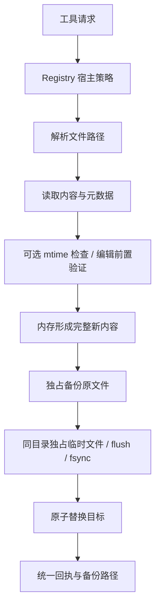

# P08 架构递进：把工具意图变成可核对的文件副作用

固定目标仍为 `V1.0.1 / c597a7ca46ea9969e5b21d9e130549ab69626ff9`。已有通用 Tool/Registry 和运行器，现在加入 Read、Write、Edit、MultiEdit。

配套：[设计详解](p08-progressive-explanations.md)、[实现记录](p08-learning-record.md)。切入点不是文件 API 语法，而是“观察什么、依据什么修改、失败时哪些事情已经发生”。

## A1：按修改意图划分四种工具

| 工具 | 主要意图 | 关键前提 |
| --- | --- | --- |
| Read | 观察文件或目录 | 路径存在且可读 |
| Write | 创建/整体替换文本 | content 是字符串；可选版本检查 |
| Edit | 精确替换一个片段 | old_string 在当前内容唯一匹配 |
| MultiEdit | 顺序执行一组片段替换 | 每一步在更新后的内存内容中唯一匹配 |

单一万能文件工具减少类数量，却让参数和失败语义混杂；各自直接写磁盘又会重复可靠性规则。目标分开意图，复用原子写和备份助手。

**现在做什么：**为四种意图定义前提和回执，沿用 P02 ToolResponse/错误码，不引入另一套运行器。

**验收：**新增文件工具只需注册，P03/P04 模型循环无需改。见[详解 A1](p08-progressive-explanations.md#p08-a1)。

## A2：先建立可观察的读取证据

Read 返回内容、行范围、总行数、mtime 毫秒与全文件字节数；读取目录则返回目录项。显式注入 Registry 时按请求 path 缓存元数据。

**现在做什么：**读取 UTF-8 文件并检查 offset/limit 与完整大小；核对读取缓存。写请求仍需显式携带 file_mtime_ms，缓存不会替调用者自动加锁。

**验收：**能区分返回片段大小和全文件大小，也能指出缓存对象由 Registry 持有而非模型持有。见[详解 A2](p08-progressive-explanations.md#p08-a2)。

## A3：选择可选的乐观冲突检查

候选方案包括不检查、mtime 检查、内容哈希或跨写者锁。目标对已有文件使用调用者提供的 mtime 毫秒值与当前值比较，冲突则拒绝修改；未提供时按基线允许写入。

**现在做什么：**先读→外部修改→携旧 mtime 写入，验证 CONFLICT 且原文不变；再省略该参数，理解为什么缓存本身不阻止写入。

**验收：**知道该检查不是跨进程锁或原子 compare-and-swap，不能据此保证两个写者绝不互相覆盖。见[详解 A3](p08-progressive-explanations.md#p08-a3)。

## A4：编辑验证先在内存完成

Edit 需要唯一匹配；MultiEdit 不能先验证每项都匹配原文再一起替换，因为前一项可能创建或消除后一项匹配。

**现在做什么：**维护内存 content，逐项验证并应用替换；全部成功后再备份和落盘。用 alpha→beta 后形成两处 beta 的例子，验证第二项失败时没有部分写入或新备份。

**验收：**合法的后项可引用前项生成的新文本；非法后项不改变磁盘原文。这里是单文件批次的准备阶段，不是多文件事务。见[详解 A4](p08-progressive-explanations.md#p08-a4)。

## A5：用独占临时文件实现完整内容替换

直接写目标可能在中途留下半份文本；固定 target.tmp 会让并发写者共享文件。目标在目标同目录用 mkstemp 独占创建临时文件，写入、flush/fsync、保留已有模式，再 os.replace。

**现在做什么：**注入 replace 失败，确认原文件保留、只清理本操作临时文件；两个写者并发，确认临时名称不同且最终文件是某一份完整内容。

**验收：**原子替换保证观察到完整版本，不保证写者排队，也不等于整套备份/替换的数据库事务。见[详解 A5](p08-progressive-explanations.md#p08-a5)。

## A6：让备份和回执与真实结果一致

时间戳本身不能保证快速/并发备份不重名；目标在 .backups 中同样独占创建名称。回执给出字节变化和备份路径；外部绝对路径的备份必须能正常表达，不能写入成功后因展示相对路径而报错。

**现在做什么：**连续写两次核对两个备份；编辑中文核对 UTF-8 字节变化；允许的外部路径修改后回执成功且备份可回读。

**验收：**成功回执对应真实完成结果，replace 失败可能已有备份，不能宣称整个过程毫无副作用。见[详解 A6](p08-progressive-explanations.md#p08-a6)。

## A7：把宿主权限、工具策略和路径行为分开

目标路径解析允许绝对路径，working_dir 是相对路径基准，不是文件系统沙箱。Registry Policy 可以拒绝工具执行；实际读写仍受宿主操作系统/运行环境权限约束。

**现在做什么：**在临时空间构造相对项目外路径，验证允许时正常操作；用 AllowlistPolicy 拒绝 Write，确认任何目录/文件/备份创建前返回 PERMISSION_DENIED。

**验收：**能分别指出路径解析、工具许可、操作系统权限和 mtime 冲突各自的职责，不用一个“安全”标签覆盖全部行为。见[详解 A7](p08-progressive-explanations.md#p08-a7)。

## A8：接回真实 Runtime 完成纵向验收

**现在做什么：**脚本模型先请求 Read，再使用回执 mtime 请求 Edit，最后回答；文件工具实际操作临时文件。检查三次模型调用、两次工具调用、ID、原文备份、中文内容和字节回执。

**验收：**原文件错误分支、唯一匹配、顺序批改、replace 失败、并发临时文件、外部路径、Policy 预拒绝和 Runtime 完整往返共同通过。

下一阶段 P09 让这些工具证据连同历史和读取缓存保存到会话，并观察真正发生的运行事件。
