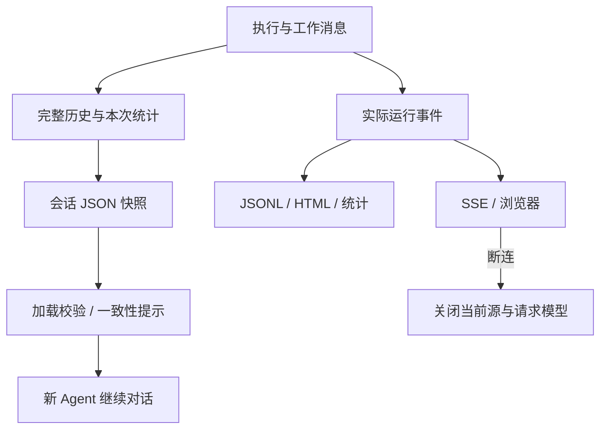

# P09 架构递进：保存执行证据，再将运行事件交给观察者

固定目标仍为 `V1.0.1 / c597a7ca46ea9969e5b21d9e130549ab69626ff9`。P08 已有真实文件副作用，本阶段解决“重启后保留什么”和“界面如何看见实际执行”。

配套：[设计详解](p09-progressive-explanations.md)、[实现记录](p09-learning-record.md)。SessionStore/TraceLogger 已因 P03 依赖落地，本阶段核对并验其完整路径，接入 Web 示例。



<a id="p09-a1"></a>
## A1：先定义可恢复状态，排除运行对象

只保存最终答案无法还原工具证据；直接序列化整个 Agent 会牵涉 SDK 连接、函数、锁和宿主对象。目标保存显式 JSON 快照：history、配置摘要、完整工具 Schema 哈希、read_cache 和运行元数据。

**现在做什么：**区分“重新构造的依赖”和“恢复的数据”。宿主重新提供模型/工具实例，加载只恢复交互与缓存，不恢复旧 Python 调用栈。

**验收：**能解释为何会话 JSON 不包含模型连接和业务工具对象。见[详解 A1](p09-progressive-explanations.md#p09-a1)。

<a id="p09-a2"></a>
## A2：用独占临时文件保存完整快照

直接写 JSON 可能留下半份文件；固定 .tmp 可能冲突。SessionStore 在自身目录独占创建临时文件，序列化完成后 replace，finally 只清理本次临时文件。session_name 是名称，不是任意路径。

**现在做什么：**注入不可序列化内容、并发保存同名会话、预先放置无关临时文件，验证失败清理和最终 JSON 完整。

**验收：**同一 Store 的替换步骤受实例锁保护；不同 Store/进程不因此共享锁。保存失败不误删其他文件。见[详解 A2](p09-progressive-explanations.md#p09-a2)。

<a id="p09-a3"></a>
## A3：先准备恢复状态，再替换当前会话

一边读一边修改当前历史会使错误快照破坏原会话。目标先将消息转成 Message、检查 metadata/read_cache 为对象并计算 Token，成功后才清空并填入历史、元数据和缓存。

**现在做什么：**分别构造非法消息、错误 metadata/cache 类型和空缓存；确认前两者不改变原状态，空缓存确实清掉旧会话缓存。活动运行期间禁止加载另一会话。

**验收：**知道这是当前明确校验路径，不是对任意层级快照字段的完整 Schema 验证。见[详解 A3](p09-progressive-explanations.md#p09-a3)。

<a id="p09-a4"></a>
## A4：让环境变化可见，不猜恢复兼容性

同名工具也可能改变参数或描述。目标对模型可见的完整 Schema 按名称排序，再稳定序列化和哈希；函数工具同样纳入。配置摘要比较模型/提供商/步数等，发现变化给出提示。

**现在做什么：**调换注册顺序时哈希保持，修改描述时哈希变化；恢复时观察一致性提示。检查的是接口约定，不是业务函数源码或全部运行环境。

**验收：**能区分“提示环境有变化”和“自动迁移/阻止恢复”。见[详解 A4](p09-progressive-explanations.md#p09-a4)。

<a id="p09-a5"></a>
## A5：将保存放在正确生命周期边界

自动保存必须包含当前轮已提交的工具交互与最新统计。中断时保留已确认回执，为未确认请求补 unknown，再允许保存恢复。

**现在做什么：**四策略各执行真实写入，在 TOOL_CALL_FINISH 处关闭→保存→新 Agent 加载→让后续请求读取已有回执。核对成功写入不因该续跑场景重复发生。

**验收：**恢复提供证据，不是自动 exactly-once 去重；若后续模型再次请求写入，仍需宿主幂等或外部状态核实。自动保存失败是尽力而为，手动保存失败向调用者传播。见[详解 A5](p09-progressive-explanations.md#p09-a5)。

<a id="p09-a6"></a>
## A6：将记录与展示分为两种输出

JSONL 适合追加和程序分析，HTML 适合人工检查。目标 TraceLogger 同时记录事件，并按真实 model_output/tool_call 计算统计。动态 HTML 转义、递归脱敏和自定义 sanitizer 是不同处理点。

**现在做什么：**用合成敏感字段和 HTML 字符验证输出；关闭 raw_response 的 HTML 展示后，核对 JSONL 仍保留相应的已脱敏事件。finalize 幂等，下一轮创建新 Logger。

**验收：**不把展示隐藏当作原始事件删除；import 不改变宿主日志级别。Trace 当前同步写入，不是隔离的日志服务。见[详解 A6](p09-progressive-explanations.md#p09-a6)。

<a id="p09-a7"></a>
## A7：在 Web 请求边界拥有并关闭资源

默认 Web 示例每次请求构造独立 Agent、Registry、模型；响应把真实事件编码成 SSE，finally 关闭该请求拥有的模型。浏览器用缓冲区解析双换行帧，并用 AbortController 停止连接。

**现在做什么：**验证四种策略连续请求互不复用 Agent；用真实随机回环端口，在文本片段到达后中断 HTTP，检查上游和模型关闭、状态 cancelled。

**目标现存边界：**外层捕获异常会再发统一提示，但 Agent 先产出的原始 ERROR 也会透传。合成错误已复现“原始 error→统一 error”两事件；不能宣称浏览器只会收到受控提示。本阶段保持目标实现，并记录该问题。

**验收：**能区分借给 Agent 的模型与 Web 宿主每请求创建并负责关闭的模型。见[详解 A7](p09-progressive-explanations.md#p09-a7)。

<a id="p09-a8"></a>
## A8：用恢复、观察和传输的组合证据验收

**现在做什么：**联合检查非法快照、原子保存、Schema 变化、自动统计、四策略中断续跑、Trace 脱敏/转义/统计、四策略 Web 请求、真实 HTTP 断连和模型关闭。

**验收：**明确恢复哪些数据、哪些依赖需要重新构造、哪些结果仍 unknown，以及公开事件是否真正受控。下一阶段 P10 增加进度、决策与按需技能信息，不把它们当作执行控制器。

本地 Web 演示：

```bash
.venv/bin/python -m pip install -r requirements/p09.txt
.venv/bin/python -m examples.web.fastapi_sse_server
```

默认是离线预设模型响应，真实框架执行与 SSE 事件；完整 RAG/Memory 组合示例在后续恢复。
