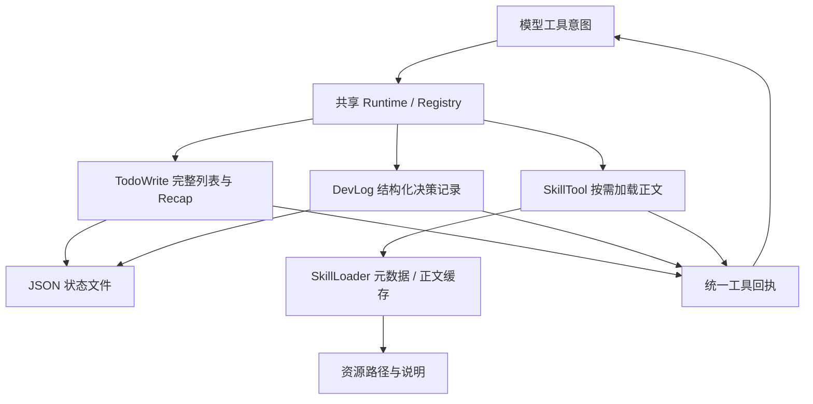

# P10 架构递进：进度、决策与技能知识各自承担什么

固定目标仍为 `V1.0.1 / c597a7ca46ea9969e5b21d9e130549ab69626ff9`。本阶段加入 TodoWrite、DevLog、SkillTool，并保留全部随仓库技能资源。

配套：[设计详解](p10-progressive-explanations.md)、[实现记录](p10-learning-record.md)、[17 个技能资源索引](p10-skill-resource-index.md)。切入点是 Agent 如何记录工作与按需取知识，执行控制仍复用已有 Runtime。

## A1：先拆开三种需求

| 需求 | 组件 | 不应据此推导 |
| --- | --- | --- |
| 当前计划做到哪里 | TodoWrite | 标记 completed 就证明外部业务成功 |
| 为什么做这个选择 | DevLog | 记录决策就自动执行决策 |
| 当前领域需要哪些知识 | SkillLoader/SkillTool | 加载正文就自动执行资源脚本 |

把这些能力塞进运行器会让执行控制与资料格式相互依赖。目标把它们做成普通工具或加载组件，Runtime 只处理已有工具协议。

**现在做什么：**明确状态、记录、知识和真实执行的不同证据，分别选择接口。

**验收：**能定位下一轮由谁决定，而不是把 Todo 或 Skill 当成另一套 Agent 引擎。见[详解 A1](p10-progressive-explanations.md#p10-a1)。

## A2：选择声明式完整列表管理进度

Todo 可以逐项增删，或每次提交完整目标状态。目标采用后者，统一验证内容、status 与最多一个 in_progress，再形成 TodoList、统计和 Recap。

**现在做什么：**创建完整列表→更新完整列表→clear→从保存文件重开；检查最多一个进行中约束和实际磁盘结果。create/update 都是覆盖列表，clear 写入空状态。

**验收：**“最多一个进行中”只是数据约束，不是线程锁，也不会关闭 ReAct 的工具并发。见[详解 A2](p10-progressive-explanations.md#p10-a2)。

## A3：用结构化追加日志保留决策

Todo 当前状态会覆盖，决策记录需要追加及分类查询。目标 DevLogEntry/Store 保存会话身份、时间、category、content、metadata；DevLogTool 提供 append/read/summary/clear。

**现在做什么：**使用源码 CATEGORIES，按类别/标签过滤并生成摘要；以相同 session_id 重建工具验证持久化，clear 后核对磁盘。

**验收：**能区分 Trace 记录实际运行事件与 DevLog 记录调用方主动提交的决策内容；后者不是执行事实审计。见[详解 A3](p10-progressive-explanations.md#p10-a3)。

## A4：把技能知识分层呈现

全部正文放进启动提示会扩大输入；完全不列目录又不便模型选择。目标启动扫描只缓存 name/description/路径，SkillTool 描述列出可用元数据，get_skill 时再缓存正文。

**现在做什么：**观察初始正文缓存为 0，调用一个技能后只有它进入正文缓存；资源仍是可用路径和说明，不作为隐式执行步骤。

**验收：**区分“只缓存元数据”和“磁盘只读取 frontmatter 字节”：当前扫描实际 read_text 全文件，再解析元数据。见[详解 A4](p10-progressive-explanations.md#p10-a4)。

## A5：统一扫描与按需加载的有效性规则

单个坏 YAML 不应使全部技能不可用。目标 safe_load 后要求对象及非空字符串 name/description，错误记录 diagnostics 并隔离；扫描按目录排序，重复名称保留先扫描项。

**现在做什么：**混放合法与非法技能，加载前再改坏正文元数据，最后 reload；核对诊断、名称变化和两层缓存清空。

**验收：**同一规则覆盖扫描与延迟加载，不能启动时允许一个结构、使用时再假设另一个结构。见[详解 A5](p10-progressive-explanations.md#p10-a5)。

## A6：通过工具回执注入正文，不改宿主系统提示

SkillTool 用 args 替换 $ARGUMENTS，将正文和资源提示放进 ToolResponse。下一模型请求通过原生 tool 回执看到知识，而非修改 system_prompt。

**现在做什么：**真实 Runtime 一批加载技能、记录 Todo 和 DevLog，再回到模型；检查宿主系统消息保持、三个 ID 回执完整、资源脚本未执行。

**验收：**知道 SkillTool 的 token_estimate 当前是字符长度；资源 hint 也不是脚本已经运行的证据。见[详解 A6](p10-progressive-explanations.md#p10-a6)。

## A7：按显式装配接入可选能力

P07 已有 Config 与组件覆盖；本阶段接通真实 Skill/TodoWrite/DevLog 注册分支，保留已有同名工具。注入 SkillLoader/SessionStore 即使 Config 关闭，也可实际加载、保存和恢复。

**现在做什么：**恢复 P07 的真实注入集成用例；确认可选功能未开启时不注册，开启后使用真实组件，而非测试替身空方法。

**验收：**剩余 Task 默认装配与父子状态恢复留 P11，当前不把同文件已有工厂当作子代理完成。见[详解 A7](p10-progressive-explanations.md#p10-a7)。

## A8：保留资源并说明外部依赖边界

**现在做什么：**按[资源索引](p10-skill-resource-index.md)比较 17 个目录、元数据名称、正文和脚本/参考入口，逐文件核对 131 个跟踪文件与许可证；按需读取全部正文，核对无诊断。

**验收：**进度/日志重开可读、clear 与磁盘一致；坏技能隔离；正文按需加载；资源不会因加载而执行。资源中的独立依赖、外部 API 和脚本兼容性不等于框架核心依赖验收。

下一阶段 P11 使用相同模型与工具能力构造隔离子会话，明确隔离目录映射与共享外部副作用的区别。
