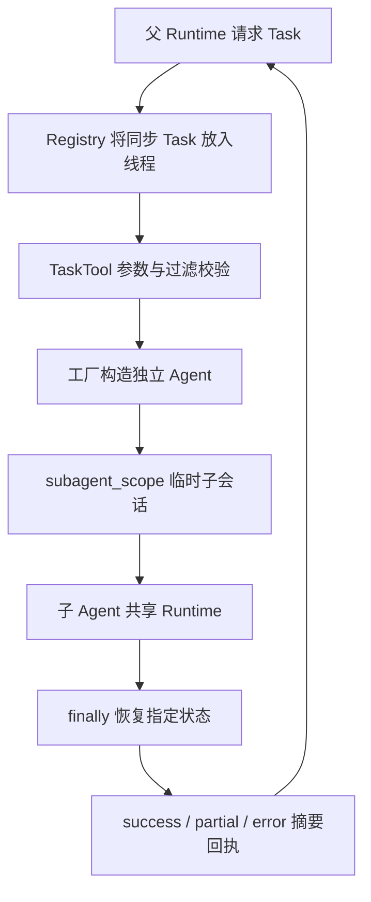

# P11 架构递进：子任务隔离哪些状态，仍共享哪些能力

固定目标仍为 `V1.0.1 / c597a7ca46ea9969e5b21d9e130549ab69626ff9`。本阶段接通 Task、工具过滤与 subagent_scope，补齐 P07 的真实默认装配和父子状态恢复。

配套：[设计详解](p11-progressive-explanations.md)、[实现记录](p11-learning-record.md)。切入点是控制权、对象所有权和恢复边界，不把“子代理”默认理解成进程或机器隔离。

## A1：先决定子任务的隔离目标

候选方案是共享父历史直接递归调用、给子任务新建 Agent，或临时切换空闲 Agent 的会话状态。目标 Task 默认工厂创建独立对象，再通过 run_as_subagent/subagent_scope 提供临时会话；空闲 Agent 也可显式复用。

**现在做什么：**区分任务输入、历史、工具名称、工具实例、模型、外部文件和父结果，逐项决定是否复制或共享。

**验收：**能说明子任务全量交互为何不应直接合入父历史，而应由 Task 回执返回摘要。见[详解 A1](p11-progressive-explanations.md#p11-a1)。

## A2：用名称过滤限制可见工具

ReadOnly 是允许列表，FullAccess 是排除特定危险名称的禁止列表，CustomFilter 支持两种模式。它们统一处理 Registry 名称，包含对象和函数工具。

**现在做什么：**只读列表包括证据回读，不包括记忆修改；核对函数 Write 也被移除。过滤通过 fork 生成新映射，不从父目录直接 unregister。

**验收：**名称筛选不等于代码效果分析或操作系统沙箱；FullAccess 也不能按字面理解为绝对全部权限。见[详解 A2](p11-progressive-explanations.md#p11-a2)。

## A3：工厂负责依赖与默认递归控制

默认工厂复制 Config，关闭子代理递归和自动保存，先 fork 并排除 Task/Skill/TodoWrite/DevLog，传播模型和步数。子 Agent 仍走已有构造装配。

**现在做什么：**核对 max_steps/max_tool_iterations 和模型身份；明确后续构造仍继承其他可选开关，所以 Skill/TodoWrite/DevLog 可能重新注册，初始排除不等于最终一律禁止。

**验收：**能沿“复制配置→初始过滤→构造装配→运行过滤”区分每个控制点。见[详解 A3](p11-progressive-explanations.md#p11-a3)。

## A4：在修改父状态前校验，再用作用域恢复

临时切换状态很容易因异常漏恢复。目标先检查活动标记、步数和过滤器，准备 fork/metadata，再保存指定状态、清空子历史、暂时禁用 session_store，finally 恢复。

**现在做什么：**验证正常、模型失败、KeyboardInterrupt、摘要/元数据后处理失败都走恢复；父自动保存不被子任务覆盖，原结果/计数/配置身份保持。

**验收：**知道这是 _STATE 明确列出的恢复范围，不是任意属性、所有策略局部字段与外部资源的完整快照。见[详解 A4](p11-progressive-explanations.md#p11-a4)。

## A5：把 Task 参数错误挡在工厂前

工厂可能创建目录、组件和客户端，因此不能先创建再检查未知策略。TaskTool 先校验任务、类型、max_steps 和 tool_filter，再创建子对象。

**现在做什么：**用空任务、错误类型、非法步数和未知过滤策略验证工厂调用次数为 0；真实未完成状态返回 partial，执行异常与参数错误使用不同错误码。

**验收：**success 来自实际 completed（兼容无 last_run 的旧自定义 Agent），不能仅凭子任务返回了一段文字认定成功。见[详解 A5](p11-progressive-explanations.md#p11-a5)。

## A6：明确模型与调用线程的所有权

父异步 Runtime 通过 Registry 在线程中执行同步 Task；子同步入口在该线程建立自己的事件循环。它不是在父事件循环里嵌套 run_until_complete。

**现在做什么：**真实父→Task→子 Read→子答案→Task 摘要→父答案；分别开启/关闭 subagent_use_light_llm，验证完整注入模型是否实际选中。宿主模型不随本次子任务被关闭。

**验收：**模型共享是对象身份/资源问题，历史隔离是会话问题；P18 才接通共享预算准入和计量。见[详解 A6](p11-progressive-explanations.md#p11-a6)。

## A7：实际执行共享工具，检查隔离边界

fork 复制名称映射并深复制读取缓存，但工具对象、Policy、breaker 仍共享。工具自身状态、客户端和外部文件修改不会被作用域回滚。

**现在做什么：**在真实 ReadTool 上保留注入的父 Registry 引用，子任务执行读取；观察子缓存字典独立，但共享 ReadTool 仍能经反向引用回写父缓存。这是当前实现实际边界，不能宣称所有读取缓存写入都隔离。

**验收：**能区分复制一个容器与复制整个对象依赖图，并据此判断副作用和缓存可能流向哪里。见[详解 A7](p11-progressive-explanations.md#p11-a7)。

## A8：恢复完整原始组合测试

**现在做什么：**运行完整 subagent_mechanism、tool_filter、agent_state_boundaries、agent_components、runtime_contract，补真实嵌套 Task 与模型开关/装配边界。

**验收：**父状态在异常收尾后恢复；父历史只出现 Task 往返；函数过滤有效；共享工具身份和外部副作用明确；P07 两项待验组合全部补齐。

下一阶段 P12 将远端 MCP 工具桥接到相同 Registry，沿用这里的名称和连接所有权边界。
