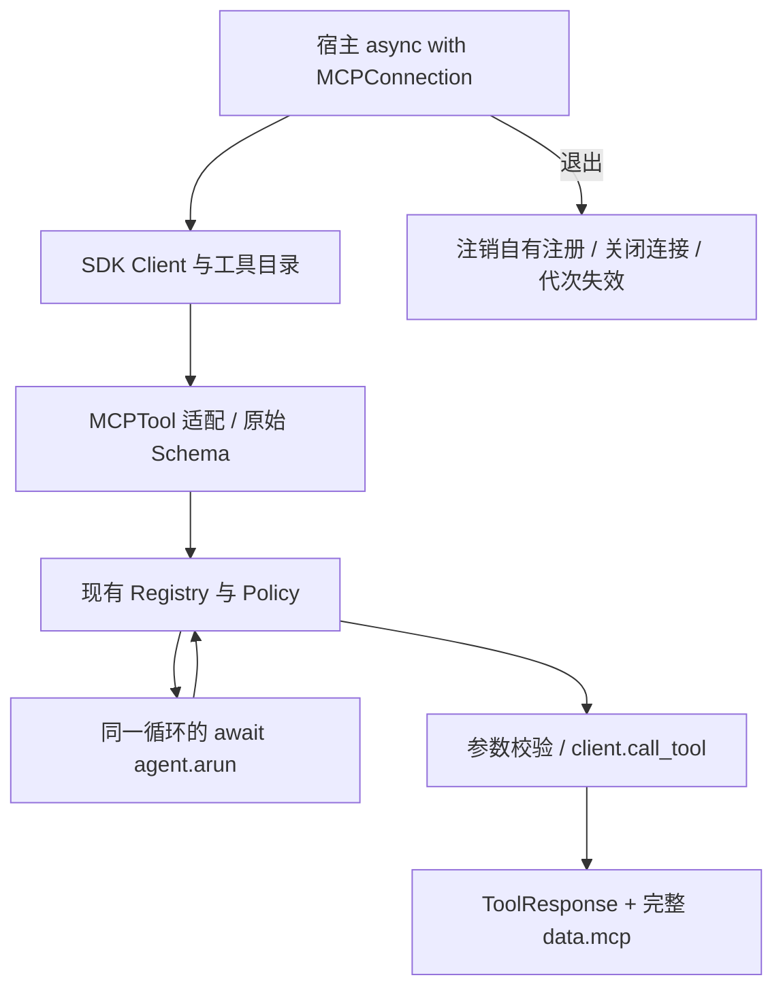

# P12 架构递进：远端 MCP 工具如何进入本地执行契约

固定目标仍为 `V1.0.1 / c597a7ca46ea9969e5b21d9e130549ab69626ff9`。本阶段通过官方 MCP SDK 连接真实 stdio/Streamable HTTP 服务，让远端工具使用已有 Registry、Policy 和回执。

配套：[设计详解](p12-progressive-explanations.md)、[实现记录](p12-learning-record.md)。切入点是协议适配和连接所有权，避免把网络客户端混进 Runtime。



<a id="p12-a1"></a>
## A1：选择桥接层，不复制执行器

候选方案是手写 MCP 握手/传输、让上层 SDK Runner 接管工具循环，或用官方 SDK 管连接、框架只适配工具。目标采用第三种：MCPConnection 管生命周期和目录，MCPTool 适配为 Tool。

**现在做什么：**保留现有 Registry/Policy/Runtime，只在远端协议边界转换 Schema、调用与结果；桥接默认导出工具，resources/prompts 仍由 SDK client 访问。

**验收：**能说明 MCP 提供工具传输，并不自动接管本地 Agent 的下一轮决策。见[详解 A1](p12-progressive-explanations.md#p12-a1)。

<a id="p12-a2"></a>
## A2：把连接放在明确异步作用域

连接是有生命周期的资源，不能像纯函数随处调用。目标在 async with 内启动/连接 Client，记录当前事件循环，关闭后工具不可用；同步 run 明确拒绝。

**现在做什么：**在同一循环内连接、注册并 await agent.arun；验证跨线程新事件循环调用被拒绝。Task 的同步子运行会创建另一循环，不能直接借用当前 MCP 连接。

**验收：**知道四入口共用执行语义不代表每种底层资源都支持全部入口；连接由宿主关闭。见[详解 A2](p12-progressive-explanations.md#p12-a2)。

<a id="p12-a3"></a>
## A3：完整协商目录，再决定可见名称

远端工具可能分页、重名或缺少指定允许项。目标遍历目录，拒绝重复 cursor、重复名称、允许列表缺项；prefix 与远端名称组成模型可见名字，限制字符和总长度。

**现在做什么：**把目录准入放在调用之前；协商失败关闭 Client，不留下可用连接。注册前批量检查与本地目录撞名，要求使用不同前缀。

**验收：**能区分远端名称、导出名称与宿主允许列表，不用远端名称直接覆盖本地工具。见[详解 A3](p12-progressive-explanations.md#p12-a3)。

<a id="p12-a4"></a>
## A4：保留嵌套 Schema，在远端调用前校验

扁平化 get_parameters 会丢掉嵌套对象和引用。目标 MCPTool 保留完整 inputSchema，覆写 to_openai_schema，检查 Schema 合法且引用仅限本地片段，再用同一 Schema 校验参数。

**现在做什么：**验证本地 $defs/$ref、嵌套参数和非法类型；外部引用在协商阶段拒绝，参数不匹配时不调用远端。

**验收：**Schema 描述与实际调用前校验来自同一份契约，不因接入 Registry 而退化成空参数表。见[详解 A4](p12-progressive-explanations.md#p12-a4)。

<a id="p12-a5"></a>
## A5：文本只是回执的一部分

MCP 结果可含文本、多模态块、structuredContent 和 isError。目标将文本块拼成可读 text，同时完整保存 model_dump 到 data.mcp；远端 isError 转为统一 EXECUTION_ERROR。

**现在做什么：**检查真实服务结构化结果，另用协议替身验证图像块和原始内容保持；Policy 拒绝在调用前发生，超时不自动重试未知写入。

**验收：**不把“能显示一段文字”当作全部远端结果，也不把超时当作远端操作必定未发生。见[详解 A5](p12-progressive-explanations.md#p12-a5)。

<a id="p12-a6"></a>
## A6：退出只清理仍由连接拥有的注册

工具进入 Registry 后，宿主可能替换同名定义。退出时盲目按名字 unregister 会删掉宿主新工具。目标记录 registry/tool 对，只有当前对象仍是自己时才注销。

**现在做什么：**连接内替换工具为本地函数，退出后确认保留；fork 不拥有连接，退出时其旧名字可能还在，但不应继续使用连接。

**验收：**能按对象身份解释清理责任，而非只按字符串名称判断所有权。见[详解 A6](p12-progressive-explanations.md#p12-a6)。

<a id="p12-a7"></a>
## A7：用代次令牌防止旧工具复活

同一个连接对象可以重新进入；只检查 client 非空会让旧 fork 中的工具跟随新连接意外恢复。目标每次进入创建新 generation，MCPTool 记住创建时令牌，调用时同时检查连接、循环和代次。

**现在做什么：**连接→fork→关闭→修改允许集合后重连，验证旧工具拒绝且没有远端请求。退出不需要遍历所有可能存在的 fork 才能失效。

**验收：**知道名称存在、连接重新打开与旧能力仍有效是不同条件。见[详解 A7](p12-progressive-explanations.md#p12-a7)。

<a id="p12-a8"></a>
## A8：用真实传输加失败协议完成验收

**现在做什么：**运行实际本地 stdio 子进程、随机回环 HTTP 服务和 Agent 示例；再检查目录失败关闭、嵌套 Schema、多模态内容、跨循环、代次、Policy 和不重试。

**验收：**四个原始 MCP 集成场景实际运行，没有因缺 SDK 而 skip；连接退出注销正确，示例真实工具回执包含 fixture 来源。

```bash
.venv/bin/python -m pip install -r requirements/p12.txt
.venv/bin/python -m examples.tools.mcp_agent_demo
```

默认脚本模型、真实本地 MCP 工具。下一阶段 P13 建立可版本化、可回读原文的基础 RAG 资料库。
