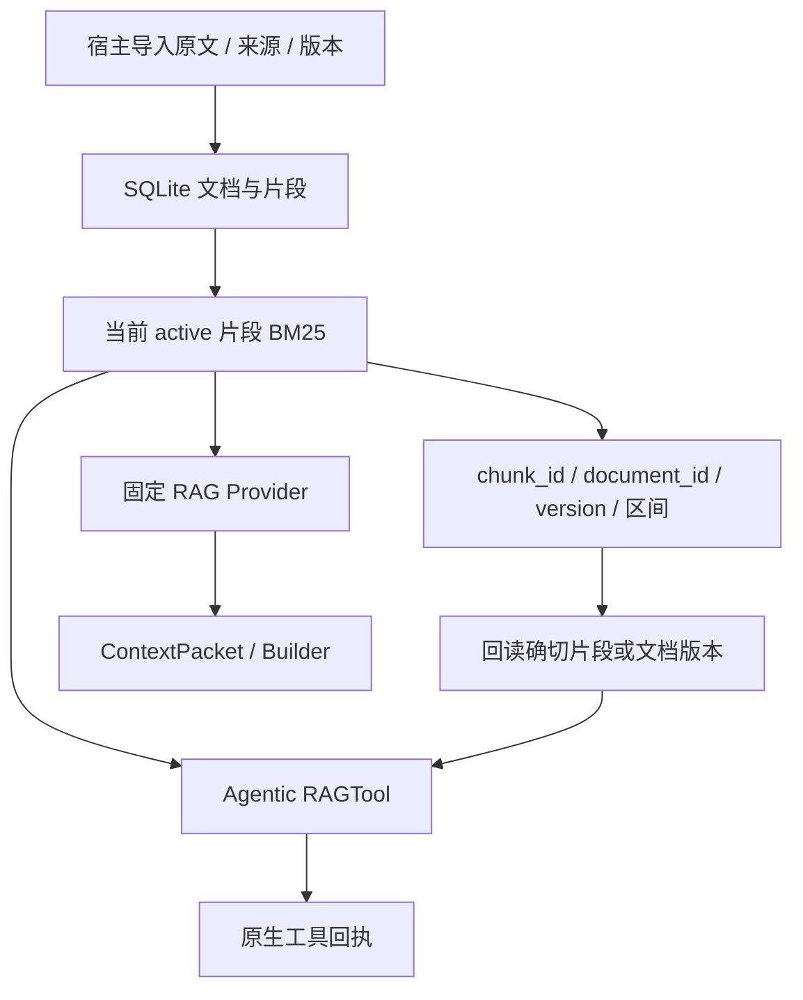

# P13 架构递进：先建立可核对的证据库，再增加检索模型

固定目标仍为 `V1.0.1 / c597a7ca46ea9969e5b21d9e130549ab69626ff9`。本阶段实现 SQLite 原文/片段存储、版本和 BM25，并通过 RAGTool/Provider 接入已有上下文与运行器。

配套：[设计详解](p13-progressive-explanations.md)、[实现记录](p13-learning-record.md)。切入点是检索结果能否回到确切原文，而不是先选择向量服务。

## A1：先明确证据存储与检索的不同职责

只存向量或片段文本会丢掉版本和完整原文；每次临时拼资料又无法稳定回读。目标先建立权威 SQLite 资料库，检索只返回带身份的证据结果。

**现在做什么：**定义文档、版本、来源、片段 ID 和 [start,end) 区间；约定检索返回当前资料，回读可访问旧证据。

**验收：**能解释为什么“召回一段相关文字”不足以证明它来自当前版本或确切原文。见[详解 A1](p13-progressive-explanations.md#p13-a1)。

## A2：选择简单可重开的持久化实现

内存对象容易起步但不能跨进程恢复；长寿命共享连接要协调线程；目标每次操作创建/关闭 SQLite 连接，在事务里读写，并用 guard_schema 拒绝不认识的版本。

**现在做什么：**建立 documents/chunks/metadata 表，验证重新创建 Store、真实新进程回读和不支持 :memory: 的约定。导入参数在改数据前验证。

**验收：**错误切片参数不写入资料；未知 Schema 版本不能继续使用；当前不需要外部数据库服务。见[详解 A2](p13-progressive-explanations.md#p13-a2)。

## A3：把版本不可变与当前激活状态分开

同 document_id/version 的来源和内容不可变；重复相同导入幂等，新版本作为当前 active。新旧由导入动作决定，不比较版本字符串大小。

**现在做什么：**导入 v10→v2，确认 v2 成为当前；重复导入旧版不重新激活，也不改变 revision。namespace 标识资料库，revision 标识当前检索集合变化。

**验收：**知道 namespace、文档版本、资料库 revision 是三种不同身份，后续向量索引不能只看其中一个。见[详解 A3](p13-progressive-explanations.md#p13-a3)。

## A4：用稳定区间形成可回读片段

按 Token、句子或字符切片都有取舍。目标按 Python 字符 chunk_size/overlap，保存原文空白，ID 由文档、版本、起止位置稳定生成。

**现在做什么：**用中文、emoji、空白和换行导入，检查原文[start:end] 与片段完全一致；同版本重复导入不能通过改变切片参数重建旧证据。

**验收：**字符偏移不是 UTF-8 字节偏移；旧 chunk_id 在新版本导入后仍能回读原来的文本。见[详解 A4](p13-progressive-explanations.md#p13-a4)。

## A5：先选择无模型依赖的 BM25

| 方案 | 当前取舍 |
| --- | --- |
| 简单包含/词项过滤 | 容易验证，但缺少词频与长度排序 |
| 本地扫描 BM25 | 目标选择；确定性、无额外服务，适合小型资料库 |
| 独立全文/向量索引 | 可进一步扩展，但仍依赖本阶段证据身份与版本 |

**现在做什么：**使用现有中英文 lexical_terms，对当前片段计算 BM25；无词项重叠返回空，按 score 降序和 chunk_id 升序稳定排序。

**验收：**没有向量也能完成 RAG；当前是词项检索，不能把分数解释为语义置信度。见[详解 A5](p13-progressive-explanations.md#p13-a5)。

## A6：读当前资料与审计旧证据使用不同入口

search 只看 active；read_chunk 按固定 ID 读确切版本；read_document 省略 version 读当前，指定 version 不跳新版。RAGTool 的全文回读要求显式版本。

**现在做什么：**替换/撤下文档后检查搜索不返回旧资料，但旧片段和显式旧文档仍可读；snapshot 在一致读事务里取 revision 与当前片段。

**验收：**撤下不是物理删除，也不是允许回读接口静默重定向到新版本。见[详解 A6](p13-progressive-explanations.md#p13-a6)。

## A7：让固定 RAG 与 Agentic RAG 共用证据契约

固定 Provider 每次模型请求自动检索；Agentic RAG 由模型选择 rag_search/rag_read/rag_read_document。两者使用相同 Store 和来源版本字段，导入由宿主负责。

**现在做什么：**实际工具往返保留来源、版本、ID；通过 RetrievalContextProvider 和可替换 Assembler 组装输入，不把存储代码放进 Agent。

**验收：**新增检索后端只需满足 SearchBackend，权威原文仍由 Store 回读；P14 再验证重排和向量索引。见[详解 A7](p13-progressive-explanations.md#p13-a7)。

## A8：用版本变化和进程重开完成验收

**现在做什么：**联合检查原文偏移、重复/非法导入、active 替换、revision/snapshot、旧证据回读、Schema 拒绝、新进程、工具和 Provider 真实路径。

**验收：**检索命中可精确回读；当前集合变化可检测；失败不留下业务记录。下一阶段 P14 增加向量与重排，同时继续以 SQLite 证据为准。
