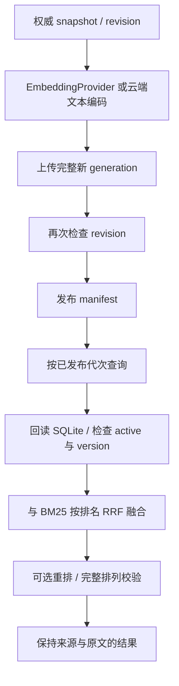

# P14 架构递进：可重建索引、混合召回与证据不变的重排

固定目标仍为 `V1.0.1 / c597a7ca46ea9969e5b21d9e130549ab69626ff9`。P13 的 SQLite 是权威证据；P14 增加可替换向量编码/索引、排名融合和重排，不改变原文身份。

配套：[设计详解](p14-progressive-explanations.md)、[实现记录](p14-learning-record.md)。切入点是“索引会过期、构建会失败、召回分数不统一”，不是先把向量库当成唯一数据源。

## A1：分离权威资料与可重建索引

只用向量库保存文本会把索引更新与证据生命周期耦合。目标保留 SQLite 作为原文与版本权威，Qdrant 保存可重建索引；命中后还要回查证据。

**现在做什么：**明确 namespace/version/revision/model_id/generation 各自表达的身份，不能把“某向量点还存在”当作当前资料有效。

**验收：**资料更新、撤下或原文缺失时拒绝旧索引，旧证据仍按 P13 规则回读。见[详解 A1](p14-progressive-explanations.md#p14-a1)。

## A2：让向量编码独立于对话模型

目标 EmbeddingProvider 区分文档与查询入口，并提供 model_id/dimension。OpenAI 兼容实现按响应 index 重排并校验缺/重复索引；FastEmbed 延迟初始化，区分 passage/query 编码。

**现在做什么：**编码结果写入前检查数量、维度、有限数值与非零向量；配置/预处理变化必须改变身份。CloudInference 是把文本交给云端编码的配置，不假装本地 Provider。

**验收：**接口可替换不等于模型质量相同；SDK 安装/懒加载检查不等于下载权重后的语义评测。见[详解 A2](p14-progressive-explanations.md#p14-a2)。

## A3：明确连接装配与宿主所有权

path、url、client 必须三选一。目标检查集合是匹配维度的单一余弦向量，manifest 中模型身份也必须匹配；注入 client 不由索引关闭。

**现在做什么：**使用真实本地 Qdrant 重开同一目录，再用共享 client 验证不同 namespace 与关闭所有权；云端配置在网络前检查 HTTPS/key，并建立过滤字段索引。

**验收：**不能以相同维度推断模型空间兼容，不能关闭宿主借入的客户端。见[详解 A3](p14-progressive-explanations.md#p14-a3)。

## A4：先构建新代次，最后切换可见清单

逐条覆盖当前点会让失败上传暴露半成品。目标采用新 generation：一致 snapshot→完整编码/上传→检查 revision→发布 manifest→回收旧代次。

**现在做什么：**注入坏向量、第二批上传失败和编码中资料变化，验证没有发布半品；清理旧代失败仅警告，新清单仍可检索。

**验收：**未发布向量可遗留但不可见；同 revision 不重复编码；实例锁不是跨进程调度或分布式事务。见[详解 A4](p14-progressive-explanations.md#p14-a4)。

## A5：查询时再次验证证据有效

目标先检查清单 revision，再按 namespace/kind/generation/model_id 过滤，逐条回读 SQLite 和当前文档，最后再次检查 revision。

**现在做什么：**插入没有权威 chunk 的向量点、更新/撤下文档，确认 IndexStaleError；显式 sync 后才恢复检索，不静默返回旧结果或无条件退回其他后端。

**验收：**检索结果是当前有效证据，不是向量载荷自称的来源与内容。见[详解 A5](p14-progressive-explanations.md#p14-a5)。

## A6：用排名融合不同量纲的召回

BM25 与余弦分数不能直接当成同一刻度。目标 HybridSearch 使用 RRF，各路第 rank 名贡献 1/(rrf_k+rank)，默认 rrf_k=60。

**现在做什么：**合并相同 ID 的排名贡献，保留一致证据，拒绝同路重复、同 ID 不同内容及检索中 revision 变化。

**验收：**融合扩大已有候选的利用，无法找回所有后端都漏掉的资料；输出 score 是融合分数，不再是原 BM25/余弦值。见[详解 A6](p14-progressive-explanations.md#p14-a6)。

## A7：重排只能返回原候选的完整排列

重排器只负责顺序。RetrievalPipeline 检查原 ID、数量和完整记录都不变；LLMReranker 要求完整整数索引排列，限制输入字符与输出 Token，并拒绝截断结果。

**现在做什么：**验证删候选、重复、改内容/分数、bool 索引、坏排列和截断被拒绝；输入过长在模型调用前失败。

**验收：**模型没有机会借重排伪造证据；额外模型调用的语义质量与框架排列契约分开验证。见[详解 A7](p14-progressive-explanations.md#p14-a7)。

## A8：用显式标注评测，并如实标明模型来源

**现在做什么：**以固定相关性标注核对 Recall@k、MRR@k、分级 nDCG@k，保留逐查询 IDs/延迟。无正相关标注返回 None，不伪装成已评测零分。

**验收：**真实本地 Qdrant、失败发布/过期拒绝、RRF、完整排列和指标共同通过。当前向量是协议夹具，云端是 HTTP 模拟；真实模型权重/账号实验另行运行自带[显式模型示例](../examples/retrieval/qdrant_retrieval_demo.py)。

下一阶段 P15 在相同检索与证据边界上增加作用域记忆、语义召回和结构化画像。
