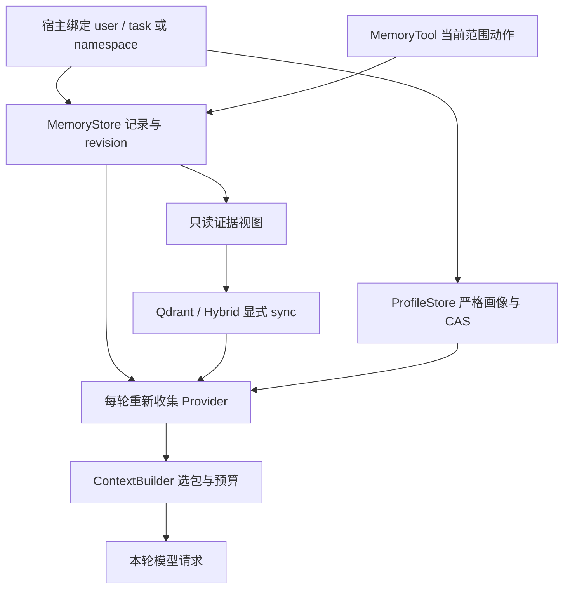

# P15 架构递进：作用域记忆、语义召回与结构化画像

固定目标：`V1.0.1 / c597a7ca46ea9969e5b21d9e130549ab69626ff9`。切入需求：同一用户将“每天步行最多 8 公里”改为“5 公里”，另一用户不能读到它；新会话仍能获得宿主明确保存的偏好。

配套：[设计详解](p15-progressive-explanations.md)、[实现记录](p15-learning-record.md)。先解释每一步的选择，再读对应实现；不要从完整类清单倒推需求。

## A1：先决定哪些状态值得跨轮保存

历史保留对话与工具证据；MemoryRecord 保存带来源、可修订的任务记忆；ProfileSnapshot 保存经严格 Schema 约束的跨会话字段。把三者全塞进 system prompt，会混淆生命周期、作用域和预算。

**现在做什么：**为步行偏好分别说明三者该存什么，确定谁决定保存与授权。框架不自动把全部模型推断认定为事实。

**验收：**能给出 user/task 与 user/namespace 两种范围的使用场景。[详解 A1](p15-progressive-explanations.md#p15-a1)。

## A2：将范围绑定在宿主对象，而非模型参数

每次调用传 user_id 灵活，却让每个调用者承担隔离正确性。目标在 Store 构造时绑定身份，SQL 的 ID 读取、查询和修改也带范围；工具没有切换范围参数。

**现在做什么：**先打通 add→search→Provider 的纵向路径，再用相同数据库、不同用户/任务核对读取和已知 ID 修改都隔离。

**验收：**模型不能借 memory_id 或额外 user_id 参数切换范围。[详解 A2](p15-progressive-explanations.md#p15-a2)。

## A3：用追加修订保留变化依据

覆盖旧文本简单，但会丢掉“为什么从 8 改为 5”。目标在立即事务中将旧条目标记 superseded，并追加有 supersedes 的替代记录；撤回标记 retracted，重复撤回幂等。

**现在做什么：**跟踪 active→superseded 与 active→retracted，确认仅成功状态变化增加当前范围 revision。

**验收：**修订后只召回 5，旧 8 可审计；撤回后不进入新候选，但原记录与已发回执仍保留。[详解 A3](p15-progressive-explanations.md#p15-a3)。

## A4：通过适配器复用索引，而非再建记忆向量系统

_MemoryDocuments 将现有 MemoryStore 暴露为只读资料协议，Memory ID 同时作为文档/片段/版本标识；复用 P14 的 generation、manifest、回读与过期检查。

**现在做什么：**先显式 sync，再修订；非空语义查询必须拒绝旧索引，空查询直接读当前近期有效记忆。后者不是向量召回失败后的静默降级。

**验收：**能解释为何近期读取已看到 5，而非空语义搜索此时返回 CONFLICT。[详解 A4](p15-progressive-explanations.md#p15-a4)。

## A5：给稳定字段独立的严格画像契约

自由文本记忆不适合替代 walking_km:int 等业务约束。目标用 ProfileModel 的严格类型、禁止未知字段、默认值校验与 Schema 身份，把数据验证集中在 Store 写边界。

**现在做什么：**写入合法画像，再尝试字符串数字、bool、未知字段、无效默认值与 Schema 变化；错误不能产生新快照。

**验收：**说明 source 只是来源声明，严格类型校验也不能证明现实真实性。[详解 A5](p15-progressive-explanations.md#p15-a5)。

## A6：用 expected_revision 解决并发覆盖

后写覆盖会让并发修正互相吞掉。目标 put/patch/forget 都在事务中比较 expected_revision；同一旧版本的两个写入只允许一个成功。

**现在做什么：**对 8→5 的 patch 保留未改字段的来源；明确顶层替换与嵌套整体替换，不自行扩展为深合并。

**验收：**冲突后宿主重新读取再决定如何写；不能盲重试旧数据。forget 写入审计墓碑，不擦除历史。[详解 A6](p15-progressive-explanations.md#p15-a6)。

## A7：在每轮请求前读取最新状态

构造时缓存一次上下文会让工具修改后第二轮仍看到 8。目标 Provider 每次调用重新读取，ContextBuilder 负责预算与角色边界；ProfileContextProvider 默认 required，MemoryProvider 的 required 由宿主选择。

**现在做什么：**运行完整 runtime_features 离线示例，观察资料、记忆、工具、会话恢复如何组合；再运行画像重开示例。

**验收：**Provider 不负责写入、索引同步或扩大作用域，required 也不是内容自行授予的权限。[详解 A7](p15-progressive-explanations.md#p15-a7)。

## A8：用隔离、变化与并发验证设计

**现在做什么：**执行当前全测试，覆盖真实 SQLite、真实本地 Qdrant、上下文组合、画像并发、严格 JSON 类型和修订/撤回。向量与模型为明确标注的夹具，不能当作语义质量证明。

**验收讲解：**①三类状态的生命周期如何分工？②修订与非空索引为何分两步？③两个并发 patch 谁应重读？④撤回和 forget 还留下哪些内容？租约中断索引、导出/purge 的版本屏障在 P18 组合验证。[详解 A8](p15-progressive-explanations.md#p15-a8)。

下一步 P16 在 P13 原文上构建带证据的有界关系遍历。
