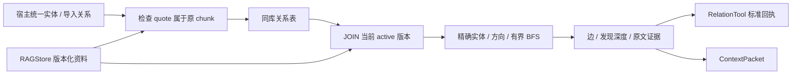

# P16 架构递进：带原文证据的有界关系遍历

固定目标：`V1.0.1 / c597a7ca46ea9969e5b21d9e130549ab69626ff9`。切入需求：已有“杭州馆连接东站、东站连接湖畔步道”的资料，怎样按实体找两跳关联，并逐条回读原文？

配套：[设计详解](p16-progressive-explanations.md)、[实现记录](p16-learning-record.md)。本阶段先实现明确实体与边的查询，再进入 P17 的模型抽取、社区和全局综合。

## A1：先将关系检索与文本检索分工

BM25 回答“哪些原文匹配词项”，关系查询回答“从指定实体沿哪些边能走到关联”。只靠重复关键词检索，难以表达方向、跳数与环。

**现在做什么：**画出三节点链，确定只做显式关系导入与查询，实体统一和语义审核由宿主负责。

**验收：**能说明本阶段不需要新增模型接口或独立图服务。[详解 A1](p16-progressive-explanations.md#p16-a1)。

## A2：让边引用原片段，而非复制另一套事实库

只存 subject/predicate/object 会丢来源；边内复制文本又会产生更新分歧。目标边存 chunk_id 与连续原文 quote，结果回读 P13 的 RetrievalResult。

**现在做什么：**定义关系 ID、三元组、quote、证据与发现 depth；用相同字段重复导入核对幂等。

**验收：**quote 不在指定 chunk 必须拒绝，引用存在不等于三元组语义正确。[详解 A2](p16-progressive-explanations.md#p16-a2)。

## A3：把当前有效性放在查询边界

资料变为版本 2 后，旧边应立即退出当前关系查询。目标查询通过 chunk/document/version JOIN 只选 active 当前版本；历史原文仍可按 P13 回读。

**现在做什么：**先导入 v1 边，再更新原文，观察当前关系为空；新关系须显式重新导入。

**验收：**不能把旧边存在于表中当作当前仍有效，也不能声称更新会自动重抽取。[详解 A3](p16-progressive-explanations.md#p16-a3)。

## A4：用 BFS 获得可解释的发现深度

递归无界扩展会遇到环和爆炸；目标用队列保存节点及深度，用 visited 避免节点重复扩展，用 edges 避免重复返回边。

**现在做什么：**先手算 A→B→C 的 out 两跳，再加入 C→A。队列中深度是节点距离，返回边 depth 是发现节点的深度加一。

**验收：**环终止、边只出现一次；结果是发现的边集合，不是已证明的因果路径。[详解 A4](p16-progressive-explanations.md#p16-a4)。

## A5：用方向和双重上限控制代价

hops 限制扩展深度，limit 限制返回边数。两者不能互相替代：一跳高出度节点也可能返回很多边。目标 hops=1..3，limit=1..100，方向 out/in/both。

**现在做什么：**对同一实体分别执行三种方向；比较 hops=3/limit=1 与 hops=1/limit=20 的意义。

**验收：**精确实体名匹配，不自动模糊合并同名地点；同层按关系 ID 的确定顺序，不称为相关性排序。[详解 A5](p16-progressive-explanations.md#p16-a5)。

## A6：把只读模型入口与关系写入分离

RelationTool 只暴露 relation_lookup，负责参数和 ToolResponse；RelationStore 负责入库约束、有效性和遍历。应用显式注册工具，不让模型自由写未经审核的边。

**现在做什么：**从 ToolRegistry 执行查询，核对标准错误码、count/method 和 evidence.source/version。

**验收：**增加工具入口不需要改 Agent Runtime，也不把 BFS 复制进工具。[详解 A6](p16-progressive-explanations.md#p16-a6)。

## A7：通过现有证据协议接入上下文

RelationResult 可转 ContextPacket，也可转回执中的字典；它保留来源、版本、chunk_id、depth。目标没有额外 RelationContextProvider 类；宿主可在现有包入口组合。

**现在做什么：**回读一条边的 chunk，核对 quote；重开同一数据库，再执行入/出方向查询。

**验收：**证据属于具体版本，相关联不等于因果或现实真实性。[详解 A7](p16-progressive-explanations.md#p16-a7)。

## A8：用链、环、旧版本和坏引用验收

**现在做什么：**运行完整 retrieval_composition 与当前全套测试。原文件还覆盖 P14 的证据不变重排组合，本阶段恢复完整文件，不仅跑关系筛选。

**验收讲解：**①为什么要同库 JOIN？②visited 与 edges 分别防什么？③limit 在哪种图上比 hops 更重要？④有界关系查询与 P17 的全局 GraphRAG 还差哪些能力？[详解 A8](p16-progressive-explanations.md#p16-a8)。
