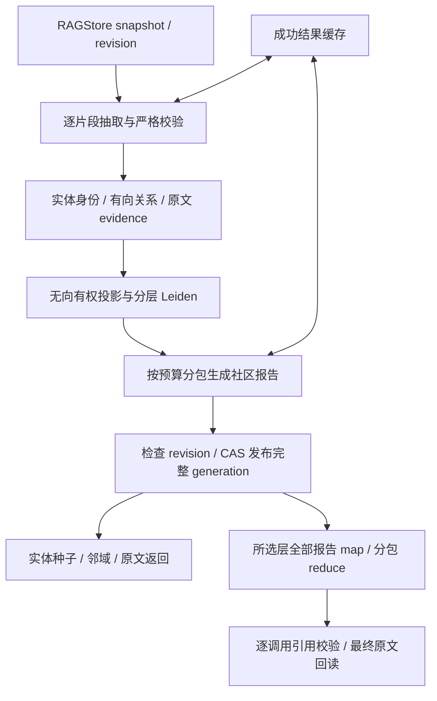

# P17 架构递进：由证据构建图，再用局部与全局两种路径查询

固定目标：`V1.0.1 / c597a7ca46ea9969e5b21d9e130549ab69626ff9`。切入需求：跨多份资料梳理供应依赖与中断，既能追查一个实体，也能综合全部社区材料，并把结论回指原文。

配套：[设计详解](p17-progressive-explanations.md)、[实现记录](p17-learning-record.md)。先完成带证据的一次纵向构建，再增加缓存、竞争发布与全局归约，不从七个文件的源码顺序开始背实现。

## A1：先区分局部追查与全局综合

BM25 找匹配原文，P16 遍历显式边，GraphRAG 则增加模型抽取、实体聚合、社区报告和多调用综合。局部查询不应每次重建整张图，全局查询也不能只取几个热门社区冒充完整处理。

**现在做什么：**将需求分成离线构建、局部查询、全局查询三条流程，标明原文、图索引、模型和工具各自所有者。

**验收：**说明为什么当前需要额外图层，以及多次模型调用带来的成本。[详解 A1](p17-progressive-explanations.md#p17-a1)。

## A2：先固定结构与证据契约，再接模型

模型返回自由文本很难可靠引用。目标定义严格 Extraction/CommunityDraft/AnswerDraft，claim 必须带 evidence IDs，GraphConfig 明确输入、输出、数量、报告和轮数限制。

**现在做什么：**用明确标注的预设模型打通单片段→合法结构→原文引用；HelloAgentsGraphModel 复用通用 invoke，并有稳定的配置/提示词/Schema 身份。

**验收：**格式错误可有限重试，截断/预算不能靠静默补写或裁掉来源修复。[详解 A2](p17-progressive-explanations.md#p17-a2)。

## A3：把模型声明转成经校验的知识结构

Schema 通过还不够：关系端点必须是同片段已声明 key，实体名或 alias 必须逐字出现在 quote，quote 必须是当前原 chunk 的连续原文。

**现在做什么：**按 kind/name/scope 规范化实体身份，聚合有向关系与 evidence；保留别名歧义，不用名字相似度擅自合并。

**验收：**区分局部 key、全局实体 ID、evidence ID；引用偏移能回到完整文档。[详解 A3](p17-progressive-explanations.md#p17-a3)。

## A4：由关系投影构建社区，并保留无实体材料

社区计算使用无向有权投影，关系原方向仍保留。目标调用真实 Leiden，按层级递增 resolution、固定 seed，在父社区内继续划分。

**现在做什么：**先观察一层实体分组，再看父子层级；无实体 chunk 进入 unassigned 报告流，不能因未抽出实体就丢掉。

**验收：**社区是材料组织方式，不是事实类别或因果证明；每层实体归属与无实体材料都可检查。[详解 A4](p17-progressive-explanations.md#p17-a4)。

## A5：缓存成功阶段，最后发布完整图代次

直接更新活跃图会把半成品暴露给查询。目标以不可变 generation 保存完整结果，缓存合法抽取与报告，最后检查资料 revision 并比较 expected_generation 发布。

**现在做什么：**注入第二次抽取失败、构建中资料变化、竞争构建与取消；重试复用成功缓存，失败不切换 active。

**验收：**缓存身份含版本化输入和配置，命中后仍校验；进程内锁不是跨库事务或后台租约。[详解 A5](p17-progressive-explanations.md#p17-a5)。

## A6：局部查询从实体种子扩展到原文

别名直接命中、词项候选、可选语义实体索引共同提供种子；按无向投影扩展邻域，用距离加词项排名提升选择原 chunks。

**现在做什么：**先运行无向量的局部追查，再接真实本地 Qdrant 的预设向量；比较 entities/relations/reports/chunks 与诊断。

**验收：**结果保留证据身份，分数不是概率；seed_limit 并非所有直接别名种子的硬上限。[详解 A6](p17-progressive-explanations.md#p17-a6)。

## A7：全局查询处理所选层的全部报告

每报告 map→按预算分包 reduce→必要时继续归约。每次 claim 只能引用本次输入允许的 evidence IDs，最终回读原文版本与 quote。

**现在做什么：**测试未知引用、空报告/无答案与不收敛归约；观察 answered/answered_partial/no_answer、coverage 和调用诊断。

**验收：**超预算或不收敛明确失败，不删输入冒充完成；coverage.complete 只是处理与来源覆盖，不是语义完整性证明。[详解 A7](p17-progressive-explanations.md#p17-a7)。

## A8：通过只读工具装配，并验证失败路径

**现在做什么：**注册 GraphRAGTool，运行真实 SQLite/Leiden/Qdrant 测试与离线旅行供应链案例。索引构建由宿主操作，global 工具仍可能调用多次模型。

**验收讲解：**①为何局部和全局分开？②为什么合法 JSON 还要证据校验？③失败缓存为何能复用却不能直接发布？④complete 能证明什么？P18 再接真实 JobWorker 与共享模型预算。[详解 A8](p17-progressive-explanations.md#p17-a8)。
