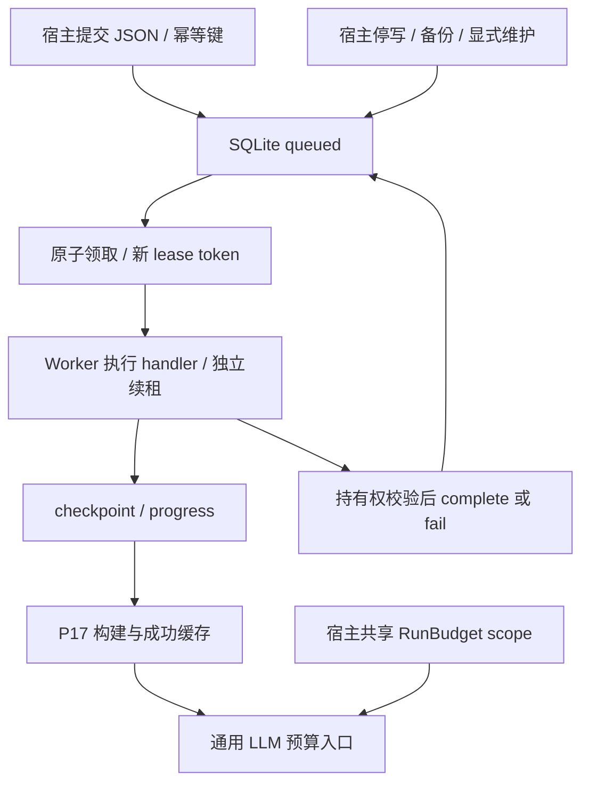

# P18 架构递进：可恢复任务、共享模型预算与数据维护

固定目标：`V1.0.1 / c597a7ca46ea9969e5b21d9e130549ab69626ff9`。切入需求：长索引任务中断后能恢复，迟到的旧执行者不能覆盖队列结果，所有模型路径不能各自绕开总限额，持久数据能够显式备份和维护。

配套：[设计详解](p18-progressive-explanations.md)、[实现记录](p18-learning-record.md)。三项能力分别拥有调度状态、模型准入状态、数据生命周期，不将它们混进 Agent Loop。

## A1：先分清会话恢复与后台任务恢复

SessionStore 保存对话与工具证据，JobQueue 保存待执行工作及尝试状态，GraphStorage 缓存已成功构建阶段。仅保存聊天历史，不能决定哪个进程当前有权处理后台任务。

**现在做什么：**画出 queued/running/succeeded/failed/cancelled 与租约过期重领，选择单机多进程 SQLite 队列。

**验收：**说明恢复需要哪种状态，以及为什么是至少一次投递。[详解 A1](p18-progressive-explanations.md#p18-a1)。

## A2：固定可持久化任务与幂等契约

任务载荷为受限 JSON，处理函数由 worker 的受信任 handlers 注册，不把可执行函数从载荷反序列化。同 namespace/idempotency_key 的 task/payload 相同返回原 Job，不同则 JobConflict。

**现在做什么：**先打通 submit→get→claim→complete，验证输入修改不污染持久快照、不同 namespace 隔离。

**验收：**提交幂等不等于外部工具副作用只发生一次。[详解 A2](p18-progressive-explanations.md#p18-a2)。

## A3：把提交权绑定当前有效租约

领取在立即事务中选择任务、递增 attempts、生成新 token。heartbeat/check/progress/complete/fail 都验证 token、running 与未过期；cancel 撤销持有权。

**现在做什么：**让旧租约过期后由新 worker 重领，再尝试旧 token 续租、写进度与提交结果。

**验收：**旧 owner 被拒绝，最终尝试耗尽不无限重领；可控 clock 验边界，另有真实进程退出实验。[详解 A3](p18-progressive-explanations.md#p18-a3)。

## A4：将续租与执行分离，并约束 worker 并发

异步 handler 直接 await，同步 handler 放到 to_thread；续租独立每 lease_seconds/3 执行，失败不能被当成续租成功。slot 控制并发，stop 后不继续轮询领取，让已有工作完成。

**现在做什么：**验证重试退避、迟到续租、取消和优雅停止；外部操作前 checkpoint，成功小步后保存 progress。

**验收：**取消等待不保证线程停止；外部操作仍要幂等，检查点也不提供跨系统原子提交。[详解 A4](p18-progressive-explanations.md#p18-a4)。

## A5：在模型公共边界共享预算

若主 Agent、摘要、子代理和 GraphRAG 各计数一次限额，会绕开整体成本控制。目标 RunBudget 以线程锁原子 reserve，ContextVar scope 选择本任务预算，LLM 装饰器集中拦截。

**现在做什么：**先验证多个 LLM/线程共享调用准入，再让 GraphRAG 格式修复重试遇到 max_calls=1。

**验收：**重试第二次被拒绝，摘要不能降级绕过 BudgetExceeded；自定义不经该模型入口的客户端不自动受限。[详解 A5](p18-progressive-explanations.md#p18-a5)。

## A6：承认流式统计与时间限制的实际边界

Token 在响应后才知道，已准入并发调用可能超过上限。流中断没有完整 usage 时记 unknown，阻止后续受 Token 限制调用；时间在准入和输出检查，不强杀阻塞 SDK。

**现在做什么：**分别完整消费和提前关闭同步/异步流，核对 usage、unknown 与底层关闭；缺统计不能假设零消耗。

**验收：**解释逻辑调用计数与远端账单的区别，时间起点是预算对象创建时。[详解 A6](p18-progressive-explanations.md#p18-a6)。

## A7：将维护变为显式、有版本屏障的宿主操作

备份使用 SQLite backup，包括已提交 WAL；迁移在事务里执行受信任回调，失败回滚。Memory/Profile 清理比较 revision 并保留版本屏障；Qdrant namespace purge 和 Graph prune 各有范围。

**现在做什么：**先停相关写入并显式备份，再做迁移/清理，验证旧写者不能重建旧画像、其他用户数据仍在。

**验收：**migrate_database 不自动备份；SQL 删除不等于擦除磁盘、日志、备份或全部图资产。[详解 A7](p18-progressive-explanations.md#p18-a7)。

## A8：用真实后台重试接上已有构建器

**现在做什么：**恢复完整 GraphRAG 与语义记忆原测试；用真实 JobWorker 验图构建失败后重试复用成功抽取、索引发布前租约中断保留旧清单。运行后台导入进度示例。

**验收讲解：**①提交幂等、租约与外部幂等各防什么？②为什么过期 worker 不得提交？③预算能否保证账单硬上限？④备份和 purge 各保存/删除什么？完成后进入 P19 全仓与独立发行验收。[详解 A8](p18-progressive-explanations.md#p18-a8)。
