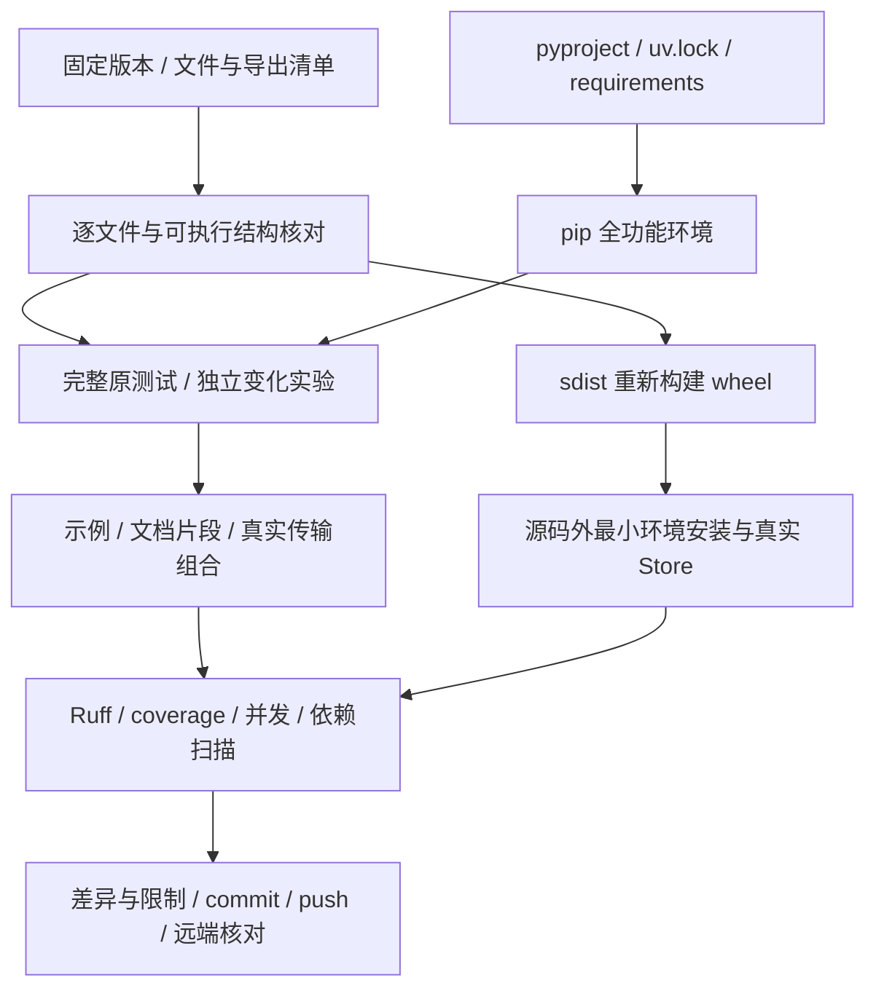

# P19 架构递进：从阶段能力到可安装、可审计的完整框架

固定目标：`V1.0.1 / c597a7ca46ea9969e5b21d9e130549ab69626ff9`。切入需求：前面的能力都能独立工作，现在怎样证明公开接口、组合行为、依赖、资源与发行共同组成完整复刻？

配套：[设计详解](p19-progressive-explanations.md)、[最终记录与差异](p19-learning-record.md)、[总方案](replication-study-plan.md)、[阶段导航](development-progress.md)。P19 的递进是从范围证据到消费证据，不以“当前测试全绿”替代全仓验收。

## A1：先把“完成”变成有限清单

零散目录和累积测试数都可能掩盖遗漏。以固定 Git 对象列出框架、导出、测试、示例、原文档与技能资源，逐项比较当前路径；历史版本用于解释选择，当前 main 快照决定兼容目标。

**现在做什么：**核对 81 个 Python 文件和 py.typed、45 个测试模块加 conftest、42 个 Python 示例及 README/HTML、32 篇原文档、131 个技能资源。

**验收：**注释差异与行为差异分开记录，不能把文件存在当作实现正确。[详解 A1](p19-progressive-explanations.md#p19-a1)。

## A2：收拢公开入口与依赖边界

阶段导出只够当时使用，最终必须恢复全部目标 __init__、版本和 Python 建议信息。核心导入应在没有 MCP/Qdrant/igraph SDK 时仍成立，可选能力在调用边界给出安装提示。

**现在做什么：**核对核心依赖、八个 extras、quality 组、Python 3.12/3.13 范围，以及 uv.lock 到 requirements 的单向导出。

**验收：**安装成功、SDK 构造成功、真实服务可用分别陈述；不将手维护多套依赖当作复现。[详解 A2](p19-progressive-explanations.md#p19-a2)。

## A3：恢复完整原测试，再移除重复提取

早期按阶段抽取避免未来依赖提前进入；最终保留这些提取会重复计数。逐定义 AST 比较后，删除已被完整文件覆盖的 34 份提取，保留新增的独立边界实验。

**现在做什么：**运行全部原文件和保留的实验，检查无 deselected；原 context 测试仅增加临时工作目录隔离，全部原定义不变。

**验收：**测试数量变化有来源，失败不会靠删原断言、扩大 skip 或降低门槛解决。[详解 A3](p19-progressive-explanations.md#p19-a3)。

## A4：将模块验收升级为实际消费路径

单元测试无法证明文档命令、组合案例和真实传输可用。目标逐个在独立目录执行公开离线案例，运行原文档中的可执行片段，并通过真实 MCP/stdIO/HTTP 和 Web 断连检查生命周期。

**现在做什么：**从用户输入追踪 Runtime→模型→工具→Provider→新上下文→会话恢复，再连接资料、记忆、子任务和后台索引。

**验收：**工具回执、原文版本、状态变化与资源关闭都可核对；离线脚本模型不冒充真实推理。[详解 A4](p19-progressive-explanations.md#p19-a4)。

## A5：用变化检查解释高内聚与低耦合

真正的架构理解是能定位需求变化该落在哪个边界：换协议改 Adapter，换召回改 SearchBackend，换策略改 Agent 策略，改存储约束进 Store，外部副作用幂等由宿主处理。

**现在做什么：**任选“增加新模型协议”“撤回偏好”“后台构建重试”三个变化，画出受影响模块与应保持稳定的契约。

**验收：**能给出最小修改范围和失败验证方法；不需要为显示模式知识而加新工厂或重构。[详解 A5](p19-progressive-explanations.md#p19-a5)。

## A6：从实际 sdist 重建 wheel，再在源码外安装

源码根目录和 editable 安装会掩盖缺文件。先 build_sdist，再从解包后的源码 build_wheel，核对所有框架 Python 字节和 py.typed，新环境只装 wheel 及核心依赖。

**现在做什么：**用 -I 在源码目录外导入，并真实执行 RAG/Memory/JobQueue；确认没有可选 SDK 时仍能用基础能力。

**验收：**根 skills 资源没有自动进入目标 wheel，应用须显式提供路径；README、学习文档与许可进入源码分发清单。[详解 A6](p19-progressive-explanations.md#p19-a6)。

## A7：按目标质量门槛保留实际证据

**现在做什么：**执行目标 Ruff 规则、分支 coverage、200 任务/4 进程原并发脚本、固定依赖公告扫描、pip check 和锁/导出检查。

**验收：**coverage 85.16% 超过 82% 门槛；安全扫描本次未发现已知漏洞，不表示未来永久安全。单机 macOS 结果不冒充远程全平台 CI。[详解 A7](p19-progressive-explanations.md#p19-a7)。

## A8：交付可追溯结果，再进行个人理解验收

**现在做什么：**保存最终差异、未验证外部服务和已知目标限制；提交并推送 origin/main，核对远端提交与本地 HEAD。按 P01～P19 的 A1～A8 回看设计，而不是再次通读所有函数。

**闭卷验收：**画出一轮带工具调用的完整状态流；解释历史/记忆/画像/索引/租约各由谁持有、何时失效；为三个需求变化选择方案并说明代价。自动化开发验收已完成，个人理解仍由你的说明验收。[详解 A8](p19-progressive-explanations.md#p19-a8)。
