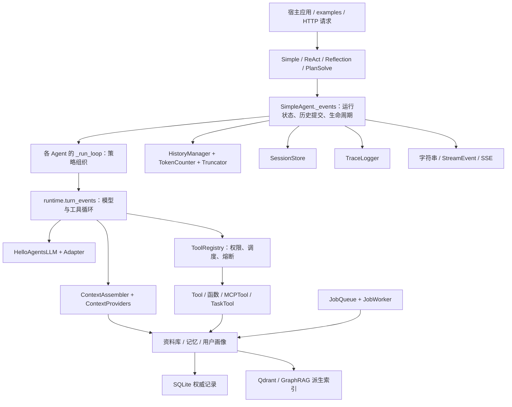
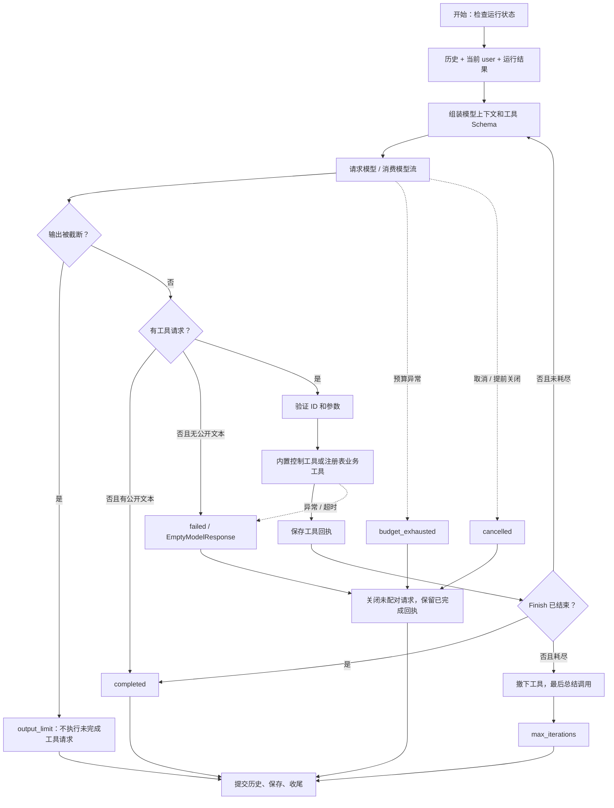
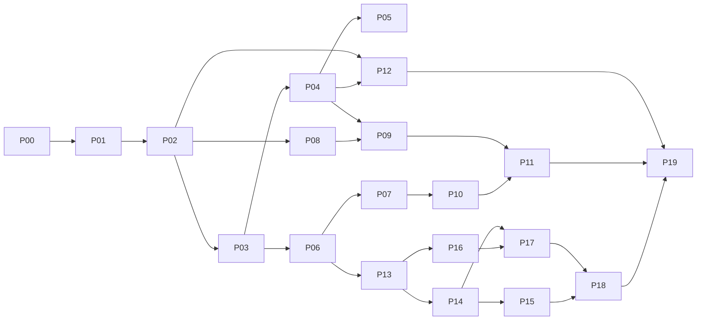

# HelloAgents v1.0.1：从零完整复刻与源码学习方案

> 分析日期：2026-10-14。适用读者：已有 Python 与 Agent 开发经验。
>
> 复刻终点：本仓库 `main` 的 `c597a7ca46ea9969e5b21d9e130549ab69626ff9`，标签 `V1.0.1`。通过历史版本理解演进，最终实现以这个固定快照为准。
>
> 初版为仓库与历史分析方案；2026-10-15 将递进粒度明确为架构决策，以 P01 的需求、方案、契约、职责和实现路径作为样板。各阶段是否已经实现、实测或通过理解验收，以复刻仓库的学习记录为准，不能从文中任务清单推断。

HelloAgents 当前是一个自己控制 Agent Loop 的 Python 组件库：本地 `runtime.turn_events` 决定模型请求、工具执行、消息回写和终止条件；四种 Agent 在这个机制上组织不同的任务策略。检索、记忆、画像、上下文和后台任务可以独立工作，再由宿主显式组合。

完成复刻的路径是：**先重建数据契约和最小工具循环，再补齐执行语义与状态管理，然后实现检索记忆和图索引，最后验证组合、恢复和发行包**。Git 历史用于回答设计为什么变化；阶段划分按当前实现的依赖关系排列。

阅读导航：[终点与基线](#1-学习终点与基线) → [当前架构](#2-当前架构先建立整体认识) → [设计与边界](#3-当前设计的关键取舍与边界) → [Git 演进](#4-git-历史如何转化为学习路线) → [实施路线](#5-实施总路线) → [阶段任务](#6-分阶段复刻任务) → [验证证据](#7-用什么证据证明复刻正确) → [进度清单](#8-学习进度与毕业清单)。附录提供全部源码、测试、资源与提交索引。

## 1. 学习终点与基线

### 1.1 怎样判定“完整复刻”

“完整”采用可检查的标准，避免把能回答一个问题当作框架已经完成：

| 维度 | 必须达到的结果 | 验证方式 |
| --- | --- | --- |
| 包结构 | 保留当前模块职责、公开导出、主要类与函数的位置 | 对照附录 A、`__all__` 和发行包 |
| 接口 | 构造参数、默认值、调用参数、返回类型、错误边界与目标快照一致 | 原仓库契约测试、签名对照 |
| 执行 | 四种 Agent 的四种入口均真实执行工具；完成、超限、失败和取消有区别 | `test_runtime_contract.py` 等 |
| 状态 | 工具原生消息、会话恢复、摘要、读取缓存和子会话隔离保持正确 | 会话、恢复、状态边界测试 |
| 数据 | 来源、版本、作用域、修订、撤回、索引代次与引用能够回读 | 检索、记忆、画像、GraphRAG 测试 |
| 工程 | 锁定安装、最小安装、可选依赖、独立 wheel 和 CI 规则一致 | 依赖、发行、质量检查 |
| 理解 | 能解释每个阶段的控制者、状态所有者、失败路径和设计限制 | 各阶段的“讲解关卡” |

不要求真实模型逐字生成相同答案。时间戳、UUID、耗时、远端模型随机输出也不做逐字比较；应验证它们的格式、身份关联和行为约束。固定输入下的消息、工具参数、存储状态、确定性排序和错误行为，则应与基线一致。

发现目标快照的限制时，先记录其实际行为，并在复刻中保持契约一致。修复缺陷或扩展能力属于另一个任务，不混入复刻验收。已经删除的历史模块用于设计对照，不重新加入 v1.0.1 的公开 API。

### 1.2 本次分析的证据范围

- 本地工作区在分析开始时干净，`HEAD`、`origin/main` 与 `V1.0.1` 指向同一提交；未执行 `fetch`，因此这里描述的是本地已有快照。
- Git 仓库不是浅克隆。本地所有引用共可达 **85 个提交**，其中 **75 个可达当前 HEAD**；13 个版本标签从 `V0.1.1` 到 `V1.0.1`。
- 当前快照有 **360 个 Git 跟踪文件**；`hello_agents/` 包含 **81 个 Python 文件、15,238 行**，另有 `py.typed`。
- `tests/` 有 **45 个测试模块**和 `conftest.py`，静态数到 **442 个 `test_` 函数定义**。这是源码定义数，参数化、跳过与可选依赖会改变实际收集/执行用例数。
- 另有 32 份现有 Markdown 指南、42 个示例 Python 文件、4 个工程脚本、131 个 `skills/` 资源文件。
- 分析依据包括当前实际调用链、公开契约、测试断言、版本间文件变化与关键提交 diff。历史提交索引列出全部本地可达提交；没有把提交标题本身当作行为证据。

固定提交比只写 `main` 更重要。未来仓库更新后，不要在学习中途悄悄改变目标；先完成此快照，再单独比较新版本。

## 2. 当前架构：先建立整体认识

### 2.1 分层与控制权



需要明确的控制边界：

1. **宿主应用**创建模型、注册工具、指定用户/任务身份和组件，管理借入资源的关闭。
2. **Agent 策略层**决定是否反思、如何规划分步，或追加 `Thought` / `Finish`。
3. **`turn_events`**决定每一轮如何发模型请求、如何执行工具、何时停止。SDK 提供模型协议，没有接管框架自己的 Agent Loop。
4. **`ToolRegistry`**处理实际业务工具的执行入口；ReAct 内置 `Thought` / `Finish` 由 Agent 特殊处理，不能把宿主注册表策略误写成覆盖所有内部控制工具。
5. **上下文组件**整理每次模型输入，不执行 Agent Loop，也不负责登录鉴权。
6. **SQLite 与派生索引**分别保存权威记录和可重建查询结构。检索结果必须能够回到对应版本的原文。
7. **后台工作器**是独立任务调度组件，需要宿主注册处理函数和启动；不会由普通 `agent.run()` 自动启动。

主要源码入口：[运行循环](../hello_agents/core/runtime.py)、[SimpleAgent](../hello_agents/agents/simple_agent.py)、[Agent 基类](../hello_agents/core/agent.py)、[组件装配](../hello_agents/core/components.py)。

### 2.2 一次实际请求的全过程

以“模型请求计算器，然后回答预算”为例，先沿真实路径读代码：

1. 宿主创建 `HelloAgentsLLM`、`ToolRegistry`、`CalculatorTool` 和 `SimpleAgent`。默认不启用 Skills、子代理、会话、追踪、待办和决策日志。
2. `run()` 经 `sync_events()` 消费 `_events()`；`arun()` 直接消费同一事件源；两个流式入口也共享 `_events()`。基类 `Agent.arun()` 的线程回退不是这些具体 Agent 的主要入口。
3. `_events()` 防止同一 Agent 实例并发修改历史，创建新的 `RunResult`，读取当前历史并追加本轮 user 消息。
4. `_build_messages()` 优先重放 `Message.metadata['model_message']`，因此上一轮的 `assistant.tool_calls` 和 `tool_call_id` 不会被压成纯字符串。
5. `_run_loop()` 调用共享循环。Simple 直接进入；ReAct 添加内部工具；Reflection 在执行、评审、改进阶段分别调用；PlanSolve 先规划，再逐步调用。
6. `turn_events()` 构建工具 Schema，在每次模型调用前执行 `_prepare_context()`。显式 Providers 此时重新检索/读取状态，Builder 组装最终消息并给出预算诊断。
7. `model_events()` 根据入口和模型能力选择异步调用、原生工具流或线程回退。模型边界使用消息副本，避免下游修改工作消息。
8. 模型返回 `LLMToolResponse`。先检查输出限制，再检查是否需要工具；同一批工具请求 ID 必须非空且唯一。
9. 将完整的 `assistant` 工具请求加入工作消息。业务工具参数必须解析为 JSON 对象，再经类型转换、宿主策略和注册表执行。
10. `ToolResponse.to_model_text()` 保留结构化数据与来源；长输出可能转为带完整输出路径的 `partial` 预览。每个回执通过 `tool_call_id` 对应原请求。
11. 工具结果追加后重新进入模型请求。ReAct 纯业务工具批次可并发；含内置控制工具的批次走串行处理。
12. 收到公开回答或 `Finish` 后结束；达到工具迭代上限时会保留最后一次无工具总结调用，但状态是 `max_iterations`。
13. `_events()` 提交本轮完整交互，按规则压缩/自动保存，再发送完成事件，最终关闭追踪并释放运行标记。
14. 失败、取消或消费者提前关闭时，`finally` 尽量保留已确认回执，并为缺回执请求补充 `execution_status='unknown'`，避免把未知副作用当作可直接重试的失败。



图示展示运行结果类别；并不保证每一种异常都发送完成事件。失败路径可产出 `ERROR` 后继续抛异常，取消则传播取消信号；调用方应同时检查异常和 `last_run`。

### 2.3 模块职责表

| 模块 | 输入与责任 | 输出/状态变化 | 下一步 |
| --- | --- | --- | --- |
| `core/agent.py` | 公共组件、工具 Schema、历史、摘要、会话与子任务辅助 | Agent 长期状态 | 具体 Agent |
| `agents/simple_agent.py` | 四入口适配、工作消息、生命周期和提交 | 字符串/事件、`last_run`、历史 | 策略循环/宿主 |
| `core/runtime.py` | 模型/工具顺序、截止时间和停止规则 | 内部事件、工作消息、运行计数 | 下一模型轮/终止 |
| `core/llm.py` / `llm_adapters.py` | 参数、消息校验、提供商协议、模型资源 | 统一响应、流片段、usage | Runtime |
| `tools/base.py` / `registry.py` | 工具定义、展开、函数约定、权限和执行 | 标准回执、熔断状态 | Runtime |
| `context/*` | 完整历史、候选资料、工具定义和预算 | 模型消息、摘要、截断预览、诊断 | 模型边界 |
| `core/components.py` | Config 默认与显式注入的覆盖语义 | 已解析组件和可选工具 | Agent 初始化 |
| `core/session_store.py` | 历史、配置、Schema 哈希、缓存、元数据 | 原子 JSON 快照 | 新会话恢复 |
| `observability/*` / `streaming.py` | 内部执行事件 | JSONL、HTML、公开事件/SSE | 人/前端 |
| `skills/*` / 内置工作工具 | 技能内容、任务进度、决策记录 | 模型可见知识/持久日志 | 工具回执 |
| `subagent_scope.py` / `TaskTool` | 子任务、过滤器、步数上限 | 隔离子会话、摘要、父状态恢复 | 父工具回执 |
| `tools/mcp.py` | SDK 连接、远端目录与 Schema | 当前连接代次的工具桥接 | Registry |
| `retrieval/*` | 版本化资料、查询、嵌入与排序 | 可回读证据和派生索引 | Provider/Tool |
| `memory/*` | 宿主作用域、记录/画像更新 | 有效记忆、审计历史、修订号 | Provider/Tool |
| `retrieval/graph/*` | 规范资料、结构化抽取、社区与问题 | 图代次、局部证据、带引用回答 | Tool/宿主 |
| `background/*` | 注册处理器和持久任务 | 租约、重试、进度、结果 | 处理组件/宿主 |
| `core/budget.py` / `storage.py` | 共享调用限额和数据库维护请求 | 原子准入、版本检查、备份/事务维护 | 各组件 |

### 2.4 数据与状态的生命周期

| 状态 | 谁创建/拥有 | 谁修改 | 保留与清理规则 |
| --- | --- | --- | --- |
| `Config` 与组件实例 | 宿主、Agent 构造 | 初始化装配 | 组件由宿主管理生命周期；不建立全局容器 |
| `Message` 历史 | `HistoryManager` | 完整提交、摘要、加载、清空 | 跨轮保留；原生消息放 metadata 中 |
| 当前 `messages` | `_events()` | Runtime 和各策略 | 本次运行工作副本，随后提交到历史 |
| Provider 候选与最终上下文 | 每次 `_prepare_context()` | Provider/Assembler | 每次重建，不自动长期保存选出的参考消息 |
| `last_context_diagnostics` | Agent | 最近一次上下文组装 | 诊断用于观察，不是持久记忆 |
| `RunResult` | 每次 `_events()` | Runtime/策略/异常收尾 | 每轮重置，保存本轮答案、状态、usage 与次数 |
| 工具读取元数据缓存 | 注册表 | Read、会话恢复 | fork 复制；工具对象和外部文件仍可能共享 |
| Session JSON | 显式启用/注入的 Store | 保存操作 | 重建对象后恢复；不序列化模型客户端或可调用工具实例 |
| Trace | 显式开启后的 Logger | 运行事件 | 每轮收尾关闭；JSONL 与 HTML 展示规则不同 |
| 资料原文/片段 | RAGStore | 新版本导入、撤下 | 当前检索只读 active；旧片段仍能按 ID 回读 |
| MemoryRecord | 按 user/task 绑定的 Store | add/revise/retract/purge | 修订追加替代记录；撤回保留历史 |
| ProfileSnapshot | 按 user/namespace 绑定的 Store | CAS 写入、forget/purge | 保存修订快照和字段来源；最新有效画像进入上下文 |
| 向量/图代次 | 索引构建器 | 完整构建后发布 | 权威数据变更后失效；失败不发布半代次 |
| 后台 Job/Lease | Queue | claim/heartbeat/complete/fail/cancel | 过期可重领；旧租约不能发布结果 |
| 共享 RunBudget | 宿主 | 模型边界装饰器 | `ContextVar` 作用域内共享；跨进程不自动传播 |

必须分清三个预算：**ContextBuilder 的输入估算预算、Agent 的工具迭代限制、RunBudget 的跨模型调用预算**。它们各自限制不同对象，任何一个都不能代替另外两个。

## 3. 当前设计的关键取舍与边界

这一节既是源码理解重点，也是复刻必须保留的行为边界。

### 3.1 应当复刻的实现细节

1. **单一执行机制。** 四入口共享事件源，四策略复用工具循环。不要为同步、异步、流式各写一套语义不同的循环。
2. **两层消息。** 存储层 `Message.to_dict()` 含时间和 metadata，不能直接当作模型消息。发送模型时使用原生消息结构，尤其要保留工具 ID、请求参数和实际返回的提供商字段。
3. **两种工具注册契约。** `Tool` 接收参数字典；`register_function` 保留单个 `input` 的简化约定。`@tool_action` 才是从方法签名生成多个结构化 action 的另一条路径。
4. **结构化回执。** `ToolResponse` 有 `success/partial/error`；有 data 时序列化完整结构，纯文本保持兼容。来源与部分成功信息不能只剩一个 `str(result)`。
5. **失败不伪装完成。** 最后总结、模型截断、无公开输出、异常和取消分别处理。`run()` 返回文本不等于 `last_run.status == 'completed'`。
6. **整轮历史。** 完整工具交互先提交，再摘要/自动保存。摘要保留最近 N 个 user 边界后的完整轮次；摘要以参考 user 内容重放，不提升为系统指令。
7. **显式组件组合。** 必需组件的 `None` 创建默认实现；可选组件的 `DEFAULT_COMPONENT` 根据 Config 装配，`None` 显式禁用，实例显式替换。
8. **证据与索引分离。** SQLite 保存不可变版本原文；向量只保存指向原文的标识。Qdrant 检索结果必须检查当前权威版本。
9. **身份由宿主绑定。** MemoryTool 不给模型选择 user/task；ProfileStore 由宿主绑定 user/namespace。数据过滤不承担宿主登录鉴权。
10. **引用约束可验证，语义仍有边界。** GraphRAG 能验证引用属于输入、quote 匹配原文，却不能单凭这些检查证明生成论断的语义完全正确。

### 3.2 已实现行为、回退与预留能力

| 位置 | 当前实际行为 | 学习时应验证/避免误读 |
| --- | --- | --- |
| `HelloAgentsLLM` | 显式参数优先；provider 自动识别按解析出的主机名；不自动加载应用 `.env` | 显式 provider 用于代理地址；不要仅看 README 的简化描述 |
| `ainvoke*` | HelloAgentsLLM 的非流式异步方法使用 `asyncio.to_thread` | 异步入口不代表远端 SDK 请求能强制取消 |
| OpenAI 工具流 | 接收文本增量和工具参数碎片，最后产出完整响应 | usage 可能在 `choices=[]` 尾包；私有推理字段不作为公开文本增量输出 |
| 其他适配器工具流 | 基类线程回退产出完整响应，可一次产出全部文本 | 不将其描述为已经实现逐 token 工具流 |
| 文本流回退 | 有界线程队列；取消后停止继续拉取 | 正在阻塞的同步读取仍可能持续到 SDK 超时 |
| 注册表 policy | 同步宿主回调；异常/异步回调返回拒绝 | Prompt 和工具筛选不能代替实际执行授权 |
| 工具参数 | Schema 声明和校验程度依工具路径不同 | `Tool.validate_parameters` 主要检查必填项；不是全局严格 JSON Schema 验证器 |
| 熔断器 | 按工具名统计 error，partial 走非失败分支；open 超时后回 closed | 没有 half-open；不要加入另一套状态机 |
| Config 熔断字段 | 定义配置，但当前 Agent 构造不自动用它们重建 Registry 的熔断器 | 修改策略需显式构造 `CircuitBreaker` 注入注册表 |
| `stream_include_*` | 在 Config 中声明，当前具体 Agent 事件链未消费这两个字段 | 事件过滤由消费方/序列化 helper 处理；不能声称字段已控制整个链路 |
| `ExecutionContext`、`StreamBuffer` | 可独立使用的辅助类型 | 当前运行主状态是工作消息和 RunResult；StreamBuffer 丢旧事件不等于对生产者施加背压 |
| `_execute_tool_call` | 基类保留同步辅助接口 | 当前 Simple/派生 Agent 主循环走 `_aexecute_tool_call` |
| ContextBuilder | 保留基础消息和工具请求/回执，整包加入资料，超预算明确失败 | 不自动裁剪当前任务；摘要与 Builder 是独立机制 |
| 资料“不是指令”说明 | 将外部参考放在 user 层，并在文本中说明用途 | 是消息层级和提示约束，不是完整提示注入防护证明 |
| 文件工具 | 支持绝对路径；mtime 毫秒值可选冲突检测；独占临时文件原子替换 | `project_root` 不是路径沙箱；检查到写入之间也不是全局并发事务 |
| 注册表 fork | 复制名称映射/读取缓存；复用工具对象、宿主 policy 和同一熔断器 | 外部副作用不会回滚；共享对象内部状态需单独理解 |
| 会话一致性 | 比较配置和工具 Schema 并给出提醒 | 不会重新创建旧工具，也不自动迁移应用环境 |
| GraphRAG coverage | 报告处理和原文引用覆盖的计数 | `complete` 不能解释为答案语义绝对完整 |
| JobQueue | 单机多进程、至少一次投递，租约 token 防旧工作者提交 | 提交幂等键不保证外部操作 exactly-once |
| RunBudget | 逻辑调用前计数，token 响应后计量，缺 usage 阻止后续 token 受限调用 | SDK 重试不另计一次；不能承诺远端账单硬上限 |
| SQLite 维护 | 原生 Python 回调、事务回滚、独立备份 | 复刻已有 `storage.py`；无需引入 Flyway |

还有两处适合做源码核查题，不直接当作已经执行验证的缺陷结论：Anthropic/Gemini 的消息转换对多个 system 消息采用最后一个值；Gemini 工具 ID 按毫秒时间生成，同批多请求可能与 Runtime 的 ID 唯一要求发生冲突。先用协议夹具确认具体输入的实际行为，记录为基线差异，不在本任务中修复。

依据：[适配器](../hello_agents/core/llm_adapters.py)、[注册表](../hello_agents/tools/registry.py)、[文件工具](../hello_agents/tools/builtin/file_tools.py)、[上下文](../hello_agents/context/builder.py)、[配置](../hello_agents/core/config.py)、[可靠性指南](reliability-guide.md)。

关键结论可在固定快照直接定位：[循环与终止](https://github.com/jjyaoao/HelloAgents/blob/c597a7ca46ea9969e5b21d9e130549ab69626ff9/hello_agents/core/runtime.py#L178)、[运行提交与收尾](https://github.com/jjyaoao/HelloAgents/blob/c597a7ca46ea9969e5b21d9e130549ab69626ff9/hello_agents/agents/simple_agent.py#L213)、[fork 共享边界](https://github.com/jjyaoao/HelloAgents/blob/c597a7ca46ea9969e5b21d9e130549ab69626ff9/hello_agents/tools/registry.py#L40)、[参考层与预算](https://github.com/jjyaoao/HelloAgents/blob/c597a7ca46ea9969e5b21d9e130549ab69626ff9/hello_agents/context/builder.py#L101)、[绝对文件路径](https://github.com/jjyaoao/HelloAgents/blob/c597a7ca46ea9969e5b21d9e130549ab69626ff9/hello_agents/tools/builtin/file_tools.py#L310)、[旧租约校验](https://github.com/jjyaoao/HelloAgents/blob/c597a7ca46ea9969e5b21d9e130549ab69626ff9/hello_agents/background/queue.py#L226)、[图发布 CAS](https://github.com/jjyaoao/HelloAgents/blob/c597a7ca46ea9969e5b21d9e130549ab69626ff9/hello_agents/retrieval/graph/storage.py#L87)。

## 4. Git 历史如何转化为学习路线

### 4.1 历史不是一套线性教程

```text
早期 LangGraph 包装实验
        ↓
Python 原生组件化教学包（0.1.x）
        ↓
记忆 / RAG / 协议 / 评测 / RL / 上下文的扩展（0.2.x）
        ├── learn_version：保留教程路线并接收自己的修复
        ├── feature-branch-1：评测重做实验，未全部进入当前 HEAD
        ↓
1.0.0：原生 Function Calling、上下文、会话、Skills、子代理
        ↓
模型协议、SDK、流式尾包和序列化修复
        ↓
1.0.1：共享 Runtime、显式组件、检索记忆、图索引、后台任务、工程验收
```

`origin/learn_version` 的两个修复及其合并提交不属于当前 HEAD 的祖先；另有 6 个评测分支提交也不属于 HEAD。不能把 `git log --all` 的相邻两行当作一次连续版本变化。附录 D 标注了可达关系；版本比较必须指定明确的左右提交。

### 4.2 需要精读的历史检查点

下表的功能判断来自文件变化和相关源码/diff；版本标题只用于定位。

| 检查点 | 观察到的变化 | 学习问题 | 对应阶段 |
| --- | --- | --- | --- |
| `78dd9a5` → `0f29e72` → `e86a0dc` | 首次 README 后加入 `HelloAgents/core`；Executor 包装编译后的 LangGraph 应用，状态消息使用 reducer | 真正控制循环的是图引擎还是本地代码？事件观察与执行控制如何区分？ | P00/P03 历史对照 |
| `ce37e07`、`55b0c05` | 建立小写 `hello_agents` 包；后者补四范式、文档、配置，并删除早期大写目录 | 从图包装转向原生 API，需要自己承担哪些状态与工具循环职责？ | P01～P05 |
| `28e38ac` / `V0.1.1` | 增加 `async_executor.py`、`chain.py`；Simple 仍主要是对话，ReAct 解析文本动作 | 工具链/异步执行器为何不等价于完整 Agent Runtime？ | P02/P04 历史对照 |
| `0cbd4d2`、`de9cf50` / `V0.2.0` | 加入早期记忆/RAG，随后改存储组织，引入 Qdrant/Neo4j 路线 | 旧 MemoryManager/记忆类型与当前版本化 MemoryStore 解决的问题是否相同？ | P13～P17 |
| `91688c2` / `V0.2.1` | 加入 protocols 下 MCP/A2A/ANP 与协议工具 | 通信协议与实际任务协作的边界在哪里？ | P11/P12 历史对照 |
| `3ddf1b6`、`a963601` / `V0.2.2` | 前者主要版本/MCP Server；后者才加入评测目录和工具 | 为什么不能从“update V0.2.2”标题推断全部实现？ | P19 历史对照 |
| `9a1af1b` / `V0.2.3` | 当前比较下仅版本声明变化 | 哪些标签是行为变化，哪些只是发布标记？ | P00 |
| `de67ddb` / `V0.2.4` | Simple 的工具枚举修正，ReAct 增加 MCP 展开处理 | 接口层应统一展开还是每种 Agent 自行处理？ | P02/P12 |
| `65bebf2` / `V0.2.5` | 新增 rl 数据、奖励、训练器和工具 | 框架运行时与模型训练支持为何应区分？ | P19 历史对照 |
| `9dd9bd5`、`1031dd8`、`9490ed3` | 前者加入 Note/Terminal；后两者加入/修正 ContextBuilder | 笔记、文件、记忆、上下文分别拥有哪种状态？ | P06/P08/P15 |
| `4d8dfdd`、`b30646a`、`707949e` | FunctionCallAgent、ToolAwareAgent 与搜索工具演进，随后发布 0.2.8 | 文本动作解析和原生工具消息的失败面有何差异？ | P03/P05 |
| `c116f80` | 调整 ReAct 提示中的 Thought/Action 格式，适配正则 | 给输出加 Markdown 如何影响文本协议？ | P03 历史实验 |
| `80212f7`、`45f8eed`、`ad2f72c`、`6749914` | Qdrant 依赖与旧工具/Builder 修复，随后发布 0.2.9 | SDK 版本、工具入口与调用者契约如何一起验收？ | P12/P14/P19 |
| `9ff239a` / `V1.0.0` | 删除旧 protocols、evaluation、rl、旧 memory 与部分工具；加入适配器、工具响应、会话、Skills、Task、文件和追踪 | 这是结构替换；为何不能把历史全部模块一起拼回当前版本？ | P01～P12 |
| `8ac7202` | 引入/调整结构化模型响应及各 Agent 对返回结果的使用 | 从字符串变成响应对象，哪些调用点必须一起迁移？ | P01/P03 |
| `5a19188` | ReAct 把错误的 `tc.function.*` 访问改成统一 `ToolCall.name/arguments` | SDK 原始对象和框架 DTO 混用会造成什么错误？ | P01/P04 |
| `1d4bfa2` | Gemini SDK 从旧接口迁往 `google.genai` | 适配器需要吸收哪些 SDK 改动？ | P01/P04 |
| `52b2597` | 处理流式 choices 缺失、Anthropic/Gemini 工具 Schema/历史转换及 Pydantic v2 序列化 | 为什么单轮能调用工具还不足以证明多轮协议正确？ | P01/P04/P09 |
| `854f179`、`6a3e8fd` | learn_version 独立修复 Simple 工具消息组织和旧 Builder→MemoryTool 调用方式 | 旧分支修复能解释契约问题，但是否能直接套用到 main？ | P03/P06/P15 对照 |
| `1650f26`、`c597a7c` / `V1.0.1` | 特性提交改变 219 个路径，新增共享 runtime/components/retrieval/memory/background 等，再合并发布 | 大提交必须按能力拆成学习阶段；合并提交与特性提交不要重复算作两次独立新增 | P03～P19 |

`V0.2.6`、`V0.2.7`、`V0.2.8` 的标签处不一定就是能力最初写入的位置。应同时看相邻提交和 diff。附录 D 覆盖小修复、文档提交与未合入分支，避免遗漏或误判。

### 4.3 固定的 Git 阅读方法

以下命令在参考仓库执行，只读，不切分支、不影响工作区：

```bash
git rev-parse HEAD
git log --graph --all --decorate --oneline
git log --reverse --first-parent --format='%h %ad %s' --date=short
git show --stat 9ff239a
git diff V0.2.9 V1.0.0 -- hello_agents
git show 5a19188 -- hello_agents/agents/react_agent.py
git show 52b2597 -- hello_agents/core/llm_adapters.py
git diff 93e77ea 1650f26 -- hello_agents/core/runtime.py hello_agents/agents/simple_agent.py
git show V0.1.1:hello_agents/agents/react_agent.py
git log --follow -- hello_agents/core/llm_adapters.py
```

每次阅读留下五项记录：**原行为 → 具体触发问题 → diff 改了什么 → 当前如何实现 → 哪个断言证明它**。`git blame` 用于定位历史来源，不凭作者/标题猜测动机。没有证据的设计动机明确写成自己的推断。

历史深读顺序：早期包装实验 → 0.1.1 四范式 → 0.2.9 能力堆叠 → 1.0.0 替换 → 三类协议修复 → 1.0.1 最终组合。历史小实验留在学习仓库的实验区，不成为最终包依赖。

## 5. 实施总路线

### 5.1 里程碑

没有固定每周投入时间，因此按完成关卡推进，不设置未经确认的日历期限。

| 里程碑 | 阶段 | 完成后能做到 |
| --- | --- | --- |
| M1：最小闭环 | P00～P03 | 从空目录实现模型→工具→回执→回答，能解释协议 |
| M2：执行与上下文 | P04～P07 | 四入口、四策略、取消与历史、显式组件组合一致 |
| M3：工程与协作 | P08～P12 | 文件、会话、追踪、Skills、子代理和 MCP 可用 |
| M4：知识与记忆 | P13～P17 | 版本化 RAG、向量/混合检索、画像记忆、关系与 GraphRAG 可用 |
| M5：恢复与发行 | P18～P19 | 后台任务、共享预算、完整组合与发行验收完成 |



主执行顺序就是 P00 到 P19。图中多条边表示先修能力，不要求使用多个代理或并行施工。

### 5.2 每阶段统一工作法：按架构决策递进

每阶段先整理“怎样完成这一整项需求”的设计路径，实际带学以一个架构决策为单位。重点是需求边界、候选方案、职责、契约、依赖、装配和变化影响。语言机制与函数实现按需用于验证设计，不再把阶段拆成大量语法/字段反例作为主线。

#### 5.2.1 从需求到实现的八步

1. **明确调用方与能力边界。** 从一次完整业务协作切入，说明本阶段向谁提供什么能力、由谁决定下一步、责任在哪里结束。
2. **比较整体方案。** 列出当前可行的组织方式，按需求、变化范围、实现和依赖成本选择。说明条件变化时为何可能改选，不把目标实现描述成唯一正确架构。
3. **定义边界契约。** 决定跨模块交换什么数据、身份如何关联、错误如何表达、状态归谁所有；先确定语义，再定位具体数据类。
4. **分配职责和依赖。** 按变化原因确定哪些工作放在一起、调用方必须知道什么、具体实现在哪里选择。模式用于说明解决办法，准确区分模式名称与源码实际结构。
5. **实现最小纵向闭环。** 先让一条请求穿过各责任边界并返回可观察结果，用真实组装逻辑和可替换外部依赖验证分层；再扩展同一闭环。
6. **加入变化，验证扩展方式。** 用新增协议、存储或策略等与本阶段有关的变化，检查差异是否留在预期位置；共同职责稳定后再抽取，不因表面代码相似过度泛化。
7. **补齐装配和生命周期。** 明确配置来源、实例作用域、借用与关闭责任、同步/异步等能力承诺；区分已接通、回退与预留能力。
8. **审查修改影响并验收。** 用变化场景核对哪些模块应该改变，按架构边界组织测试，最后对照固定快照、历史与原始断言。

每步的最小产物是：**当前问题 → 候选方案 → 选择依据与代价 → 职责/依赖变化 → 现在要做的工作 → 验证方式**。不要求每一步都新建类、拆文件或独立写一份设计文档。

#### 5.2.2 如何讲清模式、高内聚和低耦合

先说明实际问题，再说明模式如何组织协作。例如统一使用入口对应 Facade，外部协议转换对应 Adapter，创建选择可以使用简单工厂；不先列模式名再强行套入实现。源码没有提供的插件、依赖注入或严格分层能力，不因为理论上理想就写成已经实现。

高内聚用“围绕什么责任一起变化”解释；低耦合用“一个变化需要传播到哪里”解释。不能只用类小、文件多、接口多或修改行数少来判断。公共契约演进需要生产者/消费者联动，这类有理由的依赖也应准确描述。

每节至少讨论一种合理替代方案，以及当前选择的成本和剩余耦合。复刻保持目标代码结构，架构分析不自动授权重构、拆文件、改公开接口或替换依赖。

#### 5.2.3 实践与历史如何支撑架构决策

选择能检验责任边界的场景：替换一个 SDK、增加一种协议、跨调用复用资源、工具结果进入下一次请求、修改会话策略等。追踪变化由哪个模块承接，调用方是否被迫了解不应知道的细节。

测试按公共入口、适配/存储边界、组合场景和真实外部能力分层。模拟器应替代外部依赖，保留被验证的组装与转换路径；恒定成功的整体替身不能证明内部架构已经工作。

历史 diff 用于核对接口怎样变化、职责是否迁移和消费者是否同步更新。明确区分真实历史、教学方案比较、当前限制与未验证能力；不依据提交标题猜测作者动机或事故经过。学习设计顺序可以不同于 Git 时间顺序。

局部语法、复制策略、字段兼容、锁等，只在影响契约、状态所有权或生命周期时深入，不将这些问题重新扩成阶段主线。

#### 5.2.4 文档与带学的粒度

正文负责设计推进与施工顺序，配套详解负责方案选择、模式和限制。一次带学推进一项架构决策：先解释背景和候选方案，再讨论选择、模块关系、实施任务与验证，最后按需用源码核对。已有完整源码保留作为证据，不要求删除重写。

P01 样板：[架构递进正文](p01-progressive-guide.md)与[设计决策详解](p01-progressive-explanations.md)，按 A1～A8 组织。链接按当前参考与复刻仓库为同级目录编写。P02～P19 在进入对应阶段时再按同样方式细化。

阶段末分别记录实现证据与架构理解：前者是契约检查结果，后者是需求说明、方案选择、职责/依赖图、状态所有权和变化影响分析。测试通过不自动替代理解验收。

阶段按能力切片，必要地基在第一次被调用前实现。例如 P03 先提供历史基本操作、计数和截断所需路径，P06 再完成压缩与预算边界。每轮明确已实现和待实现范围，不能用始终返回成功的 stub 替代尚未实现的能力。共享机制保持一份实现，历史原型与最终兼容代码标明用途。

学习记录可使用：

```markdown
# Pxx 架构学习记录
- 当前架构决策与调用方需求：
- 本阶段边界、先修能力与固定参考提交：
- 候选方案及选择标准：
- 当前选择、成本与剩余耦合：
- 职责划分、调用/创建关系和数据契约：
- 状态/资源所有者与生命周期：
- 本轮最小纵向闭环和实施任务：
- 变化场景与预计修改范围：
- 源码、历史和原始测试依据：
- 实现检查结果与未验证范围：
- 架构理解验收：
```

### 5.3 参考仓库与复刻仓库的边界

参考仓库负责查源码、历史和验收契约；复刻仓库从空包实现。使用两个独立 Python 环境，避免原包让未完成的复刻“假通过”。本次不创建新仓库、不切分支；这些是开始学习时的准备动作。

在参考仓库使用目标快照已有锁文件；初期安装基础运行依赖和 test extra，学到相应模块才增加功能 extra。安装命令见 [安装指南](installation.md)。例如，在参考环境中：

```bash
uv --version
python --version
uv sync --locked --extra test
uv run --locked --extra test python -m pytest tests/test_tool_response_protocol.py
```

目标声明 Python `>=3.12,<3.14`，推荐 3.13；uv 声明 `>=0.12.23,<0.13`。锁文件版本来自目标快照，不在学习中自动升级它们。若本机版本不满足，先配置符合目标的解释器/uv，再安装。

后期把目标快照的测试、测试使用的文档/示例夹具逐项放入复刻仓库的对应位置，并保留原断言。多份测试通过 `__file__` 定位仓库根，直接从参考仓库路径运行可能读到参考源码/示例，不适合作为最终复刻证明。

每次验证先从复刻仓库根目录执行：

```bash
python -c "import hello_agents; print(hello_agents.__file__)"
python -m pytest tests/test_runtime_contract.py
```

检查打印路径确实属于复刻仓库。P19 再通过独立安装 wheel 验证，消除源码目录和 editable 安装掩盖的问题。

## 6. 分阶段复刻任务

下面的源码路径均指参考快照。阶段测试命令在复刻环境执行；普通 `python` 命令须使用已激活的复刻虚拟环境，或用带对应 extras 的 `uv run --locked` 包裹。如果整份测试的顶层导入依赖尚未实现的后续模块，先提取本阶段的原始断言及必要 fixture 做阶段验证，记录来源，后续再跑完整原文件；不要用空实现让测试假通过，也不要削弱原始断言。

### P00：建立可重复的学习基线

**先修：**已有 Python 与 Agent 经验。**目标：**能确定正在学习/验证哪个版本，理解包的实际边界。

阅读顺序：[README](../README.md) → [pyproject](../pyproject.toml) → [安装指南](installation.md) → [示例索引](../examples/README.md) → [测试 fixture](../tests/conftest.py) → 本文第 4 节历史检查点。

实施步骤：

1. 记录目标 SHA、13 个标签、main/learn_version/实验分支的可达关系。
2. 在自己的独立学习目录建立空复刻包；采用目标的模块路径和公开名称，先只建立当前要实现的部分。
3. 建立参考与复刻两个环境，确认 Python/uv 满足目标约束。依赖声明、锁定值与可选 extra 分别阅读，不把所有功能都塞入核心依赖。
4. 阅读 `conftest.py`：默认真实模型测试被跳过，普通测试阻止外部网络，loopback 可用于本地 MCP/HTTP 实验。
5. 先在参考环境运行离线 `examples.agents.runtime_features`，保存输出、工具消息配对和各状态的解释。此例在后续阶段反复作为综合对照。
6. 对早期 LangGraph Executor 只做控制权分析：编译图执行，本地包装读取结果/观察事件。不要把旧依赖加入最终复刻包。

参考命令：

```bash
uv run --locked --extra test python -X utf8 -m examples.agents.runtime_features --workspace workspace/reference-runtime
git rev-list --count HEAD
git rev-list --count --all
```

**验收：**固定 SHA 与实际 import 路径有记录；能画出第 2 节架构，分清历史对照和最终范围。**讲解关卡：**“为什么我的目标不是把 0.2.9 所有模块都重新加回 1.0.1？”

### P01：消息、模型响应与三种适配器

**先修：**P00。**目标：**建立 Agent 后续使用的统一模型契约。

**实际学习入口：**从配套[架构递进正文](p01-progressive-guide.md)的 A1 开始，按需求边界→方案比较→契约→职责/模式→纵向实现→多协议扩展→装配/生命周期→变化验证推进；对应[设计决策详解](p01-progressive-explanations.md)解释取舍。下面的源码与实施清单用于落地核对，既有 48 项阶段检查属于实现证据，架构理解另行验收。

阅读顺序：`core/exceptions.py` → `message.py` → `config.py` → `llm_response.py` → `llm.py` → `llm_adapters.py`。配套：[LLM 消息指南](llm-message-guide.md)。历史精读：`8ac7202`、`1d4bfa2`、`52b2597`。

实施步骤：

1. 实现 `Message`、`Config`、`ToolCall`、`LLMResponse`、`LLMToolResponse`、`StreamStats`，保持字段顺序和序列化兼容，特别是响应 DTO 的位置参数兼容。
2. 区分消息存储格式与模型输入字典；对非法容器、外部 `HumanMessage` 对象、空 role 在发送前报错，但保留合法提供商附加字段。
3. 实现 LLM 配置优先级、构造默认 kwargs 与单次覆盖、保留字段冲突检查、有限正 timeout；`.env` 由应用显式加载。
4. 先实现 OpenAI 非流式消息/工具调用，再实现 Anthropic 与 Gemini 的消息、工具 Schema、tool_choice 和回执转换。
5. Anthropic 的 assistant 请求转换成 `tool_use`，tool 回执转换成 user 的 `tool_result`；Gemini 建立 ID→工具名映射，再生成 function response。禁止把原始 SDK 对象泄漏给 Agent 层。
6. 实现主机名检测、显式 provider/别名优先、客户端延迟创建、资源关闭及关闭后拒绝使用。宿主传入 LLM 的关闭由宿主负责。
7. 建立无网络的 SDK 响应夹具，记录发送字段、返回字段、usage 明细。流式完整实现放在 P04，共享预算装饰器在 P18 补齐。

对照测试：`test_llm_message_contract.py`、`test_llm_function_calling.py`、`test_usage_details.py`、`test_pydantic_v2_serialization.py` 中当前已实现路径；`test_public_hardening.py` 的 provider、kwargs、timeout、关闭、客户端初始化相关断言。

**验收：**三种协议的一轮工具请求→回执→下一轮模型消息都能用夹具回放；OpenAI 路径保留已报告的嵌套/提供商 usage，Anthropic/Gemini 记录当前基本计数映射与信息差异；输入不被修改，重复关闭可用。未安装的 Anthropic/Gemini SDK 测试记为未完成验证，P19 必须补齐。

**讲解关卡：**“统一 DTO 为什么要与提供商 SDK 对象分离？同一次工具往返在三种协议中分别长什么样？”

### P02：工具定义、Schema、注册、权限与熔断

**先修：**P01 数据契约。**目标：**模型提出操作后，有一致、可观察的执行边界。

阅读顺序：`tools/response.py`、`errors.py` → `base.py` → `builtin/calculator.py` → `permissions.py` → `circuit_breaker.py` → `registry.py`。配套：[工具响应](tool-response-protocol.md)、[自定义工具](custom_tools_guide.md)、[执行策略](tool-policy-guide.md)、[熔断](circuit-breaker-guide.md)。

实施步骤：

1. 实现三种回执状态及 dict/JSON/model text 转换，保持 data/error/stats/context，明确 `partial` 的可用但不完整语义。
2. 实现 `ToolParameter` 和工具完整 Schema：显式 json_schema 深复制保留，array 的默认 items、required、重复参数和不可序列化值检查按原代码处理。
3. 实现普通 Tool、单 input 函数注册、`@tool_action` 自动展开三条路径。展开使用 Pydantic TypeAdapter 保留嵌套类型和引用；不要把对象/数组改成字符串。
4. 注册前先验证全部展开项，撞名默认拒绝；显式 `replace=True` 支持跨 Tool/函数替换。失败不能留下部分注册结果。
5. `fork()` 复制工具名称和函数映射、独立读取缓存，复用实际工具对象、宿主 policy 和同一熔断器；子表的服务失败可影响父表同名工具。
6. 统一同步/异步执行；原生 async Tool/action/function 真正 await，普通同步函数移到线程。同步执行不能悄悄把 awaitable 当成功文本。
7. 宿主 policy 在执行前检查参数副本；policy 故障拒绝，拒绝不触发实际工具、不累计服务熔断失败。
8. 实现每工具 closed/open 状态；error 累计失败，非 error 清零，超时恢复。计算器采用 AST 允许节点，拒绝任意调用/非数值常量。

最小验证：

```bash
python -m pytest tests/test_tool_response_protocol.py tests/test_custom_tools.py tests/test_circuit_breaker.py
python -m pytest tests/test_tool_contract_fixes.py -k 'schema or registry or action or function or calculator'
```

**验收：**同步/异步执行得到等价回执，错误/权限拒绝时没有副作用；嵌套 Schema 不被改写；重复注册和展开失败具有确定行为。只读筛选与子代理在 P11 集成，权限全链路在 P19 再验收。

**讲解关卡：**“工具对模型可见、名称被筛选、执行被 policy 允许，三者分别在哪里生效？”

### P03：原生 Function Calling 最小闭环

**先修：**P01、P02。**目标：**得到可以独立解释和运行的 SimpleAgent。

阅读顺序：`Agent.__init__`、`_build_tool_schemas`、`_convert_parameter_types` → `SimpleAgent._build_messages`、`_aexecute_tool_call` → `runtime.model_events`、`turn_events`、`RunResult` → `SimpleAgent._events`、`_commit_messages`。

实施步骤：

1. 按最终结构建立一份异步内部事件循环，最初先消费非流式结果；同步接口通过桥接消费它，后续 P04 扩展而非复制循环。
2. 使用脚本模型返回：第一次 `ToolCall('c1', 'calculator', 参数 JSON)`，第二次公开答案。校验并保存完整 assistant 请求和对应 tool 回执。
3. 工具参数解析成对象；坏 JSON、非对象或参数错误成为可见观察。重复/空请求 ID 在实际工具执行前失败。
4. 区分没有工具的单次模型调用与有工具的迭代。达到最大工具轮数后撤下工具，允许最后总结，状态保持 `max_iterations`。
5. 对 finish_reason 截断先处理，禁止执行可能不完整的工具请求；无文本也无工具时抛 `EmptyModelResponse`。
6. 添加两轮对话，第二轮必须重放上一轮的原生工具请求/结果，而不只重放最终答案。
7. 明确区分“工具执行失败的回执”和“模型/运行循环异常”。前者可能交给模型继续决定，后者不能变成空字符串成功。

历史实验：用 `V0.1.1` 的 ReAct 正则和 `c116f80` 的 diff，对纯 `Thought:` 与 Markdown `**Thought:**` 样本比较解析结果。仅用一个小夹具体会文本协议脆弱性，不加入最终 Agent。

对照测试：`test_runtime_contract.py` 的消息配对、重放、输出限制、空响应、迭代上限；`test_all_agents.py` 的模型异常传播；`test_recovery_edges.py` 的工具 ID/参数路径。

**验收：**同一夹具下，模型调用次数、工具执行次数、工作消息序列和最后状态与原版一致。**讲解关卡：**不用源码画出一次工具往返的完整消息列表；解释迭代上限为何仍可能多一次模型调用。

### P04：四入口、生命周期、真正流式与取消

**先修：**P03。**目标：**调用方式改变时，执行和恢复语义保持一致。

阅读顺序：`core/lifecycle.py`、`streaming.py` → `runtime.sync_events`、`deadline`、`model_events` → `SimpleAgent` 四入口与 `_events` → `OpenAIAdapter.astream_invoke_with_tools` 和 BaseAdapter 回退。配套：[异步](async-agent-guide.md)、[SSE](streaming-sse-guide.md)。

实施步骤：

1. 接通 `run/arun/stream_run/arun_stream`。`stream_run` 输出公开文本，`arun_stream` 输出类型化事件；两者的输出形式不同，但业务操作一致。
2. 实现模型流碎片汇总：按工具 index 拼接 name/arguments，保存调用 ID，最后才交给工具调度。处理没有 choices 的 usage 尾包。
3. 区分原生 OpenAI 工具流、完整响应回退、有界文本线程流；不能因为方法名字含 stream 就伪造逐 token 行为。
4. 保留实际返回的私有推理字段到原生历史/下一模型请求；公开文本片段不直接输出这些字段。Reflection 的阶段 THINKING 事件另行解释。
5. 实现模型/工具时限、生命周期钩子独立超时、生成器 `aclose` 和 SDK 流关闭。模型读取时限不把用户慢消费片段的时间误算进去。
6. 防止同一 Agent 并发运行；已经运行的事件循环中拒绝同步桥接，提示使用 async 接口。
7. 在每个边界取消：模型调用中、工具中、工具成功后、完成事件处。保存已有回执，对没有回执的请求补 unknown；finally 恢复 `_run_active`。
8. 读 SSE 的 `event:`、JSON `data:`、双换行边界；以分块输入验证前端不会假设一个网络块就是一个事件。

```bash
python -m pytest tests/test_async_lifecycle.py tests/test_llm_streaming.py tests/test_llm_message_contract.py tests/test_usage_details.py
python -m pytest tests/test_runtime_contract.py tests/test_recovery_edges.py -k 'stream or timeout or cancellation or deadline or entry_points or duplicate_tool'
```

**验收：**四入口同一个任务只执行一次相同写入；提前关闭释放上游流和运行标记，下一轮可用；取消后已完成回执还在，未知操作不会被标成已确认失败。同步线程的副作用可能晚到，应能清楚说明此边界。

**讲解关卡：**“取消 await 为什么不能证明线程里的写入没发生？SSE 消费停止如何传播到 SDK 流？”

### P05：ReAct、Reflection、PlanSolve 与工厂

**先修：**P04。**目标：**策略可变，执行契约保持统一。

阅读顺序：`agents/react_agent.py` → `reflection_agent.py` → `plan_solve_agent.py` → `factory.py`。配套：[Function Calling 架构](function-calling-architecture.md)、[运行指南](runtime-guide.md)。

实施步骤：

1. ReAct 追加 `Thought/Finish` Schema；验证用户工具不能撞内部名称，Finish 必须非空；同批 Finish 后其余操作不得继续执行。
2. 仅纯业务工具批次并发；按 semaphore 限制并发，失败取消等待任务，成功兄弟任务的回执保留。含控制工具时走串行路径。
3. Reflection 先 execution，再 reflection，再 refinement；每阶段复用 `turn_events`。每次新任务重置短期 `Memory.records`，不能与长期 MemoryStore 混淆。
4. 验证 `max_iterations=0`、中途非 completed、中文/英文无需改进触发，以及最终返回最近 execution，而非评审文字。
5. Planner 用 `generate_plan` 提交结构化 steps。默认 tool_choice 是 auto，并严格验证恰好正确规划调用、非空字符串列表、未截断。
6. PlanSolve 将完整计划、已完成步骤和当前步骤放入执行提示；规划不继承业务工具的强制选择参数。逐步保留执行器和调用方系统消息以及工具轨迹。
7. 单独 Executor 借用注册表、不注册额外工具；步骤未完成不能假装整计划完成。工厂传播当前参数，默认子代理工厂细节在 P11 继续。

```bash
python -m pytest tests/test_runtime_contract.py -k 'entry_points or react or planner or factory'
python -m pytest tests/test_recovery_edges.py -k 'parallel or plan or between_plan_steps'
```

**验收：**四 Agent × 四入口的共同契约通过；ReAct 同批内置控制不会与业务写入无序并发；坏计划在任何业务执行前失败；反思与规划的 usage/状态可追踪。

**讲解关卡：**“哪些行为属于策略，哪些必须由共享 Runtime 保证？ReAct 内置 Thought 与模型私有推理字段有什么不同？”

### P06：历史、计数、摘要、截断与上下文组装

**先修：**P03～P05。**目标：**明确长期历史与单次模型输入的区别。

阅读顺序：`context/history.py` → `token_counter.py`、`truncator.py` → `types.py`、`text.py` → `builder.py`、`providers.py` → `Agent` 压缩方法 → `SimpleAgent._prepare_context`。配套：[上下文指南](context-engineering-guide.md)。

实施步骤：

1. 实现 user 边界轮次检测、完整轮保留、摘要追加；历史读取为浅列表副本，理解 Message 对象不是深复制。
2. TokenCounter 计入原生工具字段；实现缓存/清空和压缩后重新计数。区分此计数器与 Builder 使用的 cl100k/字符回退估算。
3. Truncator 同时遵守行数和 UTF-8 字节上限，保留 head/tail/head_tail，按需落完整输出文件；不能按字符切坏 UTF-8。
4. 简单摘要保存统计，不声称保留全部事实；智能摘要只处理保留边界之前的历史，额外调用完整 LLM。普通摘要故障回退统计摘要，预算耗尽后不能降级绕过限额。
5. Builder 保留基础消息，加入工具 Schema 计数，required 包优先；其他包按词项相关度、MMR 多样性和整包预算选择，并记录排除原因。
6. 外部资料作为 user 参考插入当前任务之前，不拆开 assistant-tool 配对；必需内容超过预算抛 `ContextBudgetExceeded`，不能静默丢掉任务。
7. 每次模型请求重新调用 Provider；工具撤回记忆后，下一次请求不能还用旧快照。给了 packets/providers 却未配置 Builder 时明确报错。
8. 写下三个预算的计算位置、单位和触发后果。`ContextPacket.relevance_score` 不代表 Builder 会直接使用这个值；以实际词项选择代码为准。

```bash
python -m pytest tests/test_context_engineering.py tests/test_smart_summary.py tests/test_context_pipeline.py
```

**验收：**保留轮次不拆工具消息；原文预览不超字节预算，完整输出可回读；required 超限明确失败，工具 Schema 有计数，参考资料保留来源和版本。

**讲解关卡：**“历史已经超大但还未到压缩轮次，Builder 会怎么做？一句参考资料中的‘系统指令’会获得 system 权限吗？”

### P07：显式组件装配与最小默认行为

**先修：**P06。**目标：**按当前架构可替换组件，默认构造没有隐藏功能开启。

阅读顺序：`core/components.py` → `Agent.__init__` → 四 Agent 构造 → `Config` → `test_agent_components.py`。配套：[组件组合](component-composition-guide.md)。

实施步骤：

1. 实现 History/Counter/Truncator/Session/Skill 的最小 Protocol 与 `AgentComponents`。
2. 严格实现可选组件三态：DEFAULT_COMPONENT、None、实例；显式实例可以覆盖关闭的 Config，None 可以覆盖开启的 Config。
3. 在创建默认目录前校验注入组件方法及 `min_retain_rounds`；验证失败不留下 session/skills 目录副作用。
4. 透传四种 Agent 的 components；注入的现存历史不被初始化清空，计数与保留策略从实际组件取得。
5. 独立摘要/子代理模型需要注入完整实例，禁止只替模型名而错误沿用密钥和地址。资源生命周期保持宿主拥有。
6. 可选工具只按明确 Config 注册，已有同名工具不重复注册。真实 Session/Skill/Task 工具实现到后续阶段再接通对应分支。

```bash
python -m pytest tests/test_agent_components.py
python -m pytest tests/test_tool_policy.py -k default_agent
```

**验收：**默认 SimpleAgent 不自动添加工具、追踪和会话；注入三个基本组件可以真实接管运行；可选组件三态全部有证据。

基于真实 SessionStore 和 SkillLoader 的集成断言分别在 P09、P10 实现后补跑；本阶段先验证已有基本组件及可选组件的注入/禁用协议，不提前宣称全部真实存储集成通过。

**讲解关卡：**“为什么 None 与未提供可选组件不是同一含义？谁应当关闭传入组件和模型？”

### P08：文件工具与精确副作用

**先修：**P02、P04。**目标：**能解释并复刻读、写、单次编辑、批量编辑的原子性与限制。

阅读顺序：`builtin/file_tools.py` 的 `_atomic_write`/`_backup_file` → Read → Write → Edit → MultiEdit → 注册表读取缓存。配套：[文件工具指南](file_tools.md)。

实施步骤：

1. Read 支持目录与文件、offset/limit，返回内容和 mtime 毫秒/字节大小，按注册表参数建立读取缓存。
2. 对存在目标的 Write/Edit/MultiEdit，在提供 `file_mtime_ms` 时比较当前值，冲突拒绝修改；未提供时行为照基线。
3. Edit 必须唯一匹配；MultiEdit 的下一项在已经修改的内存副本上验证，全部验证后才备份和写磁盘。
4. 用目标同目录独占临时文件写入、flush/fsync、保留文件模式、`os.replace`，finally 只清理本操作临时文件。
5. 备份也使用独占名称；验证快速/并发操作不会共享 `.tmp` 或覆盖无关临时文件。
6. 理解外部绝对路径可访问和相对路径行为；把宿主权限测试与文件工具本身行为分开。mtime 检查不是跨进程排他锁。

```bash
python -m pytest tests/test_file_tools.py
python -m pytest tests/test_tool_contract_fixes.py -k 'external_path or temp or replace_failure or concurrent_writes or multiedit'
```

**验收：**失败的批量编辑不改变原文件，replace 失败也不误删其他临时文件；UTF-8 内容与返回字节统计正确；允许的外部路径编辑成功后返回正常回执。

**讲解关卡：**“这里的原子替换、乐观检查和宿主执行权限分别保障什么？两个写者为什么仍需应用协调？”

### P09：会话持久化、运行追踪与 Web 事件出口

**先修：**P04、P06～P08。**目标：**保存完整可续跑交互，并观察真正发生的执行。

阅读顺序：`session_store.py` → `Agent.save/load_session`、Schema hash → `SimpleAgent._commit_messages`、finally → `observability/trace_logger.py` → `streaming.py` → `examples/web/fastapi_sse_server.py`。配套：[会话](session-persistence-guide.md)、[可观测性](observability-guide.md)、[日志](logging-system-guide.md)、[SSE](streaming-sse-guide.md)。

实施步骤：

1. 保存 history、配置摘要、工具完整 Schema 哈希、read_cache 和运行元数据；使用独立临时文件和原子替换，session_name 是名称而不是路径。
2. 加载完整校验成功后才替换当前状态；非法消息/metadata/cache 不破坏已有历史。空缓存必须清掉旧会话缓存。
3. Schema hash 包含对象与函数工具，忽略注册顺序，但参数、description 等约定变化应被发现。配置/Schema 一致性提示保持原行为。
4. 自动保存包含本轮已经提交的工具交互和最新统计；运行中不能加载另一会话。取消保存后，重启能重放确认回执并继续。
5. 实现 Trace JSONL 事件、HTML 展示与统计；动态 HTML 转义、递归脱敏、自定义 sanitizer、raw_response 展示开关按实际行为区分。
6. Logger 收尾关闭幂等，下次运行需要新 Logger；import 不修改宿主 root logging。
7. Web 示例每请求创建独立 Agent/Registry；StreamingResponse 用双换行 SSE，客户端解析累积缓存，finally 关闭模型，失败向浏览器发送受控错误信息。

```bash
python -m pytest tests/test_session_persistence.py tests/test_observability.py tests/test_trace_integration.py
python -m pytest tests/test_recovery_edges.py -k 'session or auto_save or restored or interrupted_batch or active_stream'
python -m pytest tests/test_public_hardening.py -k 'trace or logging'
```

**验收：**存盘重启后工具 ID 配对完整；取消成功写入后的下一轮不会仅因中断重复写；旧配置变化可见；前端看到的完成/失败对应真实状态。

**讲解关卡：**“会话 JSON 是否包含工具实例/模型连接？关闭 HTML 原始响应展示是否也删掉 JSONL 原始事件？”

### P10：TodoWrite、DevLog 与 Skills 渐进加载

**先修：**P07、P09。**目标：**提供工作进度、决策记录和按需知识，不把它们混作执行引擎。

阅读顺序：`builtin/todowrite_tool.py` → `devlog_tool.py` → `skills/loader.py` → `builtin/skill_tool.py` → `register_default_tools`。配套：[TodoWrite](todowrite-usage-guide.md)、[DevLog](devlog-guide.md)、[Skills 使用](skills-usage-guide.md)、[快速开始](skills-quickstart.md)。

实施步骤：

1. TodoItem/TodoList 的状态、时间、统计与 recap；单个 in_progress 约束，更新/clear 后实际持久化，加载行为与返回结构一致。
2. DevLog 的 category/tags、append/read/summary/clear、会话身份和 JSON 持久化；用源码的 CATEGORIES，不自拟分类系统。
3. Skill 扫描按目录排序，只将 frontmatter 元数据放缓存；正文按 get_skill 加载，资源列举不等于资源被执行。
4. 使用 safe_load 并校验 metadata 结构；无效 Skill 单独隔离，重复 name 有诊断，扫描与延迟加载使用同样校验规则，reload 清两层缓存。
5. SkillTool 用 args 替换 `$ARGUMENTS`，将正文和资源提示作为 tool result；不修改 system_prompt，不自动运行 script。
6. 对照 17 个随仓库提供的 Skill 资源目录，阅读不同 frontmatter、资源路径与工具脚本依赖形式。资源文件是知识/示例材料，外部服务脚本依赖不是框架核心依赖。

```bash
python -m pytest tests/test_todowrite.py tests/test_devlog_tool.py tests/test_skills.py
python -m pytest tests/test_tool_contract_fixes.py -k skill
```

**验收：**进度/日志重开可读、clear 后磁盘一致；一个坏 Skill 不影响其余 Skill；正文按需出现，资源不会被隐式执行。17 个资源目录索引见附录 C。

**讲解关卡：**“Todo 标成 completed 能证明业务操作完成吗？Skill 的知识加载与脚本执行为什么是不同动作？”

### P11：子代理、工具过滤与父状态恢复

**先修：**P05、P07、P09、P10。**目标：**构建隔离会话的子任务，准确描述隔离范围。

阅读顺序：`tool_filter.py` → `registry.fork` → `factory.default_subagent_factory` → `subagent_scope.py` → `Agent.run_as_subagent`/注册 Task → `builtin/task_tool.py`。配套：[子代理指南](subagent-guide.md)。

实施步骤：

1. ReadOnly/FullAccess/CustomFilter 包括对象工具和函数工具。只读筛选需包括证据回读，不能允许记忆写操作；FullAccess 按当前禁止列表理解。
2. 默认工厂复制 Config、关闭递归子代理/自动保存，fork 工具名称排除 Task/Skill/TodoWrite/DevLog，并应用 `subagent_max_steps`。
3. `subagent_scope` 保存指定父状态，校验过滤器/预算后清空子历史，禁用父 session_store，fork 注册表；finally 即使后处理失败也恢复父历史、缓存指针、计数、结果等。
4. 活跃 Agent 不能直接复用为子代理；TaskTool 工厂应给独立对象。子任务通过 run_as_subagent 返回 success、摘要/结果和 metadata。
5. Task 参数错误和未知过滤策略在工厂产生副作用前失败；不能未知策略自动变成无限制。
6. success 来自实际完成状态；未完成返回 partial。子任务全量工具轨迹不自动污染父历史，父模型看到的是 Task 回执。
7. 注入轻量模型的使用开关、完整模型身份、共享预算和宿主关闭责任都要核对。

```bash
python -m pytest tests/test_subagent_mechanism.py tests/test_tool_filter.py tests/test_agent_state_boundaries.py
python -m pytest tests/test_tool_contract_fixes.py -k 'task or readonly or fork'
```

**验收：**正常/异常/KeyboardInterrupt/摘要后处理失败都恢复父状态；子会话不覆盖父自动保存文件；函数也被过滤；工具映射隔离，但外部写入不回滚。

**讲解关卡：**“什么被复制、什么被共享？这里的多 Agent 协作与分布式任务调度是什么关系？”

### P12：MCP stdio / Streamable HTTP 桥接

**先修：**P02、P04，P11 用于验证 fork 生命周期。**目标：**远端工具进入同一个实际执行协议。

阅读顺序：`tools/mcp.py` → `examples/tools/mcp_server.py`、`mcp_agent_demo.py` → `test_mcp_integration.py`。配套：[MCP 指南](mcp-guide.md)。

实施步骤：

1. 在 `async with MCPConnection` 中启动/连接 SDK client；同一事件循环内请求工具目录，处理分页、重复 cursor、重复名称和允许列表缺项。
2. 保留远端 inputSchema 嵌套结构，验证合法 JSON Schema 和本地引用；导出 prefix+名称受长度/字符约束。
3. `MCPTool.arun` 校验参数，再 call_tool；structuredContent、多模态块和 isError 放入完整 `data.mcp`，文本只是其可读部分。
4. 同步 run 明确拒绝，连接 loop/开放状态和 generation token 必须校验；重连不能让旧 fork 中的工具对象复活。
5. 注册有撞名先失败；退出只注销自己仍拥有的工具，保留宿主后来替换的同名工具。
6. 用本地 stdio 服务器和 loopback HTTP 服务器做实际传输验证。资源/prompts 可由 client 访问，但此桥接默认只导出工具。
7. 超时不能自动重试未知远端写入；权限仍由宿主 Registry policy 执行。

```bash
uv sync --locked --extra test --extra mcp --extra web
uv run --locked --extra test --extra mcp --extra web python -m pytest tests/test_mcp_integration.py
```

**验收：**真实本地传输中的目录、嵌套参数、成功/错误回执、连接关闭和重连代次均正确；MCP 工具与本地工具使用同一回执/权限路径。

**讲解关卡：**“为什么 MCP 连接不能借给另一个事件循环？旧工具名称还在 fork 表里时，什么阻止它在重连后执行？”

### P13：版本化资料库与基础 BM25 RAG

**先修：**P06、P07。**目标：**先实现可靠证据库，再增加向量模型。

阅读顺序：`storage.guard_schema` → `context/text.py` → `retrieval/store.py` → `builtin/rag_tool.py` → `RetrievalContextProvider`。配套：[RAG 指南](rag-guide.md)。

实施步骤：

1. 建立持久 SQLite 文档/片段/metadata 表；每次操作独立连接、关闭和事务，支持线程/进程重开。不支持 RAGStore 的 `:memory:` 文件约定。
2. 同 document_id/version 的内容与来源不可变；重复相同导入幂等，新导入版本替代旧 active，不按版本字符串大小推断新旧。
3. 按字符 chunk_size/overlap 分片；source 默认稳定 document_id，片段 ID 根据文档、版本与区间稳定生成；保留原文空白与 `[start,end)` 偏移。
4. 实现当前片段的扫描 BM25，中文词项规则来自 lexical_terms；固定 k1=1.2、b=0.75 的计算及 score/ID 排序对照源代码。无词项重叠返回空结果。
5. `read_chunk` 能回读旧版本；`read_document` 显式版本不得跳到新版本；deactivate 后当前检索不返回，旧证据仍可审计。
6. namespace 持久唯一，成功资料变更提升 revision，snapshot 在一致读事务内同时读取 revision 与当前片段。
7. RAGTool 提供 search/read/read_document 标准回执，检索结果转 ContextPacket 带来源版本。固定 RAG Provider 每轮自动检索；Agentic RAG 由模型调用工具选择查询。

```bash
python -m pytest tests/test_retrieval_memory.py -k 'chinese_retrieval_offsets_versions_and_reopen or invalid_chunking_writes_nothing or rag_no_match_and_tools'
python -m pytest tests/test_retrieval_composition.py -k document
```

**验收：**中文检索有可回读准确偏移；替换版本后检索只出当前、旧引用能读旧原文；失败导入不留下记录，重开和 snapshot 保持一致。

**讲解关卡：**“没有向量能否做 RAG？检索当前资料与回读旧证据为什么需要不同语义？”

### P14：Embedding、Qdrant、混合召回与重排评测

**先修：**P13。**目标：**增加可替换的语义索引，并保留原始证据身份。

阅读顺序：`embeddings.py` → `qdrant.py` → `hybrid.py` → `pipeline.py`、`rerank.py` → `evaluation.py`。配套：[Qdrant](qdrant_retrieval.md)、[云端检索](cloud-retrieval-guide.md)、[评测](retrieval-evaluation-guide.md)。

实施步骤：

1. EmbeddingProvider 定义 model_id/dimension/document/query；校验数量、维度、有限数值、非零向量。OpenAI 返回按输入 index 排序并拒绝缺/重复 index。
2. FastEmbed 延迟加载，passage/query 使用不同编码入口；它首次可能下载权重，不把该实验宣称为纯离线。协议实验可先用明确标识的假向量夹具。
3. Qdrant path/url/client 三选一，验证集合维度、距离和模型身份；借入 client 不由索引关闭。CloudInference 用 HTTPS/key 约束，把文本 Document 交给云端编码。
4. sync 读权威 snapshot，上传完整新 generation，检查 revision 未变，再发布 manifest，最后回收旧代次；失败前保持旧清单可见，未变化不重复编码。
5. search 按 namespace/kind/generation/model_id 过滤，检查清单与 revision，逐条回读 SQLite 证据并检查 active/version；失效明确抛 IndexStaleError。
6. HybridSearch 采用 RRF：每路 rank 从 1 开始，贡献 `1/(60+rank)`；不直接相加 BM25 与 cosine。拒绝同路重复 ID、同 ID 证据冲突、检索中资料变化。
7. RetrievalPipeline 只允许原候选的完整排列；重排不能增加、删除或改写来源、内容和召回分数。LLMReranker 校验完整整数排列、输入字符限额、输出截断。
8. 用固定 relevance 标注计算 Recall@k、MRR@k、分级 nDCG@k；无正相关标注返回 None，不能用零伪装“评测了但没命中”。记录候选数、来源、召回/重排次序和延迟。

```bash
uv sync --locked --extra test --extra qdrant
uv run --locked --extra test --extra qdrant python -m pytest tests/test_qdrant_retrieval.py
uv run --locked --extra test --extra qdrant python -m pytest tests/test_cloud_retrieval.py -k 'not cloud_memory'
python -m pytest tests/test_retrieval_composition.py -k 'pipeline or reranker'
python -m pytest tests/test_maintenance_budget_evaluation.py -k 'metrics or reranker'
```

**验收：**真实本地 Qdrant 重开可用；未同步/失败上传/错误维度/资料改变不发布或返回错版本；融合和重排保持证据身份。云端协议夹具通过不等于已验收真实云服务，后者单列。

**讲解关卡：**“为什么检索必须用已发布代次？重排能否找回所有召回器都遗漏的证据？”

### P15：长期记忆、语义召回与结构化画像

**先修：**P13、P14。**目标：**区分 task 范围记忆、跨会话画像和纯对话历史。

阅读顺序：`memory/store.py` → `builtin/memory_tool.py` → `context.MemoryContextProvider` → `memory/search.py` → `profile.py`。配套：[记忆](memory-guide.md)、[语义记忆](semantic-memory-guide.md)、[用户画像](profile-memory-guide.md)。

实施步骤：

1. MemoryStore 由宿主绑定 user_id/task_id；所有查询/ID 读取/修改带该作用域。Tool 不接受任意 scope，让模型无法凭参数切到其他用户。
2. 实现五种 kind、source、active/superseded/retracted、时间与 supersedes；source 是声明来源，不自动认定为验证事实。
3. revise 在立即事务中检查旧记录 active，标记 superseded 并追加替代记录；重复 retract 幂等；只成功状态变化提升作用域 revision。
4. 非空查询按词项交集召回，空查询读最近有效记录；Provider 默认近期、可选 query。下一模型调用前刷新。
5. `_MemoryDocuments` 是只读证据视图，复用 QdrantSearch/HybridSearch，无第二份语料和身份配置。变更后非空语义检索在显式 sync 前拒绝，空查询仍直接读当前近期记忆。
6. ProfileModel 使用 strict/extra=forbid/validate_default，Store 绑定 user/namespace；put/patch/forget 比较 expected_revision，写入快照和字段来源。
7. patch 先恢复严格 JSON 类型，顶层字段替换，嵌套对象整体替换；Schema hash 变化显式失败，尺寸按 UTF-8 数据与 sources 合计。
8. ProfileContextProvider 默认 required，每轮读最新 active。forget 不删除历史；导出/purge 的版本屏障在 P18 完善验证。

```bash
python -m pytest tests/test_retrieval_memory.py -k memory
python -m pytest tests/test_profile_memory.py
uv run --locked --extra test --extra qdrant python -m pytest tests/test_semantic_memory.py
uv run --locked --extra test --extra qdrant python -m pytest tests/test_cloud_retrieval.py -k cloud_memory
```

**验收：**用户/任务隔离，修订/撤回立刻影响当前上下文，旧记忆不从旧向量再次召回；两个并发画像更新只有一个 winner；严格类型/default 错误不落库。

**讲解关卡：**“历史、MemoryRecord、ProfileSnapshot 各该保存什么？为什么 forget 与磁盘数据擦除不是同一个动作？”

### P16：带原文证据的关系遍历

**先修：**P13。**目标：**先理解有界关系检索，再理解 GraphRAG 生成流程。

阅读顺序：`retrieval/relations.py` → `builtin/relation_tool.py` → `test_retrieval_composition.py`。

实施步骤：

1. 保存 subject/predicate/object/chunk_id/quote，入库验证 quote 是准确片段的连续子串，重复关系幂等。
2. 根据精确实体标识执行有向/反向/双向 BFS，保留发现 depth，约束 hops/limit，处理环和重复边。
3. 查询 JOIN 当前 active 版本，原文更新后旧边不参与当前结果；新边需要宿主重新抽取/导入。
4. 结果保持引用到 RetrievalResult，并转标准回执与 ContextPacket。
5. 对一个链和一个环分别手算入队、visited、edges、结果顺序；说明证据位置检查不能证明三元组语义正确。

```bash
python -m pytest tests/test_retrieval_composition.py -k 'graph or relation'
```

**验收：**不会无限遍历，depth 与 direction 正确；quote 不存在拒绝入库，更新资料后旧边退出；所有边可回读证据。

**讲解关卡：**“关系 BFS 为什么还不是全局 GraphRAG？一个遍历结果能证明一条因果链吗？”

### P17：GraphRAG 抽取、社区、局部查询与全局综合

**先修：**P14、P16。**目标：**完整实现当前图索引生成和引用查询，理解最大的一条检索管线。

阅读顺序：`graph/types.py` → `model.py` → `knowledge.py` → `storage.py` → `index.py` → `query.py` → `builtin/graphrag_tool.py`。配套：[GraphRAG 指南](graphrag-guide.md)。

构建管线：

```text
RAGStore snapshot(revision, chunks)
  → 逐片段结构化 extract（命中缓存则复用）
  → Schema / 实体键 / 引用 quote 校验
  → 实体规范化 + 关系/证据汇总 + 别名歧义保留
  → 有权无向投影 + 分层 Leiden 社区
  → 按预算分包生成带 evidence IDs 的 report
  → 可选实体 Embedding/Qdrant 索引
  → 核对原文 revision 与发布代次 CAS
  → 原子发布 generation + BuildReport
```

实施步骤：

1. 实现严格抽取/社区/回答 Schema 和 GraphConfig 的数量/预算限制。模型 adapter 给稳定 model_id，包含模型、协议、配置、提示词和 Schema 身份。
2. `HelloAgentsGraphModel` 用通用 llm.invoke 生成 JSON；只对格式/Schema 完整性错误有限重试，给出校验反馈但不回显无效敏感输入；截断/预算问题不能静默修补。
3. 校验 chunk 内 entity key 唯一，relation 只引用已声明 key；实体名或 alias 必须在 quote 中逐字出现，quote 是原片段连续子串且受长度限制。
4. 对 `(kind,name,scope)` 规范化产生实体身份；保留别名碰撞，不因相似名字自动合并；原文 quote 偏移换算到完整文档。
5. 关系保留方向，社区划分使用无向有权投影；层级 resolution 随 level 变化，固定 seed。未抽出实体的 chunk 进入 unassigned，不能被全局覆盖统计悄悄丢掉。
6. extract/report 缓存键包含实际版本化输入和模型配置；缓存命中仍经过校验。报告分包保留每份输入一次，单项过长、报告超量、构建中取消都明确失败而不发布半品。
7. GraphStorage 保存生成代次、缓存、active 指针；publish 比较 expected_generation，拒绝竞争发布；资料 revision 或配置身份改变使索引过期。
8. local_context 用别名/词项实体种子，可选语义种子，按 hops 扩邻域；距离分数加词项排名提升，回读 chunks，并返回实体、关系、社区报告和诊断。
9. global_search 对指定 level 所有报告做 map，按预算分包 reduce，保留引用；循环不收敛/超预算明确失败，不能剪掉部分 claim 冒充完整答案。
10. 每次生成 claim 只可引用本次输入 evidence IDs，最终回读原文版本核对 quote；返回 answered/answered_partial/no_answer、覆盖统计和调用诊断。
11. 与后台 JobWorker 组合的缓存恢复在 P18 验证；它依赖真正的构建器与缓存，而非重跑一份预设答案。

```bash
uv sync --locked --extra test --extra qdrant --extra graphrag
uv run --locked --extra test --extra qdrant --extra graphrag python -m pytest tests/test_graphrag.py -k 'not jobworker'
```

**验收：**真实 Leiden 和本地 Qdrant 路径运行；坏引用、未知引用、资料修改、竞争发布、取消、预算不足不发布不可信结果；重开/重试能复用已验证缓存；无实体材料和无答案状态可见。

**讲解关卡：**“局部图扩展与全局 map/reduce 分别解决什么问题？coverage.complete 验证了什么，哪些语义问题仍需人工/模型质量评估？”

### P18：后台任务、共享模型预算与数据维护

**先修：**P04、P15、P17。**目标：**任务中断后能恢复，旧执行者不能污染新结果。

阅读顺序：`background/types.py` → `queue.py` → `worker.py` → `core/budget.py` → `storage.py` → 各 Store export/purge/prune。配套：[后台任务](background-jobs-guide.md)、[可靠性](reliability-guide.md)。

后台状态图：

```text
submit → queued → claim(token, attempts+1) → running
            ↑                              ├─ complete → succeeded
            └─ fail + delay（未耗尽）       ├─ fail（耗尽）→ failed
                                           ├─ cancel → cancelled
                                           └─ lease 过期 → 重领或最终 failed
```

实施步骤：

1. Queue 使用持久 SQLite/WAL、宿主 namespace、JSON 快照与大小限制。幂等键相同且 task/payload 相同返回同 Job；不同操作复用同键抛 JobConflict。
2. 领取用 `BEGIN IMMEDIATE` 原子选择任务，限制 handlers task 白名单，递增 attempts，生成新 lease token。可注入 clock，过期边界用可控时钟测试。
3. heartbeat/complete/fail/report_progress/check 都验证仍拥有有效 token、running 状态和期限；cancel 撤销持有权，旧 worker 迟到结果不得提交。
4. Worker 按并发 slot 调度；async handler await，同步 handler to_thread；独立续租每 lease_seconds/3，续租失败立即停止发布。重试指数退避封顶，stop 置位停止领取、允许已领取完成。
5. 在外部操作前调用 context.checkpoint，保存 progress；处理中断后的重试用外部幂等标识。取消 await 后线程可能继续，不能宣称取消证明外部操作没发生。
6. 实现 RunBudget 原子 reserve、响应后 usage record、scope/default 选择、同步和流式装饰器。主/摘要/子代理/GraphRAG 通用 LLM 共享对象，to_thread 继承上下文。
7. 缺 usage 记 unknown，阻止后续 token 受限调用；失败请求仍有调用记录。时间预算做准入/输出检查，不强制终止阻塞 SDK。
8. 实现 schema guard、SQLite 一致性备份、显式事务迁移回调与失败回滚；备份由调用者先做，`migrate_database` 不自动备份，不引入 Flyway。
9. Memory/Profile 导出、purge 的 revision/CAS 屏障；向量 namespace purge 与图 prune 只处理派生部分，清理非分布式事务，维护时停止相关写入。
10. 做一个真实 JobWorker 的图构建失败→重试实验，检查成功抽取缓存复用、没有发布半代次、最后引用仍回读同一原文。

```bash
python -m pytest tests/test_background_jobs.py tests/test_maintenance_budget_evaluation.py
python -m pytest tests/test_agent_state_boundaries.py -k budget
uv run --locked --extra test --extra qdrant --extra graphrag python -m pytest tests/test_graphrag.py
```

**验收：**多个连接/进程只有一个有效领取者；过期/取消旧 owner 不提交结果；重试次数有限；共享限额不能被摘要回退绕过；维护失败回滚，备份含已提交 WAL 内容。

**讲解关卡：**“submit 幂等、租约 fencing、外部操作幂等分别在哪一层？token 预算为什么不是账单硬限额？”

### P19：全仓对齐、组合案例与独立发行

**先修：**P00～P18 全部完成。**目标：**将阶段性学习结果变为完整、可安装、可证明的框架复刻。

阅读顺序：全部包 `__init__`/`version.py`/`_python_version.py`/`py.typed` → `pyproject.toml`/`setup.py`/`MANIFEST.in`/锁文件 → 四个 scripts → CI → 全部 examples 和 tests。配套：[可靠性](reliability-guide.md)、[组合](component-composition-guide.md)。

实施步骤：

1. 按附录 A 逐文件对齐职责、符号和导出；确认不存在未实现的 stub。使用附录 B 补跑完整测试文件，而非仅阶段筛选子集。
2. 保留原断言、参数化和 fixture，把源码索引、示例模块、测试读到的现有文档一并放在正确位置，确认 import 使用复刻实现。
3. 按附录 C 运行全部可离线案例，验证 CLI、演示模式、输出路径、用户隔离和关闭。高级自定义工具示例的 TTL、副本隔离、异步重试/取消、文本格式化语义也属于示例契约。
4. 综合案例使用仓库自带虚构旅行资料：导入规则 v1→v2、修订步行限制、检索/回读、组装最新约束、保存会话、取消后续跑、子代理只读核对、后台索引重试。
5. 接通 Web 示例并逐块解析 SSE；对断开/错误/完成检查事件和资源清理。配置真实模型的实验单独记录 provider、模型、实际工具回执与状态。
6. 对齐 Python 范围和三类依赖：核心、八个功能 extras、quality 组。requirements 从锁文件导出，不成为第二套手维护依赖源。
7. 核对 sdist 与 wheel 边界：主包和 `py.typed`，文档/示例等源码分发规则；根 skills 资源不能假定已经随 wheel 自动安装，应按实际发行清单核查。
8. 在源码目录外安装新构建 wheel，验证基础导入和核心 Store。可选依赖缺失时核心仍可导入，相应功能调用有明确安装提示。
9. 执行源码中实际 CI 质量门槛；coverage 门槛为当前快照的 82%，必须同时保留有意义的断言，不靠增加空测试追数字。
10. 输出自己的最终差异表：相同/未验证/已知基线限制，每项附测试或可回读证据。发现与原版差异先解释，不直接扩展接口。

完整命令顺序：

```bash
uv sync --locked --all-extras --group quality
uv run --locked --all-extras --group quality python scripts/sync_requirements.py --check
uv pip check
uv run --locked --all-extras --group quality python -m pytest
uv run --locked --all-extras --group quality ruff check hello_agents tests examples scripts
uv run --locked --all-extras --group quality coverage run -m pytest
uv run --locked --all-extras --group quality coverage report
uv run --locked --all-extras --group quality python scripts/check_concurrency.py --jobs 200 --workers 4
uv run --locked --all-extras --group quality python scripts/check_distribution.py
uv run --locked --all-extras --group quality python scripts/check_security.py
```

这里重跑 pytest 的一次是 coverage 数据收集，不是无目的重复。安全扫描和发行包安装可能需要网络；不能把服务不可用写成验证通过。真实 LLM 验证使用单独命令：

```bash
python -m pytest --run-live -m live
```

只有明确配置目标服务和允许调用后再运行真实实验；默认离线验收不需要密钥，不把缺失真实服务结果隐藏为完成。

**验收：**完整本地回归、最小/全 extra 安装、独立发行、真实传输与多进程恢复证据齐全；真实服务未验证部分明确列出。CI 目标矩阵包含 Windows 3.12/3.13 的 uv 安装、Ubuntu 3.13 的 pip 全功能安装，以及 Linux/macOS 基础安装，不能以单机一次运行代替全部平台结论。

**讲解关卡：**从用户输入起，闭卷追踪模型→工具→上下文→持久化→恢复→索引→后台任务，说明所有状态的拥有者、有效期、失败边界和证据来源。

## 7. 用什么证据证明复刻正确

### 7.1 确定性差分，而非比较两段模型回答

同一组输入分别喂给参考实现和复刻实现，保存四种证据：

1. **模型边界：**每次 messages/tools/tool_choice/kwargs、统一响应与实际公开片段。
2. **工具边界：**name、参数快照、调用次数、call_id、ToolResponse 和副作用前后状态。
3. **状态边界：**history 的原生消息、RunResult、Session JSON、数据库记录、namespace/revision/generation 与租约。
4. **事件边界：**内部事件→生命周期/StreamEvent→SSE 的对应关系，以及消费停止后的资源关闭。

比较规则：

| 类型 | 应比较什么 | 可以归一化什么 |
| --- | --- | --- |
| 顺序执行 | 完整消息顺序、工具请求/回执对应、调用次数、错误和最后状态 | 时间/耗时、格式合规的随机身份值 |
| 并行工具 | 相同请求集合、call_id 配对、真实并发上限、已确认回执、失败后不启动排队写入 | 合法的完成先后；不强制两个运行完全相同的线程调度 |
| 资料/记忆 | 原文、版本、偏移、作用域、有效状态、修订关系、确定性排名 | 自动 UUID 值可映射，但引用关系必须一致 |
| Qdrant/图索引 | 已发布可见性、权威回读、失效和失败规则、引用范围 | generation UUID；浮点值按目标操作的必要容差比较 |
| 后台任务 | 状态迁移、有效 token、attempts、进度、重试结果和外部幂等 | 受控时钟实验以外的绝对时间 |
| 真实模型 | 工具实际执行、来源有效性、状态、错误、使用量是否可得 | 回答措辞和非确定的选择顺序，单独作质量观察 |

不要修改原测试让复刻过关。发现目标本身失败时，记录目标环境、最小样本、原版与复刻结果；先确定环境/SDK/夹具原因，再讨论是否另开修复任务。

### 7.2 必做的端到端实验

| 实验 | 具体操作 | 完成证据 |
| --- | --- | --- |
| E01 工具往返 | 四 Agent × 四入口，同一脚本模型要求一次记录操作 | 操作恰好一次，assistant/tool 配对完整 |
| E02 超限与失败 | 无公开响应、截断工具参数、坏 JSON、重复 ID、最大迭代 | 正确状态/异常；未授权或不完整操作未执行 |
| E03 中断续跑 | 一个写操作完成后取消，另一个请求缺回执；保存、重启、继续 | 成功回执保留，unknown 明确；下一轮不仅因取消重复确认写入 |
| E04 预算与资料权限 | required 约束和超长工具 Schema；资料中夹带指令文字 | 超限明确失败，系统消息/任务未被剪掉，外部资料仍在参考层 |
| E05 子任务隔离 | 子代理正常、异常、摘要失败，父历史和自动保存都存在 | 父状态/会话不被覆盖，policy/共享熔断关系可解释 |
| E06 资料与向量版本 | 资料 v1→v2、撤下、sync 中失败和重开 | 旧引用回读 v1，当前查询只出 v2；半代次不发布 |
| E07 记忆与画像 | 修改/撤回偏好，两用户两任务，两个并发画像写者 | 作用域隔离、旧召回失效、只有一个 CAS 更新成功 |
| E08 图证据 | 同名歧义、无实体 chunk、非法引用、全局 map/reduce | 歧义保留、无实体覆盖可见、引用回到原文、partial 不伪装 complete |
| E09 后台恢复 | 工作进程领取后退出，另一进程过期重领，旧执行者迟到提交 | 旧 token 拒绝，重试有限，进度/缓存复用，外部幂等另有证据 |
| E10 出口与发行 | SSE 任意分块/提前关闭；源码外安装新 wheel | 事件边界正确，流关闭，安装后导入来自 wheel |

推荐最后用虚构旅行资料把 E03、E06、E07、E08、E09 串成综合演示：更新预约规则，修订步行约束，重建索引，带来源回答，并演示中断与续跑。先用脚本模型保证机制确定，再添加真实模型实验，区分协议正确与回答质量。

### 7.3 逐函数深读：确保“吃透全部细节”

附录 A 是完整包文件清单，阶段内容是主路径。最后再逐个函数/方法检查以下六项，覆盖辅助函数、反序列化和独立使用路径：

| 阅读项 | 必须能回答的问题 |
| --- | --- |
| 输入契约 | 接受什么类型/默认值？数据会复制、转换还是原样传递？ |
| 控制与调用 | 谁调用它？实际主路径、独立公开路径、回退或预留路径是哪一种？ |
| 状态变化 | 修改自己的什么字段、别人的什么对象、磁盘或网络的什么状态？ |
| 输出契约 | 返回字符串、DTO、回执、生成器、事件或可调用对象？谁消费？ |
| 失败与收尾 | 捕获哪些异常、哪些继续传播？取消/生成器关闭/部分成功时怎样？ |
| 验证证据 | 对应哪个断言/实验？没有覆盖的分支如何用最小样本确认？ |

用 AST/编辑器符号列表核对所有顶层符号和类方法，再用真实调用者确认关系。没有调用者的辅助类型也要按其独立接口读懂，但不能把它们描述为主循环必经步骤。注释、Schema 和 Prompt 表达的意图必须与代码实际执行分开记录。

重点细读次序为：模型/工具协议 → `_events`/`turn_events` → 历史/上下文 → 文件/会话/子任务恢复 → 资料/索引 → 记忆/画像 → 图构建/查询 → 租约/预算 → 发布脚本。对 imports、序列化、版本建议、全局导出和测试 fixture 的收尾扫描同样必做。

## 8. 学习进度与毕业清单

将复选框作为关卡，不按已读多少行判断进度。

- [ ] P00 固定目标、环境和历史可达关系。
- [ ] P01 三协议 DTO 与消息往返。
- [ ] P02 完整工具契约、权限、展开、熔断。
- [ ] P03 最小原生工具闭环和原生历史重放。
- [ ] P04 四入口、流碎片、取消、关闭和 unknown 回执。
- [ ] P05 四策略和工厂，含坏计划/并发边界。
- [ ] P06 历史压缩、UTF-8 截断、上下文预算/来源。
- [ ] P07 组件三态与最小默认装配。
- [ ] P08 原子文件操作和精确批量编辑。
- [ ] P09 会话续跑、Trace、SSE 出口。
- [ ] P10 Todo/DevLog/Skills 的真实持久化与加载。
- [ ] P11 子任务父状态恢复及隔离边界。
- [ ] P12 真实本地 MCP 两种传输与连接代次。
- [ ] P13 不可变资料版本、BM25、证据回读。
- [ ] P14 向量代次、融合、完整排列重排与评测。
- [ ] P15 作用域记忆、语义索引、画像 CAS。
- [ ] P16 带原文证据的有界关系遍历。
- [ ] P17 Leiden 社区、图代次、局部与全局引用管线。
- [ ] P18 任务租约恢复、共享预算、备份与数据维护。
- [ ] P19 全部文件/测试/示例、独立 wheel 和质量验收。
- [ ] E01～E10 均有原版/复刻证据；所有跳过和未验证项明确标记。
- [ ] 能闭卷讲清每条主链路，也能解释至少一次失败后的状态。

毕业材料建议包含：自己的复刻仓库及阶段提交、所有关卡记录、一次综合演示、最终对照结果、仍未验证的真实服务/平台项、目标快照的已知边界。先完成当前框架，不在此路线中引入新插件体系、分布式中间件或额外抽象。

## 附录 A：全部主包源码的学习归属

以下 81 个 Python 文件逐项对应阶段；仅列顶层符号作导航，类内方法按第 7.3 节继续逐项深读。12 个 `__init__.py` 的导出与导入副作用在 P19 统一验收，另核对 `hello_agents/py.typed`。

| 源码 | 阶段 | 顶层符号 / 收尾责任 |
| --- | --- | --- |
| [hello_agents/__init__.py](../hello_agents/__init__.py) | P19 | 公开导出、可选依赖导入边界与模块副作用 |
| [hello_agents/_python_version.py](../hello_agents/_python_version.py) | P19 | `show_recommendation` |
| [hello_agents/agents/__init__.py](../hello_agents/agents/__init__.py) | P19 | 公开导出、可选依赖导入边界与模块副作用 |
| [hello_agents/agents/factory.py](../hello_agents/agents/factory.py) | P05/P11 | `create_agent`、`default_subagent_factory`、`_get_system_prompt_for_type` |
| [hello_agents/agents/plan_solve_agent.py](../hello_agents/agents/plan_solve_agent.py) | P05 | `Planner`、`Executor`、`PlanSolveAgent` |
| [hello_agents/agents/react_agent.py](../hello_agents/agents/react_agent.py) | P05 | `ReActAgent` |
| [hello_agents/agents/reflection_agent.py](../hello_agents/agents/reflection_agent.py) | P05 | `Memory`、`ReflectionAgent` |
| [hello_agents/agents/simple_agent.py](../hello_agents/agents/simple_agent.py) | P03/P04/P06/P09 | `SimpleAgent` |
| [hello_agents/background/__init__.py](../hello_agents/background/__init__.py) | P19 | 公开导出、可选依赖导入边界与模块副作用 |
| [hello_agents/background/queue.py](../hello_agents/background/queue.py) | P18 | `_positive`、`JobQueue` |
| [hello_agents/background/types.py](../hello_agents/background/types.py) | P18 | `LeaseLost`、`JobConflict`、`Job`、`JobLease` |
| [hello_agents/background/worker.py](../hello_agents/background/worker.py) | P18 | `JobContext`、`JobWorker` |
| [hello_agents/context/__init__.py](../hello_agents/context/__init__.py) | P19 | 公开导出、可选依赖导入边界与模块副作用 |
| [hello_agents/context/builder.py](../hello_agents/context/builder.py) | P06 | `ContextConfig`、`ContextBuilder` |
| [hello_agents/context/history.py](../hello_agents/context/history.py) | P06 | `HistoryManager` |
| [hello_agents/context/providers.py](../hello_agents/context/providers.py) | P06/P13/P15 | `ContextProvider`、`ContextAssembler`、`RetrievalContextProvider`、`MemoryContextProvider` |
| [hello_agents/context/text.py](../hello_agents/context/text.py) | P06/P13 | `lexical_terms`、`count_tokens` |
| [hello_agents/context/token_counter.py](../hello_agents/context/token_counter.py) | P06 | `TokenCounter` |
| [hello_agents/context/truncator.py](../hello_agents/context/truncator.py) | P06 | `ObservationTruncator` |
| [hello_agents/context/types.py](../hello_agents/context/types.py) | P06 | `ContextPacket`、`ContextBuildResult`、`ContextBudgetExceeded` |
| [hello_agents/core/__init__.py](../hello_agents/core/__init__.py) | P19 | 公开导出、可选依赖导入边界与模块副作用 |
| [hello_agents/core/agent.py](../hello_agents/core/agent.py) | P03/P06/P09/P11 | `Agent` |
| [hello_agents/core/budget.py](../hello_agents/core/budget.py) | P18 | `BudgetExceeded`、`RunBudget`、`budget_call`、`budgeted`、`budgeted_stream`、`budgeted_astream` |
| [hello_agents/core/components.py](../hello_agents/core/components.py) | P07 | `HistoryProtocol`、`TokenCounterProtocol`、`TruncatorProtocol`、`SessionStoreProtocol`、`SkillLoaderProtocol`、`_DefaultComponent`、`AgentComponents`、`ResolvedAgentComponents`、`build_agent_components`、`register_default_tools` |
| [hello_agents/core/config.py](../hello_agents/core/config.py) | P01/P07 | `Config` |
| [hello_agents/core/exceptions.py](../hello_agents/core/exceptions.py) | P01 | `HelloAgentsException`、`LLMException`、`AgentException`、`ConfigException`、`ToolException` |
| [hello_agents/core/lifecycle.py](../hello_agents/core/lifecycle.py) | P04 | `EventType`、`AgentEvent`、`ExecutionContext` |
| [hello_agents/core/llm.py](../hello_agents/core/llm.py) | P01/P04/P18 | `HelloAgentsLLM` |
| [hello_agents/core/llm_adapters.py](../hello_agents/core/llm_adapters.py) | P01/P04 | `_openai_usage`、`BaseLLMAdapter`、`OpenAIAdapter`、`AnthropicAdapter`、`GeminiAdapter`、`create_adapter` |
| [hello_agents/core/llm_response.py](../hello_agents/core/llm_response.py) | P01 | `ToolCall`、`LLMToolResponse`、`LLMResponse`、`StreamStats` |
| [hello_agents/core/message.py](../hello_agents/core/message.py) | P01 | `Message` |
| [hello_agents/core/runtime.py](../hello_agents/core/runtime.py) | P03/P04 | `RunResult`、`EmptyModelResponse`、`close_interrupted_turn`、`stopped_by_limit`、`sync_events`、`deadline`、`model_events`、`turn_events` |
| [hello_agents/core/session_store.py](../hello_agents/core/session_store.py) | P09 | `SessionStore` |
| [hello_agents/core/streaming.py](../hello_agents/core/streaming.py) | P04/P09 | `StreamEventType`、`StreamEvent`、`StreamBuffer`、`stream_to_sse`、`stream_to_json` |
| [hello_agents/core/subagent_scope.py](../hello_agents/core/subagent_scope.py) | P11 | `subagent_scope` |
| [hello_agents/memory/__init__.py](../hello_agents/memory/__init__.py) | P19 | 公开导出、可选依赖导入边界与模块副作用 |
| [hello_agents/memory/profile.py](../hello_agents/memory/profile.py) | P15/P18 | `ProfileModel`、`ProfileConflict`、`ProfileSnapshot`、`ProfileStore`、`ProfileContextProvider` |
| [hello_agents/memory/search.py](../hello_agents/memory/search.py) | P15 | `MemorySearchBackend`、`_MemoryDocuments`、`SemanticMemorySearch` |
| [hello_agents/memory/store.py](../hello_agents/memory/store.py) | P15/P18 | `MemoryRecord`、`MemoryStore` |
| [hello_agents/observability/__init__.py](../hello_agents/observability/__init__.py) | P19 | 公开导出、可选依赖导入边界与模块副作用 |
| [hello_agents/observability/trace_logger.py](../hello_agents/observability/trace_logger.py) | P09 | `TraceLogger` |
| [hello_agents/retrieval/__init__.py](../hello_agents/retrieval/__init__.py) | P19 | 公开导出、可选依赖导入边界与模块副作用 |
| [hello_agents/retrieval/embeddings.py](../hello_agents/retrieval/embeddings.py) | P14 | `EmbeddingProvider`、`validate_vectors`、`OpenAIEmbeddingProvider`、`FastEmbedProvider` |
| [hello_agents/retrieval/evaluation.py](../hello_agents/retrieval/evaluation.py) | P14 | `ranking_metrics`、`evaluate_retrieval` |
| [hello_agents/retrieval/graph/__init__.py](../hello_agents/retrieval/graph/__init__.py) | P19 | 公开导出、可选依赖导入边界与模块副作用 |
| [hello_agents/retrieval/graph/index.py](../hello_agents/retrieval/graph/index.py) | P17 | `GraphRAGIndex` |
| [hello_agents/retrieval/graph/knowledge.py](../hello_agents/retrieval/graph/knowledge.py) | P17 | `digest`、`normalize`、`validate_extraction`、`assemble`、`make_graph`、`communities` |
| [hello_agents/retrieval/graph/model.py](../hello_agents/retrieval/graph/model.py) | P17 | `HelloAgentsGraphModel` |
| [hello_agents/retrieval/graph/query.py](../hello_agents/retrieval/graph/query.py) | P17 | `question`、`local_context`、`global_search` |
| [hello_agents/retrieval/graph/storage.py](../hello_agents/retrieval/graph/storage.py) | P17/P18 | `GraphStorage` |
| [hello_agents/retrieval/graph/types.py](../hello_agents/retrieval/graph/types.py) | P17 | `GraphError`、`GraphBudgetError`、`GraphIntegrityError`、`GraphBuildConflict`、`StrictModel`、`EntityMention`、`RelationMention`、`Extraction`、`SupportedClaim`、`CommunityDraft`、`AnswerDraft`、`GraphModel`、`GraphConfig`、`BuildReport`、`GraphAnswer` |
| [hello_agents/retrieval/hybrid.py](../hello_agents/retrieval/hybrid.py) | P14 | `HybridSearch` |
| [hello_agents/retrieval/pipeline.py](../hello_agents/retrieval/pipeline.py) | P14 | `SearchBackend`、`Reranker`、`RetrievalPipeline` |
| [hello_agents/retrieval/qdrant.py](../hello_agents/retrieval/qdrant.py) | P14 | `IndexStaleError`、`QdrantCloudInference`、`QdrantSearch` |
| [hello_agents/retrieval/relations.py](../hello_agents/retrieval/relations.py) | P16 | `RelationResult`、`RelationStore` |
| [hello_agents/retrieval/rerank.py](../hello_agents/retrieval/rerank.py) | P14 | `LLMReranker` |
| [hello_agents/retrieval/store.py](../hello_agents/retrieval/store.py) | P13 | `RetrievalResult`、`DocumentResult`、`RAGStore` |
| [hello_agents/skills/__init__.py](../hello_agents/skills/__init__.py) | P19 | 公开导出、可选依赖导入边界与模块副作用 |
| [hello_agents/skills/loader.py](../hello_agents/skills/loader.py) | P10 | `Skill`、`SkillLoader` |
| [hello_agents/storage.py](../hello_agents/storage.py) | P13/P18 | `SchemaVersionError`、`guard_schema`、`backup_database`、`migrate_database` |
| [hello_agents/tools/__init__.py](../hello_agents/tools/__init__.py) | P19 | 公开导出、可选依赖导入边界与模块副作用 |
| [hello_agents/tools/base.py](../hello_agents/tools/base.py) | P02 | `tool_action`、`ToolParameter`、`Tool`、`AutoGeneratedTool` |
| [hello_agents/tools/builtin/__init__.py](../hello_agents/tools/builtin/__init__.py) | P19 | 公开导出、可选依赖导入边界与模块副作用 |
| [hello_agents/tools/builtin/calculator.py](../hello_agents/tools/builtin/calculator.py) | P02 | `CalculatorTool`、`calculate` |
| [hello_agents/tools/builtin/devlog_tool.py](../hello_agents/tools/builtin/devlog_tool.py) | P10 | `DevLogEntry`、`DevLogStore`、`DevLogTool` |
| [hello_agents/tools/builtin/file_tools.py](../hello_agents/tools/builtin/file_tools.py) | P08 | `_atomic_write`、`_backup_file`、`_display_backup`、`ReadTool`、`WriteTool`、`EditTool`、`MultiEditTool` |
| [hello_agents/tools/builtin/graphrag_tool.py](../hello_agents/tools/builtin/graphrag_tool.py) | P17 | `GraphRAGTool` |
| [hello_agents/tools/builtin/memory_tool.py](../hello_agents/tools/builtin/memory_tool.py) | P15 | `MemoryTool` |
| [hello_agents/tools/builtin/rag_tool.py](../hello_agents/tools/builtin/rag_tool.py) | P13 | `RAGTool` |
| [hello_agents/tools/builtin/relation_tool.py](../hello_agents/tools/builtin/relation_tool.py) | P16 | `RelationTool` |
| [hello_agents/tools/builtin/skill_tool.py](../hello_agents/tools/builtin/skill_tool.py) | P10 | `SkillTool` |
| [hello_agents/tools/builtin/task_tool.py](../hello_agents/tools/builtin/task_tool.py) | P11 | `TaskTool` |
| [hello_agents/tools/builtin/todowrite_tool.py](../hello_agents/tools/builtin/todowrite_tool.py) | P10 | `TodoItem`、`TodoList`、`TodoWriteTool` |
| [hello_agents/tools/circuit_breaker.py](../hello_agents/tools/circuit_breaker.py) | P02 | `CircuitBreaker` |
| [hello_agents/tools/errors.py](../hello_agents/tools/errors.py) | P02 | `ToolErrorCode` |
| [hello_agents/tools/mcp.py](../hello_agents/tools/mcp.py) | P12 | `MCPTool`、`MCPConnection` |
| [hello_agents/tools/permissions.py](../hello_agents/tools/permissions.py) | P02 | `PermissionDecision`、`ToolPolicy`、`AllowlistPolicy` |
| [hello_agents/tools/registry.py](../hello_agents/tools/registry.py) | P02/P11 | `ToolRegistry` |
| [hello_agents/tools/response.py](../hello_agents/tools/response.py) | P02 | `ToolStatus`、`ToolResponse` |
| [hello_agents/tools/tool_filter.py](../hello_agents/tools/tool_filter.py) | P11 | `ToolFilter`、`ReadOnlyFilter`、`FullAccessFilter`、`CustomFilter` |
| [hello_agents/version.py](../hello_agents/version.py) | P19 | 版本元数据常量 |

### 公开导出核对

以下按各文件真实 `__all__` 列出。模块中可直接导入而未进入 `__all__` 的其他符号，仍须参考其原路径和对应测试，不随意增加顶层导出。

| 导出位置 | `__all__` |
| --- | --- |
| [hello_agents/__init__.py](../hello_agents/__init__.py) | `AgentComponents`、`DEFAULT_COMPONENT`、`__version__`、`__author__`、`__email__`、`__description__`、`HelloAgentsLLM`、`Config`、`Message`、`HelloAgentsException`、`SimpleAgent`、`ReActAgent`、`ReflectionAgent`、`PlanSolveAgent`、`ToolRegistry`、`global_registry`、`CalculatorTool`、`calculate`、`RunBudget`、`BudgetExceeded` |
| [hello_agents/agents/__init__.py](../hello_agents/agents/__init__.py) | `SimpleAgent`、`ReActAgent`、`ReflectionAgent`、`PlanSolveAgent`、`create_agent`、`default_subagent_factory` |
| [hello_agents/background/__init__.py](../hello_agents/background/__init__.py) | `Job`、`JobLease`、`LeaseLost`、`JobConflict`、`JobQueue`、`JobWorker`、`JobContext` |
| [hello_agents/context/__init__.py](../hello_agents/context/__init__.py) | `ContextAssembler`、`ContextProvider`、`RetrievalContextProvider`、`MemoryContextProvider`、`ContextBuilder`、`ContextBuildResult`、`ContextBudgetExceeded`、`ContextConfig`、`ContextPacket`、`HistoryManager`、`ObservationTruncator`、`TokenCounter` |
| [hello_agents/core/__init__.py](../hello_agents/core/__init__.py) | `AgentComponents`、`DEFAULT_COMPONENT`、`Agent`、`HelloAgentsLLM`、`Message`、`Config`、`HelloAgentsException`、`LLMResponse`、`StreamStats`、`RunBudget`、`BudgetExceeded` |
| [hello_agents/memory/__init__.py](../hello_agents/memory/__init__.py) | `MemoryStore`、`MemoryRecord`、`SemanticMemorySearch`、`MemorySearchBackend`、`ProfileModel`、`ProfileStore`、`ProfileSnapshot`、`ProfileConflict`、`ProfileContextProvider` |
| [hello_agents/observability/__init__.py](../hello_agents/observability/__init__.py) | `TraceLogger` |
| [hello_agents/retrieval/__init__.py](../hello_agents/retrieval/__init__.py) | `RAGStore`、`RetrievalResult`、`DocumentResult`、`RetrievalPipeline`、`Reranker`、`SearchBackend`、`RelationStore`、`RelationResult`、`EmbeddingProvider`、`OpenAIEmbeddingProvider`、`FastEmbedProvider`、`HybridSearch`、`QdrantSearch`、`QdrantCloudInference`、`IndexStaleError`、`GraphRAGIndex`、`GraphConfig`、`HelloAgentsGraphModel`、`GraphAnswer`、`ranking_metrics`、`evaluate_retrieval`、`LLMReranker` |
| [hello_agents/retrieval/graph/__init__.py](../hello_agents/retrieval/graph/__init__.py) | `GraphRAGIndex`、`HelloAgentsGraphModel`、`GraphConfig`、`GraphModel`、`GraphAnswer`、`BuildReport`、`GraphError`、`GraphBudgetError`、`GraphIntegrityError`、`GraphBuildConflict` |
| [hello_agents/skills/__init__.py](../hello_agents/skills/__init__.py) | `SkillLoader`、`Skill` |
| [hello_agents/tools/__init__.py](../hello_agents/tools/__init__.py) | `Tool`、`ToolParameter`、`tool_action`、`ToolRegistry`、`global_registry`、`ToolResponse`、`ToolStatus`、`ToolErrorCode`、`MCPConnection`、`PermissionDecision`、`ToolPolicy`、`AllowlistPolicy`、`CalculatorTool`、`ReadTool`、`WriteTool`、`EditTool`、`MultiEditTool`、`TodoWriteTool`、`TodoItem`、`TodoList`、`DevLogTool`、`DevLogEntry`、`DevLogStore`、`CATEGORIES`、`TaskTool`、`SkillTool`、`RAGTool`、`RelationTool`、`MemoryTool`、`GraphRAGTool`、`ToolFilter`、`ReadOnlyFilter`、`FullAccessFilter`、`CustomFilter` |
| [hello_agents/tools/builtin/__init__.py](../hello_agents/tools/builtin/__init__.py) | `RAGTool`、`RelationTool`、`MemoryTool`、`GraphRAGTool`、`CalculatorTool`、`ReadTool`、`WriteTool`、`EditTool`、`MultiEditTool`、`TodoWriteTool`、`TodoItem`、`TodoList`、`DevLogTool`、`DevLogEntry`、`DevLogStore`、`CATEGORIES`、`TaskTool`、`SkillTool` |

## 附录 B：全部测试文件的验收归属

45 个文件全部列出。跨阶段文件先做对应子集，P19 全文件回归。定义数为静态 AST 统计，不等于参数化后的执行数。`tests/conftest.py` 的网络/环境/live 标记规则属于 P00/P19 的验收基础。

| 测试文件 | 阶段 | 定义数 | 核心断言 |
| --- | --- | --- | --- |
| [tests/test_agent_components.py](../tests/test_agent_components.py) | P07/P19 | 9 | 组件三态、注入校验、真实历史策略与默认装配 |
| [tests/test_agent_state_boundaries.py](../tests/test_agent_state_boundaries.py) | P11/P18 | 7 | 异常后父状态恢复、缓存/自动保存隔离、完整 Schema hash、预算不可降级 |
| [tests/test_all_agents.py](../tests/test_all_agents.py) | P03/P05/P19 | 6 | 模型配置、异常传播、四 Agent 基本调用及显式 live 测试 |
| [tests/test_async_lifecycle.py](../tests/test_async_lifecycle.py) | P04 | 9 | 事件 DTO、独立 ExecutionContext、异步模型/工具与生命周期钩子 |
| [tests/test_background_jobs.py](../tests/test_background_jobs.py) | P18 | 11 | 原子领取、进程退出、租约 fencing、续租、重试、取消、并发和大小限制 |
| [tests/test_circuit_breaker.py](../tests/test_circuit_breaker.py) | P02 | 13 | closed/open、partial、独立工具名、恢复与显式 Config 构造 |
| [tests/test_cloud_retrieval.py](../tests/test_cloud_retrieval.py) | P14/P15 | 4 | 云端 Document 协议夹具、失败不发布、记忆同步及配置校验 |
| [tests/test_context_engineering.py](../tests/test_context_engineering.py) | P06 | 20 | Message、轮次、压缩、截断方向、完整输出与 Agent 集成 |
| [tests/test_context_pipeline.py](../tests/test_context_pipeline.py) | P06/P13/P15/P19 | 9 | 来源/角色/预算、每轮 Provider 刷新、工具配对、注册表与 async 路径 |
| [tests/test_current_examples.py](../tests/test_current_examples.py) | P10/P19 | 5 | 离线子进程示例、Todo/DevLog 真实状态、SSE 和云配置提示 |
| [tests/test_custom_tool_examples.py](../tests/test_custom_tool_examples.py) | P02/P19 | 10 | TTL 缓存副本、重试/取消、格式化语义、持久化、展开示例 |
| [tests/test_custom_tools.py](../tests/test_custom_tools.py) | P02 | 13 | 普通 Tool、单 input 函数、时间统计、执行错误和展开注册 |
| [tests/test_dependency_contract.py](../tests/test_dependency_contract.py) | P01/P19 | 4 | 依赖上下界、Python 范围、requirements 与 lock 一致、真实 SDK 构造 |
| [tests/test_devlog_tool.py](../tests/test_devlog_tool.py) | P10 | 22 | 记录、过滤、统计、持久化、操作与自动注册 |
| [tests/test_example_env_configuration.py](../tests/test_example_env_configuration.py) | P01/P19 | 2 | 嵌入/图模型示例在构造客户端前显式加载 .env |
| [tests/test_file_tools.py](../tests/test_file_tools.py) | P08 | 17 | Read/Write/Edit/MultiEdit、冲突、备份、原子编辑与外部修改 |
| [tests/test_graphrag.py](../tests/test_graphrag.py) | P17/P18 | 17 | 真实 Leiden、缓存/代次、歧义、无实体、引用、预算、语义种子和后台恢复 |
| [tests/test_llm_function_calling.py](../tests/test_llm_function_calling.py) | P01/P04 | 8 | 三协议 Schema/消息/响应转换、调用字段与 live Function Calling |
| [tests/test_llm_message_contract.py](../tests/test_llm_message_contract.py) | P01/P04 | 4 | 非法外部消息拒绝、提供商字段保留、输入不变、usage 尾包 |
| [tests/test_llm_streaming.py](../tests/test_llm_streaming.py) | P04 | 2 | OpenAI 同步/异步流中缺失或空 choices |
| [tests/test_maintenance_budget_evaluation.py](../tests/test_maintenance_budget_evaluation.py) | P14/P18 | 12 | 共享预算、维护/迁移/备份、画像版本屏障、评测、重排与索引清理 |
| [tests/test_mcp_integration.py](../tests/test_mcp_integration.py) | P12 | 4 | 真实 stdio/HTTP、目录和嵌套参数、policy、重连代次及宿主替换保留 |
| [tests/test_observability.py](../tests/test_observability.py) | P09 | 7 | JSONL/HTML、敏感字段、统计、上下文管理及异常关闭 |
| [tests/test_profile_memory.py](../tests/test_profile_memory.py) | P15 | 6 | 严格画像、CAS 并发、来源/范围、Schema 变化、JSON 类型与 default |
| [tests/test_public_hardening.py](../tests/test_public_hardening.py) | P01/P04/P09/P19 | 16 | 参数/代理/SDK 生命周期、推理字段、Trace、导入日志和流关闭 |
| [tests/test_pydantic_v2_serialization.py](../tests/test_pydantic_v2_serialization.py) | P01/P02 | 2 | Config 与 Tool 的 Pydantic v2 序列化兼容 |
| [tests/test_python_recommendation.py](../tests/test_python_recommendation.py) | P19 | 1 | 3.12 只提示推荐 3.13，提示不污染 stdout |
| [tests/test_qdrant_retrieval.py](../tests/test_qdrant_retrieval.py) | P14 | 13 | 真实本地持久化、manifest 发布、版本/namespace、向量与 RRF/Embedding 协议 |
| [tests/test_recovery_edges.py](../tests/test_recovery_edges.py) | P04/P05/P09/P19 | 20 | 会话原子写/加载、参数/ID、取消回执、并行失败、deadline 与规划中断 |
| [tests/test_retrieval_composition.py](../tests/test_retrieval_composition.py) | P13/P14/P16 | 7 | 文档精确版本回读、关系 BFS、Pipeline 重排完整性与标准工具 |
| [tests/test_retrieval_memory.py](../tests/test_retrieval_memory.py) | P13/P15 | 7 | 中文偏移/版本、坏分片、RAG 无命中、作用域/修订/撤回和工具入口 |
| [tests/test_runtime_contract.py](../tests/test_runtime_contract.py) | P03/P04/P05/P19 | 22 | 四 Agent × 四入口、截断/空响应、配对、并发、取消和关闭 |
| [tests/test_runtime_features_example.py](../tests/test_runtime_features_example.py) | P09/P13/P15/P19 | 4 | 综合运行、持久回执、显式状态及文档中标明离线的 Python 片段 |
| [tests/test_semantic_memory.py](../tests/test_semantic_memory.py) | P15 | 4 | 真实本地向量、修订/撤回、共享集合作用域、失效与工具提示 |
| [tests/test_session_persistence.py](../tests/test_session_persistence.py) | P09 | 12 | 保存/恢复/列表/删除、一致性、禁用/自动保存与元数据 |
| [tests/test_skills.py](../tests/test_skills.py) | P10 | 13 | 元数据/正文缓存、reload、SkillTool、参数与实际工具回执 |
| [tests/test_smart_summary.py](../tests/test_smart_summary.py) | P06 | 5 | 保留边界前摘要、失败回退、token 计数与 live 摘要 |
| [tests/test_subagent_mechanism.py](../tests/test_subagent_mechanism.py) | P11 | 7 | 子任务执行、上下文隔离、过滤、摘要/完整结果与步数覆盖 |
| [tests/test_todowrite.py](../tests/test_todowrite.py) | P10 | 20 | Todo 状态/统计、单 in_progress、清空/持久化/加载和自动注册 |
| [tests/test_tool_contract_fixes.py](../tests/test_tool_contract_fixes.py) | P02/P08/P10/P11/P16/P19 | 26 | 计算器 AST、嵌套 Schema、Task/过滤、展开原子性、异步、文件与 Skill 边界 |
| [tests/test_tool_filter.py](../tests/test_tool_filter.py) | P11 | 11 | ReadOnly/FullAccess/自定义白黑名单与非法模式 |
| [tests/test_tool_policy.py](../tests/test_tool_policy.py) | P02/P07/P11/P19 | 4 | 最小默认行为、对象/函数/fork policy、失败拒绝与参数快照 |
| [tests/test_tool_response_protocol.py](../tests/test_tool_response_protocol.py) | P02 | 20 | 状态/序列化/错误码、计算器和两类注册执行回执 |
| [tests/test_trace_integration.py](../tests/test_trace_integration.py) | P09 | 3 | ReAct 的真实 Trace 事件、关闭和生成文件 |
| [tests/test_usage_details.py](../tests/test_usage_details.py) | P01/P04 | 4 | 嵌套与提供商 usage、空尾包、不编造未报告缓存指标 |

## 附录 C：文档、示例、资源与工程文件

### C.1 现有 32 份指南

| 指南 | 阶段 |
| --- | --- |
| [docs/async-agent-guide.md](async-agent-guide.md) | P04 |
| [docs/background-jobs-guide.md](background-jobs-guide.md) | P18 |
| [docs/circuit-breaker-guide.md](circuit-breaker-guide.md) | P02 |
| [docs/cloud-retrieval-guide.md](cloud-retrieval-guide.md) | P14 |
| [docs/component-composition-guide.md](component-composition-guide.md) | P07/P19 |
| [docs/context-engineering-guide.md](context-engineering-guide.md) | P06 |
| [docs/custom_tools_guide.md](custom_tools_guide.md) | P02/P19 |
| [docs/devlog-guide.md](devlog-guide.md) | P10 |
| [docs/file_tools.md](file_tools.md) | P08 |
| [docs/function-calling-architecture.md](function-calling-architecture.md) | P03/P05 |
| [docs/graphrag-guide.md](graphrag-guide.md) | P17 |
| [docs/installation.md](installation.md) | P00/P19 |
| [docs/llm-message-guide.md](llm-message-guide.md) | P01/P04 |
| [docs/logging-system-guide.md](logging-system-guide.md) | P09 |
| [docs/mcp-guide.md](mcp-guide.md) | P12 |
| [docs/memory-guide.md](memory-guide.md) | P15 |
| [docs/observability-guide.md](observability-guide.md) | P09 |
| [docs/profile-memory-guide.md](profile-memory-guide.md) | P15 |
| [docs/qdrant_retrieval.md](qdrant_retrieval.md) | P14 |
| [docs/rag-guide.md](rag-guide.md) | P13 |
| [docs/reliability-guide.md](reliability-guide.md) | P18/P19 |
| [docs/retrieval-evaluation-guide.md](retrieval-evaluation-guide.md) | P14 |
| [docs/runtime-guide.md](runtime-guide.md) | P03/P05 |
| [docs/semantic-memory-guide.md](semantic-memory-guide.md) | P15 |
| [docs/session-persistence-guide.md](session-persistence-guide.md) | P09 |
| [docs/skills-quickstart.md](skills-quickstart.md) | P10 |
| [docs/skills-usage-guide.md](skills-usage-guide.md) | P10 |
| [docs/streaming-sse-guide.md](streaming-sse-guide.md) | P04/P09 |
| [docs/subagent-guide.md](subagent-guide.md) | P11 |
| [docs/todowrite-usage-guide.md](todowrite-usage-guide.md) | P10 |
| [docs/tool-policy-guide.md](tool-policy-guide.md) | P02 |
| [docs/tool-response-protocol.md](tool-response-protocol.md) | P02 |

### C.2 示例入口

42 个 Python 文件含 10 个 `__init__.py`；下面列其余 32 个入口/辅助文件。目录初始化文件与 HTML 客户端在 P19 一起核对。所有原例的选项应先通过 `--help` 或源码确认，不把带 `--live`、嵌入 API、模型下载的实验当作无网络默认案例。

| 示例 | 阶段 |
| --- | --- |
| [examples/_support.py](../examples/_support.py) | P00/P19 |
| [examples/agents/async_agent_demo.py](../examples/agents/async_agent_demo.py) | P04/P05 |
| [examples/agents/parallel_tools_demo.py](../examples/agents/parallel_tools_demo.py) | P04/P05 |
| [examples/agents/runtime_features.py](../examples/agents/runtime_features.py) | P00/P09/P19 |
| [examples/agents/subagent_demo.py](../examples/agents/subagent_demo.py) | P11 |
| [examples/applications/travel_assistant.py](../examples/applications/travel_assistant.py) | P13/P15/P19 |
| [examples/context/context_engineering_demo.py](../examples/context/context_engineering_demo.py) | P06 |
| [examples/context/session_persistence_demo.py](../examples/context/session_persistence_demo.py) | P09 |
| [examples/memory/profile_memory_demo.py](../examples/memory/profile_memory_demo.py) | P15 |
| [examples/memory/semantic_memory_demo.py](../examples/memory/semantic_memory_demo.py) | P15 |
| [examples/retrieval/cloud_retrieval_demo.py](../examples/retrieval/cloud_retrieval_demo.py) | P14 |
| [examples/retrieval/graphrag_demo.py](../examples/retrieval/graphrag_demo.py) | P17 |
| [examples/retrieval/qdrant_retrieval_demo.py](../examples/retrieval/qdrant_retrieval_demo.py) | P14 |
| [examples/runtime/background_jobs_demo.py](../examples/runtime/background_jobs_demo.py) | P18 |
| [examples/runtime/circuit_breaker_demo.py](../examples/runtime/circuit_breaker_demo.py) | P02 |
| [examples/runtime/observability_demo.py](../examples/runtime/observability_demo.py) | P09 |
| [examples/tools/custom_tools/advanced_tool_template.py](../examples/tools/custom_tools/advanced_tool_template.py) | P02/P19 |
| [examples/tools/custom_tools/code_formatter_tool.py](../examples/tools/custom_tools/code_formatter_tool.py) | P02/P19 |
| [examples/tools/custom_tools/complete_example.py](../examples/tools/custom_tools/complete_example.py) | P02/P19 |
| [examples/tools/custom_tools/expandable_tool_template.py](../examples/tools/custom_tools/expandable_tool_template.py) | P02/P19 |
| [examples/tools/custom_tools/simple_tool_template.py](../examples/tools/custom_tools/simple_tool_template.py) | P02/P19 |
| [examples/tools/custom_tools/weather_tool.py](../examples/tools/custom_tools/weather_tool.py) | P02/P19 |
| [examples/tools/devlog_demo.py](../examples/tools/devlog_demo.py) | P10 |
| [examples/tools/file_tools_demo.py](../examples/tools/file_tools_demo.py) | P08 |
| [examples/tools/mcp_agent_demo.py](../examples/tools/mcp_agent_demo.py) | P12 |
| [examples/tools/mcp_server.py](../examples/tools/mcp_server.py) | P12 |
| [examples/tools/skills_demo.py](../examples/tools/skills_demo.py) | P10 |
| [examples/tools/todowrite_demo.py](../examples/tools/todowrite_demo.py) | P10 |
| [examples/tools/todowrite_real_world.py](../examples/tools/todowrite_real_world.py) | P10 |
| [examples/tools/tool_response_demo.py](../examples/tools/tool_response_demo.py) | P02 |
| [examples/web/fastapi_sse_server.py](../examples/web/fastapi_sse_server.py) | P09/P19 |
| [examples/web/test_sse_client.py](../examples/web/test_sse_client.py) | P09/P19 |

### C.3 随仓库附带的 17 个 Skill 资源目录

P10 要复刻的是加载协议、缓存、诊断、参数替换和资源提示。对以下 131 个资源文件，在最终参考资源集里按原路径保留内容，逐个了解脚本入口/依赖/输出；XML 标准文件、许可证和静态模板作为资源核对，不把重写这些外部格式资料当作 Agent Runtime 实现。SkillTool 不自动执行脚本，也不把这些脚本的服务依赖安装进框架核心。

| Skill 目录 | 跟踪文件数 | 阅读入口 |
| --- | --- | --- |
| `skills/ASR` | 3 | [skills/ASR/SKILL.md](../skills/ASR/SKILL.md)，再按其中资源路径读 scripts/references/examples |
| `skills/LLM` | 3 | [skills/LLM/SKILL.md](../skills/LLM/SKILL.md)，再按其中资源路径读 scripts/references/examples |
| `skills/TTS` | 3 | [skills/TTS/SKILL.md](../skills/TTS/SKILL.md)，再按其中资源路径读 scripts/references/examples |
| `skills/VLM` | 3 | [skills/VLM/SKILL.md](../skills/VLM/SKILL.md)，再按其中资源路径读 scripts/references/examples |
| `skills/docx` | 61 | [skills/docx/SKILL.md](../skills/docx/SKILL.md)，再按其中资源路径读 scripts/references/examples |
| `skills/finance` | 2 | [skills/finance/SKILL.md](../skills/finance/SKILL.md)，再按其中资源路径读 scripts/references/examples |
| `skills/frontend-design` | 14 | [skills/frontend-design/SKILL.md](../skills/frontend-design/SKILL.md)，再按其中资源路径读 scripts/references/examples |
| `skills/gift-evaluator` | 2 | [skills/gift-evaluator/SKILL.md](../skills/gift-evaluator/SKILL.md)，再按其中资源路径读 scripts/references/examples |
| `skills/image-generation` | 3 | [skills/image-generation/SKILL.md](../skills/image-generation/SKILL.md)，再按其中资源路径读 scripts/references/examples |
| `skills/pdf` | 14 | [skills/pdf/SKILL.md](../skills/pdf/SKILL.md)，再按其中资源路径读 scripts/references/examples |
| `skills/podcast-generate` | 7 | [skills/podcast-generate/SKILL.md](../skills/podcast-generate/SKILL.md)，再按其中资源路径读 scripts/references/examples |
| `skills/pptx` | 1 | [skills/pptx/SKILL.md](../skills/pptx/SKILL.md)，再按其中资源路径读 scripts/references/examples |
| `skills/video-generation` | 3 | [skills/video-generation/SKILL.md](../skills/video-generation/SKILL.md)，再按其中资源路径读 scripts/references/examples |
| `skills/video-understand` | 3 | [skills/video-understand/SKILL.md](../skills/video-understand/SKILL.md)，再按其中资源路径读 scripts/references/examples |
| `skills/web-reader` | 3 | [skills/web-reader/SKILL.md](../skills/web-reader/SKILL.md)，再按其中资源路径读 scripts/references/examples |
| `skills/web-search` | 3 | [skills/web-search/SKILL.md](../skills/web-search/SKILL.md)，再按其中资源路径读 scripts/references/examples |
| `skills/xlsx` | 3 | [skills/xlsx/SKILL.md](../skills/xlsx/SKILL.md)，再按其中资源路径读 scripts/references/examples |

### C.4 工程收尾清单

| 文件/目录 | 阶段与核对内容 |
| --- | --- |
| [pyproject.toml](../pyproject.toml)、[setup.py](../setup.py) | P00/P19：项目 metadata、Python/依赖范围、extras、quality、包发现和检查配置 |
| [uv.lock](../uv.lock)、[requirements.txt](../requirements.txt)、[requirements/README.md](../requirements/README.md) 及全部导出 txt | P19：一份解析源、八个 extra、all 导出与完整固定版本 |
| [MANIFEST.in](../MANIFEST.in)、[.python-version](../.python-version)、[.gitignore](../.gitignore) | P19：发行边界、推荐解释器和本地运行产物 |
| [.env.example](../.env.example) | P01/P14/P19：环境项名称/用途、应用显式加载和不同服务身份 |
| [scripts/sync_requirements.py](../scripts/sync_requirements.py) | P19：锁定导出与 --check 不修改文件 |
| [scripts/check_distribution.py](../scripts/check_distribution.py) | P19：sdist→wheel→源码外安装，包文件内容与 py.typed 核对 |
| [scripts/check_concurrency.py](../scripts/check_concurrency.py) | P18/P19：真实进程退出、恢复、幂等与 namespace；输出本地实测报告 |
| [scripts/check_security.py](../scripts/check_security.py) | P19：锁定 registry 依赖扫描，网络失败不能伪装通过 |
| [.github/workflows/dependencies.yml](../.github/workflows/dependencies.yml) | P19：锁/安装/依赖/测试/发行/coverage/并发/扫描矩阵 |
| [README.md](../README.md)、[examples/README.md](../examples/README.md)、[LICENSE](../LICENSE) | P19：最终用法、示例索引、版本/来源与原有许可文件 |
| `hello_agents/py.typed` 与全部包初始化文件 | P19：类型标记、公开导出和无不必要导入副作用 |
| [examples/web/sse_client.html](../examples/web/sse_client.html) | P09/P19：fetch 流累积、SSE 帧解析、页面状态和错误 |

## 附录 D：全部 85 个本地可达提交的核查索引

顺序为 `git log --all --reverse --topo-order`，保证祖先先于后代，日期统一换算为 Asia/Shanghai 的作者日期；分支间日期可能跳回。范围“HEAD”表示属于当前目标祖先，“旁支”表示不属于当前 HEAD。合并行的路径数相对第一父提交计算，因此可能与特性提交重复，不能相加当作独立开发量。每个链接定位原始提交，必要时用第 4.3 节命令读精确 diff。

| 提交 | 日期 | 范围/类型 | 原标题 | diff 核查入口 |
| --- | --- | --- | --- | --- |
| [78dd9a5](https://github.com/jjyaoao/HelloAgents/commit/78dd9a594cc11f902b7e4e5d4906df97fc6f239c) | 2025-09-11 | HEAD | Initial commit | `README.md` |
| [0f29e72](https://github.com/jjyaoao/HelloAgents/commit/0f29e727f1e2b390504b04e4c36dde050e08a5f1) | 2025-09-11 | HEAD | update v1.0 | `HelloAgents/core/agent.py`, `HelloAgents/core/graph.py`, `HelloAgents/core/node.py` 等 5 个代码路径 |
| [1cca908](https://github.com/jjyaoao/HelloAgents/commit/1cca9082dc634a791456bc58b1a81cc154bc94ac) | 2025-09-11 | HEAD | Update README.md | `README.md` |
| [e385ddc](https://github.com/jjyaoao/HelloAgents/commit/e385ddc33004c8478c87e763b76462fe0c6edd9d) | 2025-09-11 | HEAD / 合并 | Merge pull request #1 from jjyaoao/WHQAQ11-patch-1 | `README.md` |
| [e86a0dc](https://github.com/jjyaoao/HelloAgents/commit/e86a0dc94e97b069d294ad8443bed42276a65942) | 2025-09-13 | HEAD | 更新core模块的核心逻辑 | `HelloAgents/core/executor.py`, `HelloAgents/core/graph.py`, `HelloAgents/core/llms.py` 等 7 个代码路径 |
| [c3702c7](https://github.com/jjyaoao/HelloAgents/commit/c3702c7a8f5641f404f37804f416d5603230247f) | 2025-09-13 | HEAD | 删除不再需要的 agent.py 与 node.py 文件 | `HelloAgents/core/agent.py`, `HelloAgents/core/node.py` |
| [3b314f4](https://github.com/jjyaoao/HelloAgents/commit/3b314f4b6ef247b763358e335f2409982662b009) | 2025-09-13 | HEAD | sample讲解 | `HelloAgents/First part.md` |
| [5f2e4b2](https://github.com/jjyaoao/HelloAgents/commit/5f2e4b2f4f6723c8aa9ba92719a509bb6ddc3e1e) | 2025-09-13 | HEAD | sample运行图 | `HelloAgents/imgs/part1_result.png` |
| [ce37e07](https://github.com/jjyaoao/HelloAgents/commit/ce37e07e8c8e56ed3b90cbfa2cb4f630ce652e3b) | 2025-09-16 | HEAD | update v | `hello_agents/__init__.py`, `hello_agents/agents/__init__.py`, `hello_agents/agents/simple.py` 等 21 个代码路径 |
| [55b0c05](https://github.com/jjyaoao/HelloAgents/commit/55b0c05bc616f9866e419f7d6163349afe8a2c3e) | 2025-09-19 | HEAD | update V0.1.0 | `HelloAgents/core/executor.py`, `HelloAgents/core/graph.py`, `HelloAgents/core/llms.py` 等 26 个代码路径 |
| [2e39526](https://github.com/jjyaoao/HelloAgents/commit/2e395266eec1132a4f701d6c6191f497591e00fa) | 2025-09-19 | HEAD | fix ci | `.github/workflows/ci.yml`, `.github/workflows/test.yml`, `README.md` |
| [31bedcc](https://github.com/jjyaoao/HelloAgents/commit/31bedcc508c68817c18c8c33cb0cd22917aa4354) | 2025-09-19 | HEAD | fix ci02 | `.github/workflows/ci.yml` |
| [28e38ac](https://github.com/jjyaoao/HelloAgents/commit/28e38ac55eee46fa8321b808657165e8a46d85bf) | 2025-09-22 | HEAD | update v0.1.1 | `hello_agents/__init__.py`, `hello_agents/agents/react_agent.py`, `hello_agents/core/agent.py` 等 14 个代码路径 |
| [0cbd4d2](https://github.com/jjyaoao/HelloAgents/commit/0cbd4d29cfcd26e120eaa023e5bdb60049da3adb) | 2025-09-27 | HEAD | update rag&memory V1.0 | `hello_agents/__init__.py`, `hello_agents/agents/__init__.py`, `hello_agents/agents/plan_solve_agent.py` 等 36 个代码路径 |
| [de9cf50](https://github.com/jjyaoao/HelloAgents/commit/de9cf50657aea8411dd7813dd3cd191dc925f5a7) | 2025-10-01 | HEAD | V2.0 | `hello_agents/__init__.py`, `hello_agents/core/database_config.py`, `hello_agents/memory/__init__.py` 等 28 个代码路径 |
| [91688c2](https://github.com/jjyaoao/HelloAgents/commit/91688c20b9aca55029bd8fc96fd4f31dee5ababa) | 2025-10-09 | HEAD | Update V0.2.1 | `hello_agents/agents/simple_agent.py`, `hello_agents/protocols/__init__.py`, `hello_agents/protocols/a2a/__init__.py` 等 16 个代码路径 |
| [3ddf1b6](https://github.com/jjyaoao/HelloAgents/commit/3ddf1b6297b740eec0986ed8b3f73be832be5282) | 2025-10-09 | HEAD | Update V0.2.2 | `hello_agents/protocols/mcp/server.py`, `hello_agents/version.py` |
| [a963601](https://github.com/jjyaoao/HelloAgents/commit/a9636016c569c2fba872b2638ec7ca65721e3902) | 2025-10-11 | HEAD | update V0.2.2 | `hello_agents/agents/react_agent.py`, `hello_agents/evaluation/__init__.py`, `hello_agents/evaluation/benchmarks/__init__.py` 等 22 个代码路径 |
| [9a1af1b](https://github.com/jjyaoao/HelloAgents/commit/9a1af1bf968f8cd1974da227ce8782857d1afee8) | 2025-10-11 | HEAD | update V0.2.3 | `hello_agents/version.py` |
| [de67ddb](https://github.com/jjyaoao/HelloAgents/commit/de67ddbfb949725baa392a3bf3dd5d4049a58785) | 2025-10-13 | HEAD | update V0.2.4 | `hello_agents/agents/react_agent.py`, `hello_agents/agents/simple_agent.py`, `hello_agents/version.py` |
| [65bebf2](https://github.com/jjyaoao/HelloAgents/commit/65bebf27b3cf792c412834d755051f95289bb695) | 2025-10-18 | HEAD | update v0.2.5 | `hello_agents/rl/__init__.py`, `hello_agents/rl/datasets.py`, `hello_agents/rl/rewards.py` 等 8 个代码路径 |
| [ebb01fd](https://github.com/jjyaoao/HelloAgents/commit/ebb01fd745b9bd26511be4756e27fb59b1c534e5) | 2025-10-18 | HEAD | fix bug | `.github/workflows/ci.yml` |
| [9ddeda4](https://github.com/jjyaoao/HelloAgents/commit/9ddeda40824ea0a0ee4ae6bac285de09f3ed3104) | 2025-10-18 | HEAD | update readme | `README.md` |
| [9dd9bd5](https://github.com/jjyaoao/HelloAgents/commit/9dd9bd593185d9d1c9ced8b0bb6db766ccd17e79) | 2025-10-19 | HEAD | update | `hello_agents/tools/builtin/__init__.py`, `hello_agents/tools/builtin/note_tool.py`, `hello_agents/tools/builtin/terminal_tool.py` |
| [ab1300f](https://github.com/jjyaoao/HelloAgents/commit/ab1300ffb8b01df355786fe63b80d5b9ef8dcc0a) | 2025-10-19 | HEAD | update v0.2.6 | `hello_agents/version.py` |
| [ef8ea38](https://github.com/jjyaoao/HelloAgents/commit/ef8ea3824ab18944554c3ab9e52a167fbc2040c6) | 2025-10-21 | HEAD | Update README.md | `README.md` |
| [1031dd8](https://github.com/jjyaoao/HelloAgents/commit/1031dd87f181ede4e95f991609932bc2b3ea7d03) | 2025-10-23 | HEAD | update | `hello_agents/context/__init__.py`, `hello_agents/context/builder.py`, `hello_agents/tools/__init__.py` |
| [4a5a8dc](https://github.com/jjyaoao/HelloAgents/commit/4a5a8dc11e9e6a9d18d00965aa5b64384bfe5ff1) | 2025-10-23 | HEAD | Delete setup.py | `setup.py` |
| [3d0bcff](https://github.com/jjyaoao/HelloAgents/commit/3d0bcff12c0b6d387958355834a0711868367dba) | 2025-10-23 | HEAD | Create setup.py | `setup.py` |
| [9490ed3](https://github.com/jjyaoao/HelloAgents/commit/9490ed39e9a3b84ccae41df7ae80eb87f5a58b21) | 2025-10-23 | HEAD | Update builder.py | `hello_agents/context/builder.py` |
| [ead33fb](https://github.com/jjyaoao/HelloAgents/commit/ead33fb7b5ac56f31c7e4d7d027799b8920654b7) | 2025-10-23 | HEAD / 合并 | Merge pull request #3 from jjyaoao/st_1023 | `hello_agents/context/__init__.py`, `hello_agents/context/builder.py`, `hello_agents/tools/__init__.py` |
| [90bea7c](https://github.com/jjyaoao/HelloAgents/commit/90bea7c0e188259a12feab731459d48ede905469) | 2025-10-23 | HEAD | Fix import statement for dashscope | `hello_agents/memory/embedding.py` |
| [3b694d7](https://github.com/jjyaoao/HelloAgents/commit/3b694d79e45b74cf13ee9b2f575c67fbbc88651e) | 2025-10-23 | HEAD / 合并 | Merge pull request #4 from weijia99/main | `hello_agents/memory/embedding.py` |
| [b3c3b52](https://github.com/jjyaoao/HelloAgents/commit/b3c3b52fc198d5ef0a32578f893403cc8d30b754) | 2025-10-27 | 旁支 | 评估模块重构，保留AIME部分，添加通用模块部分 | `hello_agents/evaluation/__init__.py`, `hello_agents/evaluation/benchmarks/__init__.py`, `hello_agents/evaluation/benchmarks/data_generation_AIME/__init__.py` 等 16 个代码路径 |
| [a9a2338](https://github.com/jjyaoao/HelloAgents/commit/a9a2338f1a372ea60fd60fce56879eecbd355cfb) | 2025-10-28 | 旁支 | 通用评估器修改 | `hello_agents/__init__.py`, `hello_agents/evaluation/__init__.py`, `hello_agents/evaluation/benchmarks/__init__.py` 等 11 个代码路径 |
| [0f930f5](https://github.com/jjyaoao/HelloAgents/commit/0f930f584e1da2f9ce8d716156c0fed3dd08f2ff) | 2025-10-31 | 旁支 | feat: 添加通用模块的使用指南 | `test/universal_evaluator_guide.md` |
| [ce4c267](https://github.com/jjyaoao/HelloAgents/commit/ce4c267886199313a3a7487425996d9a7420aa77) | 2025-11-01 | 旁支 | 添加feat文件夹，增加universal通用模块代码使用示例以及使用指南 | `hello_agents/evaluation/benchmarks/data_generation/__init__.py`, `hello_agents/evaluation/benchmarks/data_generation/dataset.py`, `hello_agents/evaluation/benchmarks/data_generation/llm_judge.py` 等 4 个代码路径 |
| [2d0aa51](https://github.com/jjyaoao/HelloAgents/commit/2d0aa510bdc585bcb834aed2a09bfe1e72932ccf) | 2025-11-01 | 旁支 | Remove test folder from tracking | `test/AIME_llmjudge1.py`, `test/AIME_winrate1.py`, `test/evaluate_with_llm_judge.py` 等 9 个路径 |
| [3f6c608](https://github.com/jjyaoao/HelloAgents/commit/3f6c6085e3734e546e0ef7bd1724faf5ef2b5233) | 2025-11-01 | 旁支 | Remove folder from tracking | `.claude/settings.local.json` |
| [9ec2445](https://github.com/jjyaoao/HelloAgents/commit/9ec2445c56266bed22deb9108a133e945bbbf9b0) | 2025-10-25 | HEAD | feat:优化llm provider 以及search服务增加 | `hello_agents/core/llm.py`, `hello_agents/tools/builtin/search.py` |
| [c8457f4](https://github.com/jjyaoao/HelloAgents/commit/c8457f4a7e5045dd0ec062706da87f4972d95343) | 2025-10-25 | HEAD / 合并 | Merge pull request #5 from fancyboi999/feature/search-enhancement | `hello_agents/core/llm.py`, `hello_agents/tools/builtin/search.py` |
| [4d8dfdd](https://github.com/jjyaoao/HelloAgents/commit/4d8dfddcf5cb63877914521bfaf369040feb3b19) | 2025-10-25 | HEAD | update | `hello_agents/agents/__init__.py`, `hello_agents/agents/function_call_agent.py` |
| [9ad83c4](https://github.com/jjyaoao/HelloAgents/commit/9ad83c47365dd493d06e06cb2bf0f201d2fa71a7) | 2025-10-25 | HEAD / 合并 | Merge pull request #6 from jjyaoao/st_1023 | `hello_agents/agents/__init__.py`, `hello_agents/agents/function_call_agent.py` |
| [b30646a](https://github.com/jjyaoao/HelloAgents/commit/b30646a2e63cc438441a6c3c39ffaef75bae460f) | 2025-10-26 | HEAD | update search_tools | `hello_agents/__init__.py`, `hello_agents/agents/__init__.py`, `hello_agents/agents/tool_aware_agent.py` 等 6 个代码路径 |
| [707949e](https://github.com/jjyaoao/HelloAgents/commit/707949e4f76927146acf142db607cbf6d22bce5f) | 2025-10-26 | HEAD | V0.2.8 | `hello_agents/version.py` |
| [45a6ccc](https://github.com/jjyaoao/HelloAgents/commit/45a6ccc4566007d31294d31a59ed793182d33d17) | 2025-10-26 | HEAD | update | `hello_agents/agents/simple_agent.py`, `hello_agents/tools/base.py`, `hello_agents/tools/builtin/memory_tool.py` 等 6 个代码路径 |
| [784dbaa](https://github.com/jjyaoao/HelloAgents/commit/784dbaaacac3d2402a0f70d03c24cdbb902f8aae) | 2025-10-26 | HEAD / 合并 | Merge pull request #7 from jjyaoao/st_1023 | `hello_agents/agents/simple_agent.py`, `hello_agents/tools/base.py`, `hello_agents/tools/builtin/memory_tool.py` 等 6 个代码路径 |
| [c116f80](https://github.com/jjyaoao/HelloAgents/commit/c116f80c4379294304173a85f9eff71028df91da) | 2025-10-28 | HEAD | modify default prompt of react_agent to adapt to the REGEX | `hello_agents/agents/react_agent.py` |
| [246b302](https://github.com/jjyaoao/HelloAgents/commit/246b3025624eea94fddc9698b243ff562af50a8e) | 2025-10-28 | HEAD / 合并 | Merge pull request #9 from splashthelight/main | `hello_agents/agents/react_agent.py` |
| [4ecadd8](https://github.com/jjyaoao/HelloAgents/commit/4ecadd8e60456715b94de9488b1e6667f82622b3) | 2025-11-17 | HEAD | Update README.md | `README.md` |
| [80212f7](https://github.com/jjyaoao/HelloAgents/commit/80212f74bc3566fb88beafee0f81892bd09edaf7) | 2025-11-27 | HEAD | fix qdrant-client version | `pyproject.toml`, `requirements.txt` |
| [3b65c48](https://github.com/jjyaoao/HelloAgents/commit/3b65c48f69d0a84bdf4de71f1b607dfd34d05429) | 2025-11-21 | HEAD | fix a bug | `hello_agents/memory/types/semantic.py` |
| [4b446ff](https://github.com/jjyaoao/HelloAgents/commit/4b446ffa6d1ba7e69566d20144cf44bfa6679fa2) | 2025-12-04 | HEAD / 合并 | Merge pull request #19 from moyu026/main | `hello_agents/memory/types/semantic.py` |
| [07f22ed](https://github.com/jjyaoao/HelloAgents/commit/07f22edabe960203a78ce29b31f2fe2a261dfceb) | 2025-12-30 | HEAD | 实例化RAGTool时，删除错误的多余参数 | `examples/chapter08_memory_rag.py` |
| [2941554](https://github.com/jjyaoao/HelloAgents/commit/29415541f9bfd470a8e5921a3072005feacc9115) | 2026-01-05 | HEAD / 合并 | Merge pull request #33 from 2323yiqi/bugfix | `examples/chapter08_memory_rag.py` |
| [45f8eed](https://github.com/jjyaoao/HelloAgents/commit/45f8eed1d88991136cf46ad8469bdd171a11207f) | 2025-12-27 | HEAD | fix qdrant-client version | `pyproject.toml`, `requirements.txt`, `uv.lock` |
| [c0ff897](https://github.com/jjyaoao/HelloAgents/commit/c0ff897f962c357e4796629df6b55dd421ec89ab) | 2026-01-09 | HEAD / 合并 | Merge pull request #32 from tiansiyuan/main | `pyproject.toml`, `requirements.txt`, `uv.lock` |
| [ad2f72c](https://github.com/jjyaoao/HelloAgents/commit/ad2f72cf7f276e3f36aaf696318d8424a36a986c) | 2026-01-09 | HEAD | fix note&terminal tools, builder, and qdrant version | `hello_agents/context/builder.py`, `hello_agents/memory/storage/qdrant_store.py`, `hello_agents/tools/builtin/note_tool.py` 等 4 个代码路径 |
| [e9dd9a9](https://github.com/jjyaoao/HelloAgents/commit/e9dd9a993a018ad32e949745d39da37d51b8e3c8) | 2026-02-05 | HEAD | add functioncall agent init | `hello_agents/__init__.py` |
| [6749914](https://github.com/jjyaoao/HelloAgents/commit/67499145c9499f0021933ef1adf2741a995703d9) | 2026-02-13 | HEAD | Update V0.2.9 | `hello_agents/version.py` |
| [854f179](https://github.com/jjyaoao/HelloAgents/commit/854f1795df9a6541f6b40b6e35b3d12bdb8c35f2) | 2026-04-05 | 旁支 | update simple_agent | `hello_agents/agents/simple_agent.py` |
| [e7b4938](https://github.com/jjyaoao/HelloAgents/commit/e7b4938c2ba8e39a3f431aadab605df62db08ab4) | 2026-04-15 | 旁支 / 合并 | Merge pull request #75 from sjzhang312/learn_version | `hello_agents/agents/simple_agent.py` |
| [6a3e8fd](https://github.com/jjyaoao/HelloAgents/commit/6a3e8fd30ac10777f8ce347e6e16077b07be4dd4) | 2026-05-27 | 旁支 | fix(context): 修复 ContextBuilder._gather() 中 memory_tool 的调用接口不匹配问题。 | `hello_agents/context/builder.py` |
| [3927c6d](https://github.com/jjyaoao/HelloAgents/commit/3927c6d1decb37737c4c1344fde00ccef55ab1f3) | 2026-05-27 | 旁支 / 合并 | Merge pull request #92 from jiujiaoxiaoqiaoba/fix/20260527-fix-issue-90 | `hello_agents/context/builder.py` |
| [9feea3e](https://github.com/jjyaoao/HelloAgents/commit/9feea3e91851898535444b3d14ee3c3b8a301571) | 2026-02-13 | HEAD | update readme | `README.md` |
| [38fdb99](https://github.com/jjyaoao/HelloAgents/commit/38fdb999ca342fce213d0bd60ae94addc5aa3ba4) | 2026-02-13 | HEAD | update readme | `README.md` |
| [61bd939](https://github.com/jjyaoao/HelloAgents/commit/61bd9395a6d6566c0c887b0ce22b656f71f8f7b2) | 2026-02-13 | HEAD | update readme | `README.md` |
| [9ff239a](https://github.com/jjyaoao/HelloAgents/commit/9ff239a351a413133ffcfa96abbc782ff17e91dc) | 2026-02-21 | HEAD | Update version V1.0.0 | `hello_agents/__init__.py`, `hello_agents/agents/__init__.py`, `hello_agents/agents/factory.py` 等 108 个代码路径 |
| [f243ad1](https://github.com/jjyaoao/HelloAgents/commit/f243ad1a71733bdaad0df1dda521676d9aaacc93) | 2026-02-21 | HEAD | fix some bug | `examples/fastapi_sse_server.py` |
| [3517c40](https://github.com/jjyaoao/HelloAgents/commit/3517c4024b0ecfc05d79548cfa1517e132474127) | 2026-02-28 | HEAD | add Golang development version link to README | `README.md` |
| [2570830](https://github.com/jjyaoao/HelloAgents/commit/2570830a58823546ea41bd5a538d9c6ca1a5ed87) | 2026-03-01 | HEAD / 合并 | Merge pull request #57 from chaojixinren/add-golang-version-link | `README.md` |
| [8ac7202](https://github.com/jjyaoao/HelloAgents/commit/8ac7202a1423486c5fcb8bf56619b0d9e040aed7) | 2026-03-27 | HEAD | Update return response | `hello_agents/agents/plan_solve_agent.py`, `hello_agents/agents/react_agent.py`, `hello_agents/agents/reflection_agent.py` 等 7 个代码路径 |
| [07048a9](https://github.com/jjyaoao/HelloAgents/commit/07048a9fd9d6d3b5264b10df22de732ac7ee2f9e) | 2026-03-31 | HEAD | Update last modified date in circuit-breaker guide | `docs/circuit-breaker-guide.md` |
| [5a19188](https://github.com/jjyaoao/HelloAgents/commit/5a1918832ca437493f87e2caa44925f320454dbf) | 2026-03-31 | HEAD | 修复React agent中对ToolCall调用时引用参数的错误问题 | `hello_agents/agents/react_agent.py` |
| [3798905](https://github.com/jjyaoao/HelloAgents/commit/3798905587311c3c73c37e2374185edc75ba2cf7) | 2026-04-03 | HEAD / 合并 | Merge pull request #70 from wy66064628/main | `hello_agents/agents/react_agent.py` |
| [1d4bfa2](https://github.com/jjyaoao/HelloAgents/commit/1d4bfa2fa4ca09dc116a2665820ed2c2c14c8815) | 2026-04-02 | HEAD | fix: migrate GeminiAdapter from deprecated google-generativeai to google-genai | `hello_agents/core/llm_adapters.py` |
| [15796e8](https://github.com/jjyaoao/HelloAgents/commit/15796e8a00078cf98d3c24dc4b0e28f32c7f8677) | 2026-04-04 | HEAD / 合并 | Merge pull request #73 from Violet2314/fix/migrate-gemini-to-google-genai | `hello_agents/core/llm_adapters.py` |
| [52b2597](https://github.com/jjyaoao/HelloAgents/commit/52b2597c70a905d0f42a88885a99af4556806311) | 2026-05-16 | HEAD | fix issue86 & issue79 | `hello_agents/core/agent.py`, `hello_agents/core/config.py`, `hello_agents/core/llm_adapters.py` 等 4 个代码路径 |
| [6c16956](https://github.com/jjyaoao/HelloAgents/commit/6c169565c3b92e6b7e8e5f35288c1b2294fc580e) | 2026-06-04 | HEAD | docs: add AtomGit mirror link | `README.md` |
| [c59faba](https://github.com/jjyaoao/HelloAgents/commit/c59faba64cb9cf504b057027c212d6c7b04b7fc0) | 2026-06-04 | HEAD | docs: update AtomGit mirror link | `README.md` |
| [5432566](https://github.com/jjyaoao/HelloAgents/commit/5432566d01ea1c2095c4a717fe2a010aa1c3b0bd) | 2026-06-08 | HEAD | docs: update AtomGit mirror URL | `README.md` |
| [b1cdbb3](https://github.com/jjyaoao/HelloAgents/commit/b1cdbb381466f46d6d9fa85cb8272ecebde49715) | 2026-08-14 | HEAD | docs: add TypeScript implementation to README | `README.md` |
| [93e77ea](https://github.com/jjyaoao/HelloAgents/commit/93e77ea60c13436636c9b39b6761ff8dfe940ba2) | 2026-09-04 | HEAD / 合并 | Merge pull request #110 from JunLang-7/docs/add-ts-version-link | `README.md` |
| [1650f26](https://github.com/jjyaoao/HelloAgents/commit/1650f26654fb8f65b9af10e9ead0e2e17ccdfce1) | 2026-10-06 | HEAD | Release HelloAgents 1.0.1 with composable runtime, retrieval and memory | `hello_agents/__init__.py`, `hello_agents/_python_version.py`, `hello_agents/agents/__init__.py` 等 72 个代码路径 |
| [c597a7c](https://github.com/jjyaoao/HelloAgents/commit/c597a7ca46ea9969e5b21d9e130549ab69626ff9) | 2026-10-06 | HEAD / 合并 | Merge pull request #119 from jjyaoao/feature/retrieval-memory-context | `hello_agents/__init__.py`, `hello_agents/_python_version.py`, `hello_agents/agents/__init__.py` 等 72 个代码路径 |

## 附录 E：开始学习时的第一组任务

先完成或按已确认的免验安排结束 P00 基线；进入 P01 时从 A1 的调用方需求和能力边界开始，逐步完成方案选择、契约、模块关系和实施路径，再用源码与测试验证。已有完整代码也保持这个设计顺序，不要求删除重写。满足 P01 整体验收后进入 P02。

每次继续学习时可以直接说明：“按这份方案进行 Pxx 的下一项架构决策：说明问题、可选方案和选择依据，再给职责/依赖变化、实施任务和验证方式。一次推进一项架构决定，源码细节按需展开。”
